# 🌐 Wireless LAN and IEEE 802.11 — Complete Study Guide

> **How to use this document.** Read it **top to bottom** as one journey — each Part ends by handing you the next question. If you jump in with the map below, start at the **Part banner** (the “What's ahead” box) so you know why that chapter exists. Some later chapters go *deeper* on a topic you already met (P2P, TWT, OFDMA, CTS-to-Self). Those are labelled **first look / deeper look**, not new topics — keep going, don't restart.

---

## 🗺️ Navigation Map (Table of Contents)

**PART 1 — Fundamentals** *(shared medium)*
- Wireless LAN & IEEE 802.11 Overview · **generation nicknames (HT / VHT / HE)** · BSS/ESS · Key Terms
- Data Link Layer: LLC & MAC · DCF / PCF / EDCA
- MPDU vs MSDU
- CSMA/CA: how it works · CCA · hidden/exposed node → hands off to Part 2

**PART 2 — Protection & Coexistence** *(AP toolkit)*
- AP protection checklist (CTS‑to‑Self, RTS/CTS, dual‑CTS, PMF)
- Dynamic rate & bandwidth · throughput scenarios
- BSS Coloring *(Wi-Fi 6 first look)* · old+new devices on one AP *(CTS-to-Self deeper look)*

**PART 3 — Frames, the Radio, and Beacons**
- 802.11 MAC frame format · Frame Control · types · addressing
- PHY primer: frequency, channel, QAM, SNR, MCS
- Beacon frames · TSF · TIM/DTIM

**PART 4 — Connecting & Securing a Device**
- Wireless network modes · scanning & association
- Open / WPA2 / WPA3(SAE) / WPA2‑Enterprise (EAP‑TLS, PEAP, EAPOL)
- 4‑way handshake · Layer‑3 DHCP
- AP process & internet access (bridge/router, NAT, DNS)

**PART 5 — Peer‑to‑Peer & Public Wi‑Fi** *(no home AP / public AP)*
- Ad‑Hoc (IBSS) · Wi‑Fi Direct (protocol walk, then formation-types recap)
- Hotspot 2.0 / Passpoint · Starbucks walk-through
- Wi‑Fi Aware (NAN) · park walk-through

**PART 6 — Mobility, Efficiency & Power**
- Roaming: 802.11k / v / r
- Fragmentation & aggregation (A‑MSDU / A‑MPDU)
- Power management: Legacy PS · U‑APSD · TWT *(first look)* · CAM
- Band switching · DFS scan

**PART 7 — Modern & Advanced PHY/MAC**
- DPP (Easy Connect) · FTM/RTT · Wi‑Fi Sensing
- Wi‑Fi 5 / 6 / 7 overview · preamble puncturing · QoS (WMM/TSPEC)
- OFDMA / Trigger / MLO internals · captures · Linux drivers · Wi‑Fi 8

**PART 8 — Special Domains**
- Target Wake Time *(protocol deep dive)*
- Vehicular Wi‑Fi: 802.11p (WAVE/DSRC) · 802.11bd · C‑V2X

---

## 🧭 The Big Picture — where everything fits

Before the details, here is the whole stack in one diagram. Every chapter below zooms into one of these boxes.

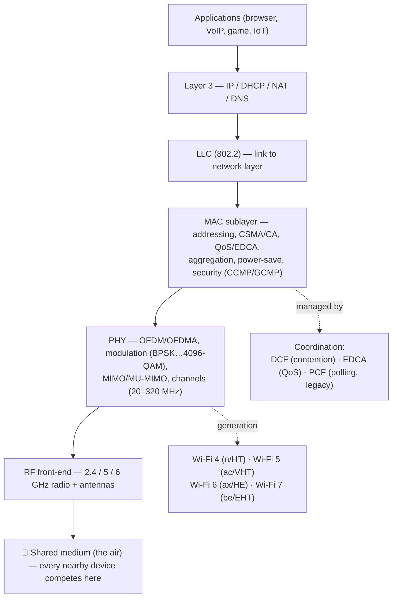

> 🔑 **Mental model:** the **PHY** turns bits into radio waves; the **MAC** decides *who talks when* on a medium everyone shares; everything above (IP, DHCP, apps) is the same as on wired networks. Most of Wi‑Fi's cleverness — and most of this document — lives in the **MAC** and the **PHY**.

---
---

# 🧱 PART 1 · Fundamentals — How Wi-Fi Shares the Air

> **What's ahead:** we start at the ground floor — what a wireless LAN *is*, the two layers 802.11 defines (MAC + PHY), and the core challenge of radio: *many devices, one shared medium.* By the end of this part you'll understand **CSMA/CA**, the "listen before you talk" rule that keeps the air collision-free, and the problems it still can't solve on its own (which sets up Part 2).

---

## 🔧 What is Wireless LAN?

A **Wireless LAN** is a network where devices communicate using wireless protocols/technologies within a defined area.

---

## 📜 What is IEEE 802.11 ?

the IEEE 802.11 standard defines how Wireless LANs operate. It provides a common framework that governs how data is transmitted, accessed, and secured over the air.

The standard specifically addresses two key layers of the OSI model, each with distinct responsibilities:

- **Physical Layer** :-Transmission/reception and modulation/demodulation of raw bits/signal over the wireless medium
- **Data Link Layer**:-Ensures reliable data delivery/access over the physical medium

### 🏷️ Generation nicknames — keep this card in your pocket

802.11 grows in **editions**. Marketing says Wi-Fi 4/5/6; engineers say **HT / VHT / HE**. Same thing. You do **not** need the features yet — only the names — so later headings don't feel like a new subject.

| What people say | IEEE name | Engineer nickname | One-line meaning |
|-----------------|-----------|-------------------|------------------|
| **Legacy** | 802.11a/b/g | *(no nickname)* | Old, slow, **every** device can decode these frames |
| **Wi-Fi 4** | 802.11n | **HT** = High Throughput | Faster (wider channel + several antennas). Some old devices **cannot** decode an HT frame |
| **Wi-Fi 5** | 802.11ac | **VHT** = Very High Throughput | Even faster, mostly 5 GHz |
| **Wi-Fi 6** | 802.11ax | **HE** = High Efficiency | Not just faster — **shares** the air better when many devices talk |
| **Wi-Fi 7** | 802.11be | **EHT** = Extremely High Throughput | Wider still + several radios at once |

> 🔑 **The only fact you need for Part 2:** a **new-style frame** (HT/VHT/HE) can be **invisible** to a **legacy** radio. The old device thinks the air is free and talks over it. So the AP first shouts something **legacy** devices *do* understand (a CTS). That is all “HT/VHT coexistence” means. Full generation chapter = **Part 7**.

---

## 📶 Wireless Services in IEEE 802.11
The IEEE 802.11 standard defines two main types of service structures that organize how wireless networks operate:
### 1. **BSS (Basic Service Set)**

- A group/unit of wireless network devices communicating with the same **Access Point (AP)**.

### 2. **ESS (Extended Service Set)**

- A collection of multiple APs and their associated client stations, all united by a single **Distribution System Medium (DSM)**.
- The **ESSID** (Extended SSID) is the shared network name.
- The terms **SSID** and **ESSID** are often used interchangeably.

---

## 📡 Key Terms

- **BSSID**: The physical /MAC address of the AP (48-bit hex).
- **AP (Access Point)**:these are devices which accept Wireless signals from multiple devices and retransmit them to  the rest of the network.
  - Acts as a bridge between wireless devices and the wired network.
  - Operates at Layer 2 (Data Link Layer).
- **SSID**: A unique string identifying a wireless network.


# 🧩 Data Link Layer Details

The **Data Link Layer** in the OSI model ensures reliable data transfer between two directly connected nodes. It is divided into two sublayers:

## 1. Logical Link Control (LLC)
- Provides an interface between the network layer and MAC sublayer.
- Responsible for:
  - Frame synchronization
  - Flow control
  - Error checking

## 2. Medium Access Control (MAC)
- Controls access to the physical transmission medium.
- Responsible for:
  - Addressing (MAC addresses)
  - Channel access control
  - Frame delimiting and error detection

---
## 🕹️ MAC Layer Functions:-
In Mac we have two more layers
### 1. **DCF (Distributed Coordination Function)**

- it provides contention Based Services i.e it uses **CSMA/CA** (Carrier Sense Multiple Access with Collision Avoidance).
- Operates on **half-duplex**.
- **csma\ca Timers** are used to avoid collisions.

> 📌 *CSMA/CA is for wireless, CSMA/CD is for wired.*

### 2. **PCF (Point Coordination Function)**

- Poll-based / priority-based access mechanism.

### 📊 DCF vs PCF vs EDCA — the three access methods at a glance
- **DCF** is the fundamental, best-effort access method where all devices are treated equally (the CSMA/CA we study next).
- **PCF** is a centralized, polling-based method that provides collision-free access but is rarely used in practice due to its complexity.
- **EDCA** is an extension of DCF that adds Quality of Service (QoS) by creating prioritized traffic queues (voice before video before best-effort). It is the standard for modern Wi-Fi networks (802.11e and later) — we return to it in detail in the **QoS (WMM/TSPEC)** chapter.

## 🧱 MPDU vs MSDU in Wi-Fi

In Wi-Fi communication, data flows through several layers. Two key units involved in packaging and transmitting this data are:

- **MSDU (MAC Service Data Unit)**
- **MPDU (MAC Protocol Data Unit)**
Understanding the difference between them helps in grasping how Wi-Fi handles data efficiency, error control, and speed.

---
### 📦 What is MSDU?

### ➕ Full Form:**MAC Service Data Unit**
An **MSDU** is a data packet received from the **upper layers** (like IP or TCP) and handed off to the **MAC layer** for transmission.

### 🔄 Example:
Think of it as a **customer's order** that needs to be packed before shipping.

### ✅ Key Points:
- Contains actual **payload** (user data)
- Sits at the **interface between Layer 2 and Layer 3** (Data Link ↔ Network)
- Before transmission, it's usually **converted into MPDU**

---
### 📡 What is MPDU?

### ➕ Full Form:**MAC Protocol Data Unit**

An **MPDU** is the **final packet** that is transmitted over the air by the Wi-Fi interface.

### 🔄 Example:
Think of it as the **shipping box** that actually leaves the warehouse.

### ✅ Key Points:
- Includes **MAC header**, **frame check sequence (FCS)**, and **possibly one or more MSDUs**
- It’s what actually gets **transmitted on the wireless medium**
- Can be aggregated (A-MPDU) for performance

---
### ⚙️ Flow of Data: From MSDU to MPDU
```text
App/Data → TCP/UDP → IP Packet → MSDU → MPDU → Wireless Transmission
```

> ➡️ **Next:** that last hop — *MPDU → Wireless Transmission* — is the hard part. Many devices share one radio channel. The rule that decides *who talks when* is **CSMA/CA**.

---

# 📡 CSMA/CA in Wi-Fi: Problems Explained

## 🧠 What is CSMA/CA?

**Carrier Sense Multiple Access with Collision Avoidance (CSMA/CA)** is a network protocol used in **Wi-Fi** to manage how multiple devices share the same wireless channel.

> 💡 It tries to **avoid** collisions *before* they happen, unlike CSMA/CD (used in Ethernet), which handles collisions *after* they occur.

---

## ⚙️ How CSMA/CA Works (Simplified)

1. A device **"listens"** to check if the wireless channel is free.
2. If the channel is **idle**, it waits for a **DIFS(Distributed Interframe Space)** & random back-off time.
3. If still idle Backoff timer decrements, when the channel remains idle & the timer hits **zero**, the device transmits its frame(data).
4. If the channel is **busy**, the device wait for next DIFS, and tries again later.
5. - If an **ACK Handling** is received → success.
   - If not → assume collision → **increase CW**, retry (up to a max retry limit).

---

### ⏱️ CSMA/CA Timing — the interframe spaces (IFS)

The whole dance is governed by **gaps of silence** of different lengths. A *shorter* gap = *higher* priority, because that device starts counting first. This is the single most important timing picture in Wi‑Fi:

```text
 Medium busy (someone else's frame)
 ┌──────────────────────────┐
 │        FRAME             │
 └──────────────────────────┘
                             │<-DIFS->│<-- backoff slots -->│
                             │        │ ▢ ▢ ▢ ▢ ▢ ▢ ▢       │
                             │        │ (count down while   │
                             │        │  medium stays idle) │
                             │        └─────────────────────┘
                             │                               ┌───────────┐
                             │   my turn → transmit ───────► │  MY FRAME │
                             │                               └───────────┘
                             │                                     │<SIFS>│ ┌─────┐
                             │   receiver replies after SIFS ────────────► │ ACK │
                                                                           └─────┘
```

- **SIFS (Short IFS)** — the *shortest* gap. Used *inside* an exchange that already won the medium: before an **ACK**, **CTS**, or the next frame of a burst. Nobody else can grab the medium during a SIFS, which is how an ACK is "protected."
- **DIFS (DCF IFS)** — the gap a *new* transmission must wait before starting backoff. `DIFS = SIFS + 2 × slot`.
- **AIFS[AC]** — the EDCA/QoS version of DIFS; each Access Category has its own value (voice waits less than background). See the EDCA section.
- **Backoff** — a random number of idle **slots** in `[0, CW]`; the counter **freezes** whenever the medium goes busy and resumes when idle again. Two stations rarely pick the same number, which is how collisions are *avoided*.
- **EIFS (Extended IFS)** — a longer wait used after receiving a frame that failed FCS (you don't know how long the medium will really be busy, so you back off extra).

| IFS | Relative length | Used for |
|-----|-----------------|----------|
| **SIFS** | shortest | ACK, CTS, next frame in a TXOP burst |
| **PIFS** | SIFS + 1 slot | PCF / point-coordinated access (legacy) |
| **DIFS** | SIFS + 2 slots | start of a new DCF transmission |
| **AIFS[AC]** | ≥ DIFS, per-AC | EDCA QoS access (voice=short, background=long) |
| **EIFS** | longest | after a corrupted/undecodable frame |

> 🔑 **Why shorter = higher priority:** an ACK uses SIFS (shortest) so it *always* beats any new transmission that must wait a full DIFS/AIFS. The ordering `SIFS < PIFS < DIFS < AIFS[background]` is a built‑in priority ladder.

---

## 🎧 CCA (Clear Channel Assessment)

When step 1 above says a device **"listens,"** that listening is performed by **CCA** — the PHY's continuous answer to the question *"is the medium busy right now?"* It is the foundation of carrier sensing in CSMA/CA, and it has **two independent mechanisms**:

| Mechanism | Also called | How it decides "busy" |
|-----------|-------------|------------------------|
| **Physical CS** | CCA-CS / Carrier Sense | The PHY **decodes a valid 802.11 preamble** → it knows a real Wi-Fi frame is on air and how long it will last (from the PLCP/L-SIG length). Most sensitive. |
| **Physical ED** | CCA-ED / Energy Detect | The PHY measures **raw RF energy** against a threshold (e.g., ~ −62 dBm in 20 MHz). Catches **non-802.11 interference** (microwaves, Bluetooth, radar) that can't be decoded. |
| **Virtual CS** | NAV (Network Allocation Vector) | A **countdown timer** set from the **Duration field** of overheard frames (e.g., RTS/CTS). The medium is treated as busy until NAV reaches 0 — *even if the radio hears nothing*. |

**The rule:** the medium is considered **idle only when *both* physical CS/ED report idle *and* the NAV is zero.** Any one of them indicating "busy" freezes the backoff countdown.

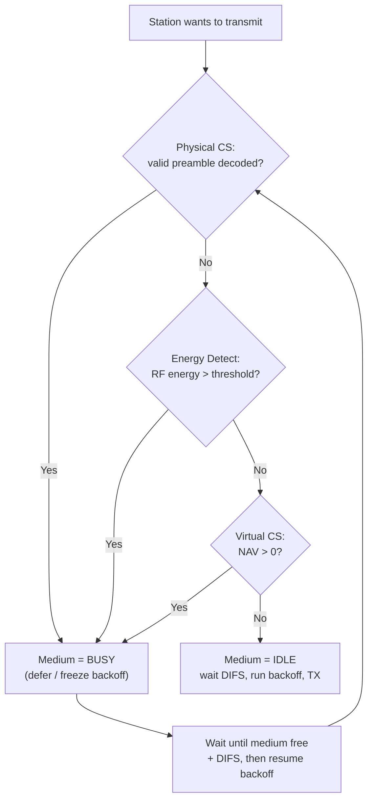

> 🔑 **CCA + NAV together** are why the hidden-node RTS/CTS fix works: even a station that cannot *hear* the data transmission still sees the **Duration** in the CTS and sets its **NAV** (virtual CS) to stay quiet.

- **Physical CS (preamble)** is more sensitive than **ED**, so a decodable Wi-Fi frame defers traffic at a lower signal level than mere interference does.
- In **Wi-Fi 6/7 spatial reuse (BSS Coloring)**, the CCA/ED threshold for *inter-BSS* (different color) frames is **raised (OBSS_PD)** so weak neighbouring-network frames are ignored and the station can transmit anyway — improving channel reuse.

---

## ❗ Common Problems with CSMA/CA in Wi-Fi

### 1. 🔇 Hidden Node Problem

#### 📍 What happens:
- Two devices (A and C) are **out of range** of each other but **both in range** of the same Access Point (B).
- A and C **can’t hear** each other.
- Both think the channel is free and **transmit at the same time** → causing a **collision** at B.
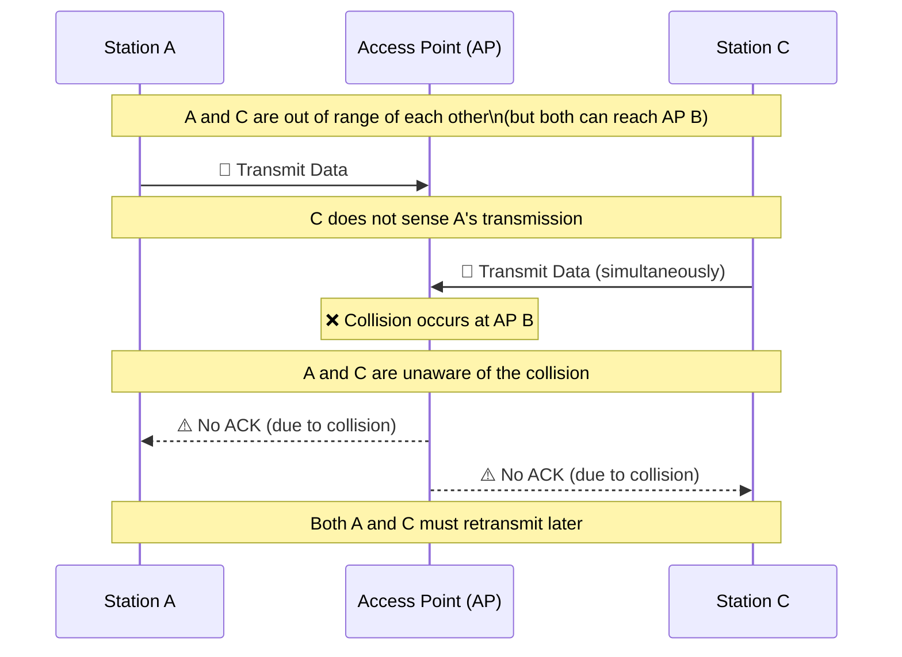
#### 📌 Real-World Analogy:
> Imagine two people in separate rooms trying to talk to the same receptionist over a walkie-talkie. They can’t hear each other and both talk at once, confusing the receptionist.

#### ✅ Solution: RTS/CTS Handshake
> With RTS/CTS, the sender first reserves the medium. The AP's CTS is heard by **all** stations in its range (including the hidden node C), so C defers and the collision is avoided.

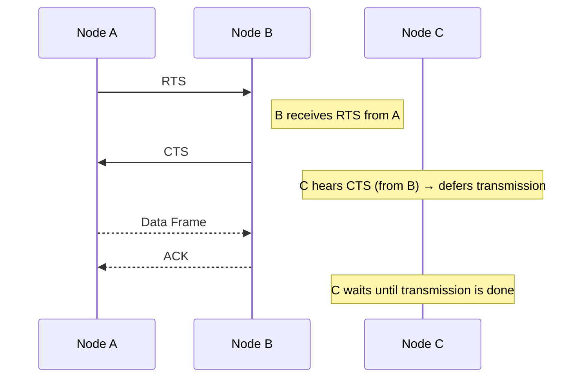

#### ⏱️ The timing view — how the NAV silences the hidden node

The message order above doesn't show *the key trick*: every RTS and CTS carries a **Duration** value, and every station that hears it sets its **NAV** (a virtual "busy" countdown) for exactly that long. The hidden node C never hears A's data — but it **does** hear B's **CTS**, so it stays quiet for the whole exchange:

```text
         │◄─RTS─►│      │◄──── DATA ────►│
 A  ─────┤ RTS   ├─SIFS─┤     DATA        ├─SIFS─────────── (A transmits)
         │       │      │                │       │◄ACK►│
 B  ──────────SIFS┤ CTS ├────────────────────────┤ ACK ├── (AP replies)
                  │     │
 C  ── (can't hear A at all) ────────────────────────────  (hidden node)
         ▲ hears nothing     ▲ HEARS CTS from B
         │                   │
         │    ┌──────────────┴───────────────────────────┐
  NAV(C):│    │  NAV set from CTS Duration = quiet period │  ← C defers here
         │    └──────────────────────────────────────────┘
                 C stays silent until NAV = 0 → no collision at B ✅
```

- **RTS Duration** covers CTS + DATA + ACK + the SIFS gaps; **CTS Duration** covers DATA + ACK + gaps.
- Any station in range of **either** A (hears RTS) **or** B (hears CTS) backs off — so even though C can't hear A, the CTS alone protects the exchange.
- All the little gaps are **SIFS** (shortest IFS), so nobody can slip in between RTS→CTS→DATA→ACK.

> 🔑 **This is why RTS/CTS fixes the hidden node:** it converts a problem C *can't* detect by listening (physical carrier sense) into one it *can* obey (virtual carrier sense via NAV).

---
### 2. 📡 Exposed Node Problem

#### 📍 What happens:
- A device refrains from transmitting, thinking the channel is busy, even when its transmission **would not cause interference**.

#### 📌 Example:
- Device A is sending data to B.
- Device C wants to send data to D.
- C hears A's signal and assumes the channel is busy.
- But since C → D and A → B are **non-interfering**, it could have transmitted safely.

#### ❌ Result:
- **Unnecessary waiting** → **inefficient use** of the wireless channel.
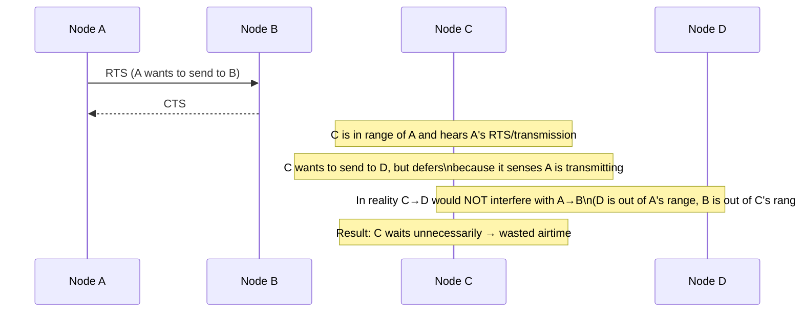

#### ✅ Solution: Why the Exposed Node Problem is Hard to Solve
- Unlike the hidden node problem, basic RTS/CTS does **not** fix the exposed node problem — it can even make it worse, because C hears A's RTS and defers.
- Practical mitigations:
  - **Carrier-sense based on the receiver, not the sender:** the real question is whether C's *intended receiver* (D) would be interfered with, not whether C can hear A. Schemes like **RTS/CTS with directional awareness** or **receiver-side CCA** address this.
  - **Directional / beamformed antennas (MU-MIMO, 802.11ac/ax):** spatially separate A→B and C→D so they genuinely don't collide, allowing concurrent transmission.
  - **BSS Coloring + spatial reuse (Wi-Fi 6):** a station that decodes an OBSS frame *below* the adjusted OBSS_PD threshold may transmit anyway instead of deferring — directly reducing exposed-node-style over-deferral.
  - **Tighter power control / cell planning:** reducing TX power and overlapping coverage limits the range over which C senses A.
- **Key point:** the exposed node problem is fundamentally about *over-conservative carrier sensing*. The fixes loosen or spatially refine that sensing rather than reserving the medium (which is the hidden-node fix).

---


### 3. 🐢 High Overhead from Waiting

- Due to **random backoff timers** and **acknowledgments**, there is a delay even when the network is idle.
- Leads to **reduced throughput**, especially with many devices.

---

### 4. 📶 Performance Drops with More Devices

- As more devices share the channel, the chances of collisions and delays increase.
- **Congestion** leads to **packet loss**, **retransmissions**, and **slower speeds**.

---

### 5. 🔁 No Central Control

- Wi-Fi uses a **distributed system**, so each device independently decides when to transmit.
- This can lead to **poor coordination**, especially in crowded networks.

---

## ✅ Summary of CSMA/CA Limitations
| **Issue**            | **Description**                                                            | **Solutions**                                                                 |
|----------------------|-----------------------------------------------------------------------------|-------------------------------------------------------------------------------|
| **Hidden Node**       | Devices unaware of each other cause unintentional collisions               | Use of **RTS/CTS (Request to Send / Clear to Send)** mechanism in 802.11     |
| **Exposed Node**      | Devices unnecessarily delay sending even when it's safe                    | Improved MAC protocols and **carrier sensing** with RTS/CTS                   |
| **Overhead**          | Waiting, backoff, and acknowledgment mechanisms reduce speed               | **Frame aggregation**, **block acknowledgments**, and **802.11n/ac/ax** improvements |
| **Scalability**       | Performance degrades as the number of users increases                      | Introduction of **OFDMA** (Orthogonal Frequency Division Multiple Access) and **MU-MIMO** in 802.11ax |
| **Lack of Coordination** | No central controller leads to inefficiencies in shared environments   | Use of **Access Points** in Infrastructure mode and centralized management via controllers (in enterprise WLANs) |


---

## 🧠 Alternatives & Solutions

- 🧱 **RTS/CTS (Request to Send / Clear to Send)**: Optional handshake that reduces hidden node collisions.
- 🚀 **Wi-Fi 6 (802.11ax)** introduces better coordination through **OFDMA** and **BSS Coloring**.
- 🛰️ **Mesh Networking** helps balance loads and reduce interference.
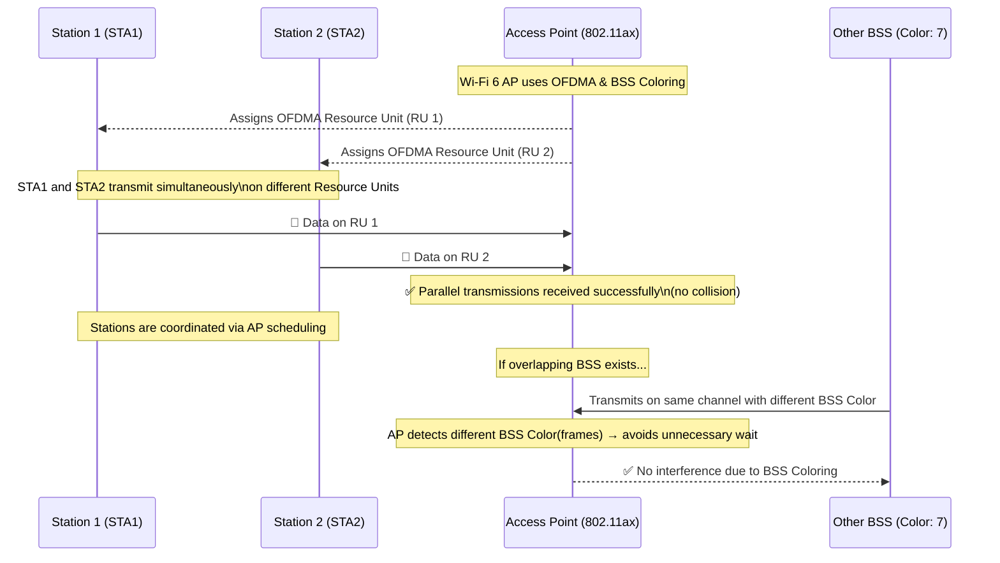

> ➡️ **Part 1 ends here.** You now know the shared-medium problem and the first fix (RTS/CTS). **OFDMA** in the diagram above is a *later* Wi-Fi 6 trick (the AP slices one channel so two stations talk at once) — ignore the details; Part 7 teaches it. Part 2 is what the AP does **today** when the room is mixed or crowded.

---

# 🧱 PART 2 · Protection & Coexistence — How the AP Keeps the Air Usable

> **What's ahead:** CSMA/CA still fails when **old and new devices share one AP**, or when nodes cannot hear each other. This part is the AP's toolkit, in plain order:
> 1. **Reserve the air** (CTS-to-Self, RTS/CTS) so nobody talks over a frame some radios cannot decode.
> 2. **Lock disconnect frames** (PMF) so a stranger cannot fake “please leave.”
> 3. **Slow down / narrow the channel** when the signal is weak.
> 4. A **Wi-Fi 6 preview**: BSS Coloring (ignore a *weak* neighbor instead of waiting).
> 5. Then the same reservation story again, slower: *why* a mixed old+new room needs CTS-to-Self.
>
> If you see **HT / VHT / HE / legacy**, flip back to the **generation nicknames** card in Part 1. You do not need MIMO or 256-QAM yet.

---

# AP Protection Mechanisms in Mixed or Challenging Wi-Fi Environments

## 1. CTS-to-Self Protection Trigger
- When the AP sees **legacy** devices (old a/b/g radios that cannot decode **HT/VHT** frames — see the nickname card), it first sends a **CTS-to-Self**: a short “channel reserved” shout that *every* radio understands, then sends the new-style data.

## 2. RTS/CTS Handshake Use
- In very congested or high-interference environments, the AP or client devices may initiate the RTS/CTS handshake to avoid collisions before sending data, especially for longer packets.

## 3. Protected Management Frames (PMF) Enforcement
- **PMF** (also called 802.11w) is a lock on a few *management* frames — mainly “please disconnect.” Without it, anyone nearby can forge a disconnect and kick you off. Full security story is Part 4; here you only need: *the AP can require that lock.*

**User Scenario:**  
A user is connected to a Wi-Fi network in a busy café. An attacker attempts a deauthentication attack by sending fake deauthentication frames to disconnect the user from the network, causing service disruption.

**How the AP detects this:**  
- The AP and client support PMF (802.11w), which encrypts and authenticates key management frames like deauthentication and disassociation frames.  
- When an attacker sends fake deauth frames, the client or AP checks the integrity using Message Integrity Check (MIC). If the frame is invalid or spoofed, it is discarded.

**Mitigation:**  
- PMF prevents clients from being disconnected by spoofed frames, ensuring users remain connected securely.  
- Both client and AP must support PMF to establish this protection.  
- PMF is mandatory in WPA3 and can be optionally enabled in WPA2.

## 4. Dual CTS for Mixed STBC and Non-STBC Devices
- **STBC** (Space-Time Block Coding) is just a more robust *way of sending the same bits from two antennas*. Some new devices send CTS in that flavor; old devices cannot decode it. So the AP sends **two** CTS frames — one STBC, one plain — so **everyone** sets their NAV (the “stay quiet” timer). Same idea as CTS-to-Self; two dialects of the shout.

**User Scenario:**  
In a corporate network, some devices use STBC to hear better at range, while older devices do not.

**Condition:**  
- The AP must reserve the medium for *all* clients, not only the ones that understand STBC.

**Mitigation:**  
- Dual CTS: one frame each dialect. Every device updates NAV. Transmission proceeds.

## 5. Dynamic Rate and Bandwidth Adjustment
- The AP dynamically downgrades rates and adjusts channel bandwidth when interacting with legacy devices or due to radio conditions, to maintain connectivity and reduce packet loss.

**User Scenario:**  
A user walks through a large office using a legacy device while connecting to a modern AP supporting 802.11ac. The device is at the edge of AP coverage with weak signal strength.

**Condition:**  
- The AP detects the device's limited capabilities and the reduced signal quality.  
- Using high data rates or wide channels leads to frequent packet loss and retransmissions, causing poor experience.

**Mitigation:**  
- The AP dynamically downgrades the data rate to a more robust, lower speed suitable for the current conditions.  
- It also narrows channel bandwidth (e.g., from 80 MHz to 40 MHz or 20 MHz) to improve reliability.  
- These adjustments optimize connectivity, reduce packet loss, and maintain user experience despite challenging conditions.

---

These mechanisms allow wireless networks to adapt dynamically for security, compatibility, and performance based on real-world scenarios.

# Dynamic Rate and Bandwidth Adjustment: User Scenarios and Mitigation

## Scenario 1: Legacy Device at Cell Edge
- A user with an older Wi-Fi device (e.g., 802.11b/g) moves to the edge of an AP’s coverage area.
- The AP detects weak signal strength and possible high error rates.
- High data rates or wide channel bandwidths cause frequent retransmissions and poor performance.

**Mitigation:**  
- The AP dynamically downgrades to lower data rates that are more robust for the weak signal.  
- Channel bandwidth is reduced (e.g., from 80 MHz to 40 MHz or 20 MHz) to improve link stability.  
- This reduces packet loss and improves user experience.

---

## Scenario 2: Interference in a Dense Wi-Fi Environment
- In a high-density office, multiple APs and clients operate in overlapping channels.
- The AP notices rising collisions and degraded throughput caused by interference.

**Mitigation:**  
- The AP adjusts rates down to more reliable speeds to maintain connectivity.  
- It may narrow channel width to avoid overlapping frequencies and reduce cross-channel interference.  
- These changes improve coexistence and overall network performance.

---

## Scenario 3: Mixed Device Capabilities
- The AP supports **Wi-Fi 5 (VHT)** devices but also has many **legacy** clients.
- Legacy clients cannot use the fastest “gears” (**MCS** = Modulation and Coding Scheme — the speed setting; PHY primer in Part 3) or the widest channels.

**Mitigation:**  
- AP dynamically adjusts rates and bandwidth per client capabilities.  
- For legacy clients, it restricts channel widths and data rates accordingly while maximizing performance for newer clients.  
- This adaptive behavior ensures fair and efficient use of shared medium.

---

## Scenario 4: Rapid Device Movement
- A client device moves quickly through the coverage area (e.g., a user walking with a smartphone).
- Rapid changes in signal strength cause fluctuating link quality.

**Mitigation:**  
- AP continuously monitors signal quality and adjusts data rates dynamically in real-time.  
- Temporarily lowers or raises rates to match changing conditions and avoid excessive retransmissions.

---

## Scenario 5: Environmental Changes Affecting Wi-Fi
- Sudden changes like doors closing, new obstacles, or people crowding an area reduce signal quality.
- The AP detects increased frame errors or retransmissions.

**Mitigation:**  
- AP schedules dynamic rate fallback and bandwidth reduction to maintain robust connections.  
- This helps maintain connectivity and adjusts back when conditions improve.

---

**Overall**, dynamic rate and bandwidth adjustments allow an AP to optimize connectivity and performance adaptively, balancing speed and reliability in real-world Wi-Fi usage scenarios.


# Wi-Fi Throughput Improvement Scenarios and Mitigations

## Scenario 1: Optimizing AP Transmission Power
- In a dense office with many APs, high transmission power can cause co-channel interference, degrading throughput.
- The AP optimizes its transmission power dynamically to maximize the signal-to-interference ratio (SIR) by either lowering or increasing power.
- This optimization reduces interference while maintaining coverage, resulting in higher network throughput.

---

## Scenario 2: Channel Bonding and Non-Channel Bonding Selection
- APs select between channel bonding (e.g., 40/80/160 MHz channels) and non-channel bonded narrower channels to maximize throughput.
- In some dense deployments, using non-bonded channels reduces interference among neighboring APs, improving individual AP throughput.
- The AP dynamically chooses the best channel setup for current interference conditions.

---

## Scenario 3: Dynamic Channel Selection
- The AP scans the spectrum for the least congested channels periodically or on demand.
- By switching to cleaner channels suffering less interference, throughput is maximized.
- This is especially beneficial in high-density environments or where neighboring networks are using overlapping channels.

---

## Scenario 4: Quality of Service (QoS) Prioritization
- The AP prioritizes latency-sensitive and high-bandwidth applications (video conferencing, VoIP, streaming) using QoS.
- This ensures critical traffic is served faster and with better reliability, improving the perceived throughput for important applications.

---

## Scenario 5: Multi-User MIMO (MU-MIMO) Utilization
- **MIMO** = several antennas sending several streams. **MU-MIMO** = the AP talks to *several clients at the same instant* (different beams), instead of one after another. First look only — full picture in Part 7.
- This raises total throughput and cuts wait time when many devices are active.

---

These approaches enable APs to dynamically adapt to evolving network conditions and client demands to boost overall Wi-Fi throughput and user experience.

## 🎛️ The three radio knobs — what, how, and when

Enterprise controllers call the whole job **RRM (Radio Resource Management)**. RRM does not invent a new frame type. It watches the air, then turns three knobs: **which channel**, **how loud**, and **how wide**. A home AP can do a simpler version of the same three by itself.

```text
        RRM  (the controller, or the AP alone)
         │
         ├── 1. Channel selection     which lane?     (36 vs 149, or 1 vs 6 vs 11)
         ├── 2. Transmit power (TPC)  how loud?       (dBm)
         └── 3. Channel width (DBA)   how wide?       (20 / 40 / 80 / 160 MHz)

        DFS is not a fourth performance knob.
        DFS is the law: "listen for radar before you use some 5 GHz lanes."
```

### 1. Channel selection

**What.** Pick the center channel so your network is not sitting on top of a loud neighbor. On 2.4 GHz the useful non-overlapping set is **1, 6, and 11**. On 5 GHz there are many 20 MHz channels (36, 40, 44, …).

**How — who hears the crowd, who picks the new lane, who the phone follows.**

The controller is not a radio. It never hears the air. Each **AP is an ear**. It reports numbers on a **wired management tunnel** (Cisco calls it CAPWAP). Clients never see that tunnel.

```text
  AP-A on channel 36
        │  listens (its own channel, and short off-channel peeks)
        │  "3 other BSSIDs, air busy ~70%, noise −80 dBm"
        │  wired tunnel  →  controller
        ▼
  Controller scores every AP.
        Channel 36 is a shared lane. Channel 149 is quiet.
        wired tunnel  →  "AP-A, move to 149"
        ▼
  AP-A writes a Channel Switch Announcement into the beacon:
        "after 5 beacons, I will be on channel 149"
        ▼
  Phone reads the beacon, retunes its radio to 149,
  and keeps the same association (same BSSID, same keys).
```

**What “busy” means.** The AP is not told by a person. Its chip counts, over many milliseconds:

- **Airtime** — how often CCA says the medium is already busy (your 70%). On a shared channel every device waits for the others (CSMA), so a high number means your 40 MB upload sits in a queue behind strangers.
- **Other BSSIDs** — how many beacons it can decode on that channel. Same channel = you **share** time. Overlapping channels (2.4 GHz channel 1 and channel 2) are worse: you cannot decode them cleanly, so they look like **noise** and raise PER.
- **Noise floor** — energy that is not a decodable Wi-Fi frame (microwave, a non-Wi-Fi camera, radar).

On 2.4 GHz the usable non-overlapping set is only **1, 6, and 11**. Moving from 1 to 2 does not escape a neighbor on 1. Moving from 1 to 6 does.

**What the phone actually does.** It does not scan the whole band and it does not log in again. The CSA beacon names the new channel and a countdown in beacon intervals. When the count hits zero, both the AP and the phone switch frequency together. The 4-way handshake is not repeated. If the new channel is a **DFS** channel, the AP must stay silent and listen for radar **before** the first beacon on that channel (Part 6). During that listen the SSID disappears.

A home AP with no controller does the listening and the choice inside itself, then still uses the CSA beacon to tell the phone.

**When.**
- The AP boots, or you add or remove an AP.
- A neighbor network appears on your channel and stays busy.
- A scheduled RRM pass (often every few minutes to hours — **not** every packet).
- Radar is heard on the current channel (DFS forces the move).

### 2. Dynamic Transmit Power Control (TPC)

**What.** How loudly the AP transmits, in **dBm**. Louder reaches farther. Louder also shouts into the next room’s AP, so those clients defer (the exposed-node feeling, at building scale). TPC is the volume knob. It is one piece of RRM. On 5 GHz, **802.11h** is the standard piece that also tells a client the maximum power it may use.

**How — nobody sends a frame that says “you are too loud.”**

The proof is a number the **neighbor AP measures**, not a complaint. AP-A keeps sending ordinary beacons. AP-B’s radio writes down how loud that beacon was (**RSSI**). That number rides the wired tunnel to the controller. The controller sends a new transmit power back to AP-A. AP-A’s next beacon is simply quieter.

```text
  AP-A beacon leaves the antenna at 20 dBm
        │   normal beacon, on the air. No power field that says "I am too loud."
        ▼
  AP-B measures RSSI = −45 dBm
        │   "From my ceiling, AP-A sounds very loud."
        │   neighbor report on the WIRED tunnel:
        │   BSSID of AP-A, channel, RSSI −45 dBm
        ▼
  Controller compares with its target.
        One common rule (Cisco-style TPC):
        the 3rd-loudest neighbor should land near −70 dBm.
        −45 is 25 dB louder than −70 → too much overlap.
        │   config on the SAME tunnel: "AP-A, transmit at 14 dBm"
        ▼
  AP-A stores 14 dBm in the radio.
        Next beacons go out quieter.
        Phones are not sent a "power changed" frame.
        They measure a weaker beacon. If SNR dropped, MCS drops.
        Next cycle AP-B reports the new RSSI (say −62).
        Close enough to −70 → controller stops stepping.
```

**Who told whom.** AP-B told the **controller** (RSSI report). The controller told **AP-A** (power command). AP-B never speaks to AP-A about volume.

**Why those two numbers.** Transmit power is in dBm at the antenna. About **3 dB** is double the power, so 20 → 17 → 14 dBm is a step down by half, then half again (100 mW → 50 mW → 25 mW). RSSI is how loud that signal is **at the listener**. −40 dBm is strong, −70 dBm is a normal neighbor, −85 dBm is almost gone. The controller wants **some** overlap so a phone can roam, and not so much that three APs shout across the same desks. “3rd loudest near −70 dBm” is that balance: the two nearest APs can be louder (they are your roam targets); a third one that loud means the cells are piled on top of each other.

| What the controller sees | What it sends back | What you feel |
|--|--|--|
| Neighbors hear this AP at −45 dBm | lower power, one step | less interference next door; phones at the edge get a weaker signal and may drop MCS |
| Phones hear their AP at −80 dBm and no other AP covers them | raise power | the edge comes back; neighbors hear you more |
| 3rd neighbor already near −70 dBm | leave power alone | overlap is enough to roam and not enough to jam |

**Where the −80 dBm client number comes from.** The phone is already telling the AP how loud the AP sounds (client reports inside normal management traffic). The AP forwards that on the same tunnel. It is not a packet the user sends.

**802.11h is a different message.** A **Power Constraint** inside the beacon tells **clients** “do not transmit above this.” That limit is on the air. It does not decide the AP’s own power. The AP’s power was decided on the tunnel, above.

A home AP with no controller is both the ear and the brain: it hears the neighbor beacon itself and turns its own radio down.

**When.**
- Many APs in one office (start lower; overlap should be enough to roam, not enough to jam).
- A coverage hole after a wall, a closed door, or an AP that went down.
- After a channel change (the new channel may need a different power).
- **Not** on every frame. Power changes are slow, like channel changes, because every client’s rate (MCS) depends on the new loudness.

> 🔑 **Channel vs power.** A bad channel is “everyone is in my lane.” Too much power is “my engine is so loud the next lane thinks the road is busy.” Fix the lane first, then the volume.

### 3. Bandwidth (channel width) adjustment — DBA

**What.** **DBA (Dynamic Bandwidth Adjustment)** chooses **20, 40, 80, 160 MHz** (320 MHz only on Wi-Fi 7). Some write-ups call the same automatic choice **DBCA**. It is not a second protocol. The widening itself is **channel bonding**: glue neighboring 20 MHz blocks into one wider channel. Wider is faster **only if** those extra blocks are free and the signal is strong enough to fill them.

#### Who decides the width (same tunnel as TPC)

1. **The AP measures the extra slices**, not only the primary 20 MHz. The primary can be free while the three secondary blocks of an 80 MHz channel are full of a neighbor. It also notes client SNR.
2. **The AP tells the controller** on the wired tunnel: “secondary busy” or “clients are strong and the extra slices are idle.”
3. **The controller answers** on that tunnel: “use 40 MHz” or “use 80 MHz.” A home AP decides this inside itself.
4. **Clients learn the width from the beacon** (HT / VHT / HE / EHT operation information), not from a special data frame. They build the same wide channel the AP just chose.
5. If only one 20 MHz slice is bad, Wi-Fi 6/7 can **puncture** that slice and keep the rest (Part 7). Older clients cannot; they fall back to a narrower width.

#### What a wider channel actually speeds up — a 40 MB upload

A 40 MB upload is not one giant chunk. It is on the order of **tens of thousands of packets** (40 MB ÷ about 1500 bytes). Bonding does **not** mean four different packets leave for four different people at once. That is **OFDMA** (Part 7). Bonding means **one transmission** is spread across **more subcarriers** in the same moment, so each OFDM symbol carries more bits of **this** upload.

| | **20 MHz** | **80 MHz (four blocks bonded)** |
|--|------------|----------------------------------|
| Highway | one narrow road | about four lanes |
| Freight | the same 40 MB, cut into packets | the same packets |
| How they ride | the bits of one symbol use the subcarriers of one 20 MHz block | the bits of one symbol use the subcarriers of all four blocks, **together** |
| Result | the upload takes longer | often around **4×** the PHY rate, when every extra lane is clear |

**Subcarriers are the trucks.** A 20 MHz channel already has dozens of data subcarriers (the small tones inside OFDM). Bonding does not merely duplicate that list. The quiet **guard** between two 20 MHz blocks is partly turned into extra data tones, so a 40 MHz channel has **a little more than twice** the data subcarriers of one 20 MHz channel, and an 80 MHz channel **a little more than four times**. The phone stripes the upload across all of those tones in one symbol. The AP listens to the whole width, the PHY stitches the tones back into one bitstream, and the MAC sees the packets again.

**The catch.** If a neighbor is using one bonded block, those tones are garbage. Retries climb, and DBA shrinks the width (80 → 40 → 20) so the upload uses only clean lanes.

**When the AP widens.** The extra blocks are idle, and the client is close (high SNR) — a quiet 5 GHz or 6 GHz home, one person streaming or uploading.

**When the AP narrows.**
- Apartment or dense office: a neighbor owns a secondary block. A dirty 80 MHz channel is often **slower** than a clean 40 or 20, because the sender waits and retries.
- Client at the cell edge: a wider channel collects more noise, SNR falls, high MCS fails, PER rises.
- Radar on part of the wide channel: DFS forces the AP to leave or shrink that slice.

#### MIMO on top of the wider channel

Bonding adds **lanes** (frequency). **MIMO** adds **decks** (space). A 2×2 radio has two transmit and two receive antennas, so two **spatial streams**. A 4×4 radio has four. The phone sends a different stream from each antenna on the **same** channel, at the **same** time. The signals bounce off walls and arrive mixed. The AP’s antennas see slightly different mixes and the chip separates stream 1 from stream 2. No extra MHz is required.

| | What it multiplies | 40 MB upload |
|--|--------------------|--------------|
| **Bonding** | subcarriers (lanes) | more bits of the same symbol side by side |
| **MIMO** | spatial streams (decks) | a second copy of that wide highway, same frequencies, different antennas |

Rough PHY rate ≈ **(width factor) × (number of spatial streams) × (bits per tone from the MCS)**.

- 20 MHz, 1 stream — slowest.
- 80 MHz, 1 stream — about four times the lanes, one deck.
- 80 MHz, 2×2 — those lanes, **two** decks.

The last step stops at the weaker device. A 4×4 home AP cannot make a 2×2 phone grow two extra antennas. The upload runs at **2 streams**, not 4.

### DFS and DBA — do not mix them up

| | **DFS** (Dynamic Frequency Selection) | **DBA** (Dynamic Bandwidth Adjustment) |
|--|----------------------------------------|----------------------------------------|
| **Question** | May I **use** this 5 GHz channel? | How **wide** should my channel be? |
| **Why** | Law. Weather and airport radar share some 5 GHz channels (802.11h). | Speed. A wider channel is faster only when the extra slices are clean. |
| **What the AP does** | Stays **silent** and listens (CAC, often 60 s) before the first beacon. If radar appears later, it **leaves** that channel at once. | Bonds or unbonds 20 MHz slices (20/40/80/160) from live measurements. |
| **User symptom** | SSID missing for about a minute after a channel change onto a DFS channel. | Throughput up or down; the SSID usually stays up. |

They meet in one case: an 80 MHz channel that includes a DFS slice. The AP must pass the radar listen **before** it may use that width, and it must abandon or shrink the channel if radar shows up.

> ➡️ The full DFS listen (CAC time, “no beacons for 60 seconds”) is in **Part 6**. You only needed the difference here: **DFS picks permission to use a lane. DBA picks how many lanes you glue together. TPC picks how loud you are. Channel selection picks which lane.**

## 🌐 How this fits CSMA/CA

Everything above is the AP working *around* CSMA/CA's limits: it cannot stop hidden nodes or mixed-legacy collisions by itself, so the AP reserves the medium, slows down at the cell edge, picks a cleaner channel, and (in Wi-Fi 5+) talks to several clients at once. One more modern trick belongs in this “don't defer unnecessarily” family — **BSS Coloring**. It is a **Wi-Fi 6 preview** here (full generation chapter is Part 7); you only need the idea: *tag each BSS so a weak neighbor is ignored, not waited for.*

## 🎨 BSS Coloring in Wi-Fi 6 (802.11ax) — first look

**BSS Coloring** adds a small identifier (called a *color*) to every Wi-Fi frame, indicating which **BSS (Basic Service Set)** or network the frame belongs to.

This mechanism helps devices differentiate between transmissions from:
- **Their own network (intra-BSS)**
- **Other overlapping networks (OBSS – Overlapping BSS)**

---

### 🧠 How It Works:

When a station receives a frame, it performs the following check:

- **Is this my BSS color?**
  - ✅ **Yes** → It's from my network.  
    → **Defer transmission** to avoid collision.
  
  - ❌ **No** → It's from another network (OBSS).  
    → Check the signal strength:
      - If the signal is **strong** → Still defer to avoid interference.
      - If the signal is **weak (below threshold)** →  
        ➡️ **Ignore it** and **continue transmission**.

---

### ✅ Why It Matters:

- **Reduces unnecessary deferrals** in dense Wi-Fi environments.
- **Improves channel reuse** and **overall efficiency**.
- Especially useful in places with multiple APs (offices, apartments, campuses).

> ➡️ **Same toolkit, slower replay.** You already know the AP can shout CTS-to-Self. This chapter is only *why* a room with **old + new phones** forces that shout. If HT/VHT still look like random letters, read the box below (or the Part 1 nickname card) and continue — do not open Part 7 yet.


# 🛡️ Protection when old and new devices share one AP (HT / VHT coexistence)

> **Stay here.** This is still Part 2 (reserving the air). It is **not** the Wi-Fi 5 feature chapter.

### 🏷️ 30-second reminder (then we continue)

| Nickname | Means | What matters *in this chapter* |
|----------|--------|--------------------------------|
| **Legacy** | 802.11a/b/g | Understands old frames only |
| **HT** | Wi-Fi 4 / 802.11n | New frame format — **legacy radios may not decode it** |
| **VHT** | Wi-Fi 5 / 802.11ac | Even newer format — same problem for anyone older |
| **non-HT STA** | a station that is still legacy | The AP must protect *around* this device |

**The only problem this chapter solves:** an HT/VHT data frame can look like **noise** to a legacy radio. That radio thinks the air is free and transmits → collision. Fix: before the new-style data, send a **CTS** (a frame every radio has understood since 802.11b). Legacy sets its NAV and stays quiet. Then the HT/VHT frame goes out safely.

Speeds, MIMO, 256-QAM, 4K video = **Part 7**. You do not need them to finish this page.

---

## 🔎 How the AP knows a legacy (non-HT) device is in the room

- The AP reads **association / probe** frames. If a station advertises only old rates (1/2/5.5/11 or 6–54 Mbps) and no HT capabilities, it is marked **non-HT**.
- The AP then sets a few **beacon flags** so every neighbor AP learns “legacy is present — turn protection on”:
  - **NonERP_Present** — “an old 802.11b-style station is here.” (ERP = the 802.11g-era name for “extended” 2.4 GHz; treat it as *legacy present*.)
  - **OBSS Non-HT STAs Present** — “a *neighbor* network also has a legacy station.”
  - **Non-greenfield STAs Present** — “greenfield” would mean *HT-only, no legacy in the room*. This bit means the opposite: *someone here cannot do HT-only*, so mixed-mode protection stays on.
- Nearby APs read those bits and enable CTS-to-Self / RTS/CTS too.

You do not need to memorise the flag names. Remember: **AP sees an old client → turns protection on → tells other APs via the beacon.**

## 🛰️ What is "CTS-to-Self"?

▶️ **CTS-to-Self** is a protection mechanism used in wireless networks (Wi-Fi) to reserve the medium without using RTS (Request to Send).  
Instead of sending an RTS and waiting for CTS, the device just sends a **CTS frame to itself** to reserve the channel.

---

## 🧩 Why Use CTS-to-Self?
CTS-to-Self is useful to prevent collisions when:
- Mixed **802.11b/g/n** devices exist.  
- Legacy clients don’t understand newer frame types (like **HT** or **VHT**).  
- A device wants to announce to others:  
  *"I’m going to transmit — please don’t interfere."*

---

## 🔄 How It Works
1. Device sends a **CTS frame to itself**, with a **Duration field** indicating how long the channel will be in use.  
2. All nearby devices update their **NAV (Network Allocation Vector)** and remain silent for that duration.  
3. The device then transmits its data safely.

---

## 🆚 RTS/CTS vs CTS-to-Self

| Feature       | RTS/CTS                  | CTS-to-Self            |
|---------------|--------------------------|------------------------|
| **Frames Used** | RTS → CTS → Data        | CTS (to self) → Data   |
| **Overhead**   | Higher (2 extra frames) | Lower (1 extra frame)  |
| **Usage**      | More robust              | Faster but less reliable |
| **Common Use** | Congested or large networks | 802.11n protection / mixed-mode |

---

## 🔐 Use Case in 802.11n
When operating in **802.11n mixed mode** (b/g/n devices), CTS-to-Self helps prevent collisions with legacy devices that don’t understand the new **802.11n frames**.

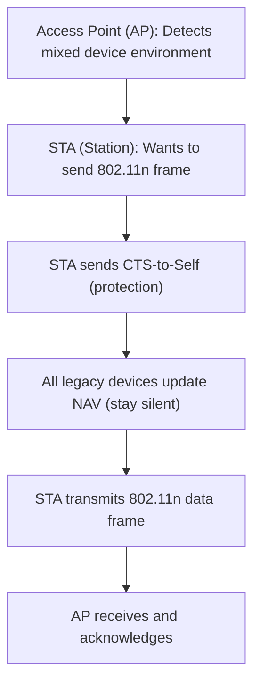
---

## ✅ Interview-Friendly Answer
"**CTS-to-Self** is a WLAN protection mechanism where a device sends a *Clear-to-Send (CTS)* frame to itself to reserve the wireless medium. It’s a simpler, faster alternative to the RTS/CTS handshake, and it’s commonly used in 802.11 networks to avoid collisions, especially in mixed environments with legacy devices."

> ➡️ **Part 2 ends here.** You know *when* the medium is reserved. Part 3 opens the actual **packet** — every field in an 802.11 frame — then the **radio** those bits ride, then the most important management frame: the **beacon**.

---

# 🧱 PART 3 · Frames, the Radio, and Beacons

> **What's ahead:** first the **MAC header** (type, addresses, flags). Then we pause for a **PHY primer** (frequency, channel, QAM, SNR) so later words like “80 MHz” and “256-QAM” are pictures, not jargon. Then we come back to MAC for **beacons / TSF / TIM / DTIM** — the frames that make discovery and power-save possible.

---

# 📡 Wi-Fi MAC Frame Format (802.11)

| **Field** | Frame Control | Duration/ID | Address 1 | Address 2 | Address 3 | Seq Ctrl | Address 4 | Frame Body | FCS |
|-----------|---------------|-------------|-----------|-----------|-----------|----------|-----------|------------|-----|
| **Size**  | 2 B           | 2 B         | 6 B       | 6 B       | 6 B       | 2 B      | 6 B       | 0–2312 B   | 4 B |

> **Note:** Address 4 is present only in WDS/mesh frames (To DS = 1 *and* From DS = 1). A QoS Control field (2 B) and, in 802.11n+, an extra **HT Control** field (4 B — a small “Wi-Fi 4 and later” header add-on; ignore the internals) may also appear, which is why the exact header size varies.
> **Total Size:** Variable (typically 28–2346 bytes depending on payload and which optional fields are present)


### 🧩 Frame Control Field Structure (2 bytes = 16 bits)
it consists of various bits Namely
| **Subfield**             | **Size** |
|--------------------------|----------|
| Protocol Version         | 2 bits   |
| Type                     | 2 bits   |
| Subtype                  | 4 bits   |
| To DS                    | 1 bit    |
| From DS                  | 1 bit    |
| More Fragments           | 1 bit    |
| Retry                    | 1 bit    |
| Power Management         | 1 bit    |
| More Data                | 1 bit    |
| Protected Frame (was "WEP") | 1 bit    |
| Order                    | 1 bit    |

> 🧪 This field defines the **type, control, and behavior** of the 802.11 frame.

## 🧾 IEEE 802.11 Frame Types and Subtypes

Each 802.11 frame has a **Frame Type** field (2 bits) and a **Subtype** field (4 bits) inside the **Frame Control (FC)** field.
These determine **what kind of frame it is** and **what it's used for**.
### Frame Types:
Frame type is subdivided into
1. **Management Frames**
2. **Control Frames**
3. **Data Frames**

Sub type helps specify the exact frametype(Probe,RTS etc..)

---

### 📊 Frame Types & Subtypes Table

| **Frame Type**       | **Type Value** | **Common Subtypes**                          | **Usage**                                         |
|----------------------|----------------|-----------------------------------------------|--------------------------------------------------|
| **Management**       | `00`           | - Association Request<br>- Association Response<br>- Probe Request<br>- Probe Response<br>- Beacon<br>- Authentication<br>- Deauthentication | Used to **establish, manage, and terminate** Wi-Fi connections |
| **Control**          | `01`           | - RTS (Request to Send)<br>- CTS (Clear to Send)<br>- ACK (Acknowledgment)<br>- PS-Poll | Assists with **medium access control**, power saving, and reliability |
| **Data**             | `10`           | - Data<br>- QoS Data<br>- Null Function<br>- CF-Ack | Carries **actual payload** (e.g., IP packets, ARP, DNS, etc.) |
| **Reserved**         | `11`           | - N/A                                          | Reserved for future use by IEEE                  |

---

### 🧠 Key Concepts

- The **Frame Type** tells us the category (Mgmt, Control, Data).
- The **Subtype** field (4 bits) tells us **exactly what kind of frame** it is within that category.
- These values are found inside the **Frame Control field** of every 802.11 frame.

> 🔍 Example:  
> A **Beacon Frame** has Frame Type = `00` (Management), Subtype = `1000` (Beacon)

---


### Other Fields:

- **Duration**: The duration bit specify  time interval we want to occupy the channel.
- **Sequence Control (SC)**: Holds the **sequence number** and **fragment number**; used for **fragmentation/reassembly and duplicate-frame detection** (not clock synchronization).
- **FCS**: Frame Check Sequence is used for are checking probably (CRC32)
---
**To DS** (frame is going *to* the Distribution System) and **From DS** (frame is coming *from* the Distribution System) are two 1-bit flags in the Frame Control field. Their combination determines how the four address fields (Address 1–4) are interpreted:
## 🧭 Addressing in Wi-Fi

| Address | Purpose                        |
|---------|--------------------------------|
| Addr1   | Next Destination               |
| Addr2   | Previous Sender                |
| Addr3   | Final Destination              |
| Addr4   | Original Source (if needed)    |

> 🔹 If `To DS = 0` and `From DS = 0` → Direct station-to-station communication.

**More frag** (More fragments): It is 1 bit long field which when set to 1 means frame is followed by other fragments.
**Order**: It is 1 bit long field, if this bit is set to 1 the received frames must be processed in strict order.
**retry**:it is 1-bit long field, if the current frame is a retransmission of an earlier frame.
**power mgmt**:If the field is set to 1, station goes into power-save mode. If the field is set to 0, the station stays active.

> ➡️ **Pause the MAC header.** Those bits do not float in a vacuum — they become radio waves. The next section is the **PHY primer**. After it we return to MAC frames (beacons).

---

## 🧲 Layer 1 (PHY) Fundamentals — the radio, explained with pictures

Before modulation tables, let's build intuition for the words everyone throws around: *frequency, band, channel, bandwidth, subcarrier, QAM, dBm, SNR*. **One master analogy ties it all together: radio is sound in a swimming pool.** You make waves in the water; a friend across the pool feels them and decodes your message.

### 🌊 Frequency & Band — *how fast the waves wiggle*

**Frequency** = how many wave cycles pass per second (Hz). Wi-Fi uses **2.4 GHz, 5 GHz, and 6 GHz** — meaning ~2.4 / 5 / 6 *billion* wiggles per second. A **band** is just a *neighborhood* of frequencies set aside for Wi-Fi.

```text
   ← lower frequency                               higher frequency →
   ┌───────────────┬──────────────────┬──────────────────────────┐
   │   2.4 GHz     │      5 GHz        │        6 GHz (6E)        │
   │ travels FAR,  │  balanced        │ huge free space,         │
   │ bends walls   │  speed + range   │ short range, cleanest    │
   │ but CROWDED   │  many channels   │ newest, least crowded    │
   └───────────────┴──────────────────┴──────────────────────────┘
```

> 🔑 **Analogy:** a **low** frequency (2.4 GHz) is like a **deep bass note** — it travels far and goes *through* walls, but everyone's microwave, Bluetooth mouse, and neighbor is also "humming" there (crowded, slow). A **high** frequency (5/6 GHz) is like a **high-pitched whistle** — crisp and fast, carries more data, but fades quickly and is blocked by walls. *Lower = range, higher = speed.*

### 🛣️ Channel & Bandwidth — *which lane, and how wide*

A **band** is huge, so it's chopped into **channels** (think: radio stations / highway lanes). **Bandwidth (channel width)** is how *wide* that lane is — **20, 40, 80, 160, 320 MHz**. Wider lane = more cars (bits) per second.

```text
   20 MHz lane:   [■■]                 ← narrow, slow, but robust & less interference
   40 MHz lane:   [■■■■]               ← 2× the data
   80 MHz lane:   [■■■■■■■■]           ← 4× the data
  160 MHz lane:   [■■■■■■■■■■■■■■■■]    ← 8× the data (needs clean, wide spectrum)
```

> 🔑 **Analogy:** bandwidth is the **width of a highway**. A 20 MHz road carries some traffic; widen it to 160 MHz and 8× the cars flow — *but* a wider road is harder to find empty (more likely to overlap a neighbor) and needs a stronger signal to fill. This is **channel bonding**: gluing adjacent 20 MHz lanes into one wide road.

### 🎼 Subcarriers & OFDM — *one wide lane split into many tiny lanes*

Here's the clever part. Instead of one big signal filling the whole 20 MHz lane, OFDM splits it into **hundreds of ultra-thin sub-lanes called subcarriers (tones)**, each carrying a little data *in parallel*. They're spaced so they don't interfere ("orthogonal").

```text
   One 20 MHz channel, viewed up close:
   │▏▏▏▏▏▏▏▏▏▏▏▏▏▏▏▏▏▏▏▏▏▏▏▏▏▏▏▏▏▏▏▏▏▏▏▏▏▏▏▏▏▏▏▏▏▏▏▏│  ← ~64–256 subcarriers
    each thin line = one subcarrier carrying a few bits, all AT ONCE
```

> 🔑 **Analogy:** instead of **one person shouting** one letter at a time (old single-carrier), OFDM is a **choir of hundreds of singers**, each holding a different steady note and each encoding a bit. Together they deliver a whole paragraph in the time one shout would take. (**OFDMA**, from the Wi-Fi 6 chapter, then *hands different singers to different people* — that's the only extra step.)

### 🔢 Modulation & QAM — *how much you pack into each wave*

**Modulation** = how many bits you encode per "symbol" (per tiny time-slot on a subcarrier). **QAM (Quadrature Amplitude Modulation)** varies both the **amplitude** (loudness) and **phase** (timing shift) of the wave to create many distinguishable points — a **constellation**.

```text
   BPSK (1 bit)      16-QAM (4 bits)        256-QAM (8 bits)      1024-QAM (10 bits)
    • ... •          • • • •                ▓▓▓▓▓▓▓▓             ░░░░░░░░░░░░
                     • • • •                ▓▓▓▓▓▓▓▓             ░░ denser ░░
   2 points          • • • •                ▓▓ 256 pts         ░░ 1024 pts ░░
                     • • • •                ▓▓▓▓▓▓▓▓             ░░░░░░░░░░░░
   easy to tell      16 points             packed tight         SUPER tight →
   apart (robust)    (more data)           (needs clean signal)  tiny noise = error
```

> 🔑 **Analogy:** a symbol is a **hand gesture** across the pool. **BPSK** = thumbs up / thumbs down (2 options, impossible to misread even in choppy water). **1024-QAM** = 1024 subtly different finger positions — carries *way* more info per gesture, but your friend must see your hand **crystal clear**; the tiniest ripple and they misread it. That's why high QAM needs a strong, clean signal (close to the AP).

### 📏 dBm / RSSI & SNR — *how loud, and how clear*

- **RSSI / dBm** = **signal strength** (loudness). Measured in **dBm** (negative numbers): **−40 dBm = very strong** (next to AP), **−70 dBm = okay**, **−85 dBm = barely alive**. Closer to 0 = stronger.
- **Noise floor** = the background "hiss" (other devices, thermal noise).
- **SNR (Signal-to-Noise Ratio)** = how far your signal rises *above* the noise. **This is what really decides your speed**, not loudness alone.

```text
   signal ────▇▇▇▇▇──────  ← RSSI (how loud you are)
                         
   noise  ──~~~~~~~~~~~~~~  ← noise floor (background hiss)

   SNR = gap between them.  BIG gap → can use 1024-QAM (fast).
                            small gap → must drop to BPSK (slow but survives).
```

> 🔑 **Analogy:** **RSSI is how loudly your friend speaks; SNR is how well you can hear them over the crowd.** A loud voice in a noisy nightclub (high RSSI, low SNR) is still hard to understand, so you both switch to simple thumbs-up signals (low QAM). A normal voice in a quiet library (modest RSSI, high SNR) is perfectly clear, so you can use rich, detailed gestures (high QAM). **The rate adapts to SNR in real time** — this is the "rate/MCS adaptation" the driver does constantly.

### 🧩 Putting it together — MCS (the "gear" of the radio)

The radio bundles **modulation + coding rate + spatial streams** into a numbered **MCS (Modulation and Coding Scheme)** — like gears on a bike. Good signal → shift to a high gear (256/1024-QAM, light error-correction, fast). Weak signal → drop to a low gear (BPSK, heavy error-correction, slow but reliable).

| Term | Plain meaning | Analogy |
|------|---------------|---------|
| **Frequency / band** | which "neighborhood" of airwaves | bass note vs whistle |
| **Channel** | a specific lane in that band | a radio station / highway lane |
| **Bandwidth** | how wide the lane is (20–320 MHz) | width of the highway |
| **Subcarrier (OFDM)** | tiny parallel sub-lanes | a choir of singers |
| **Modulation / QAM** | bits packed per symbol | simple vs detailed hand gestures |
| **Coding rate (FEC)** | redundancy to survive errors | repeating yourself for safety |
| **RSSI (dBm)** | signal loudness | how loud the speaker is |
| **SNR** | signal clarity vs noise | hearing them over a crowd |
| **MCS** | the chosen speed "gear" | bicycle gear |
| **PER** | how often a frame fails | how often the listener mishears you |

### 📉 PER (Packet Error Rate) — the number that moves the gear

**PER** = frames that fail / frames you sent.

A frame “fails” when the receiver cannot decode it (the checksum, FCS, does not match). Noise, a weak signal, or a too-aggressive MCS all raise PER.

```text
  same room, client walks away
  MCS 9 (fast)   PER  2%  →  40%   ← too many failures, retries eat the air
  MCS 4 (slower) PER  1%  →   3%   ← boring, but almost every frame lands

  rate control watches PER (and retries):
    PER stays tiny  → try a higher MCS
    PER jumps       → drop a gear
```

> 🔑 **Two different “loss” numbers.** The **air PER** is what the radio sees. The **app / TCP loss** is much smaller, because the MAC **retries** the bad frame several times before giving up. A speed test can look clean while the radio is quietly retrying. If retries run out, TCP finally sees a loss and shrinks its window (next to aggregation, below). A common rate-control habit is to allow a **small** PER at a high MCS: a few retries at top gear still beat a perfect but much slower gear.

---

## ⚙️ Physical Layer and Modulation Schemes

### Based on encoding, speed, and range:

- **802.11a**: 5 GHz (UNII bands), OFDM (BPSK/QPSK/16-QAM/64-QAM), 6–54 Mbps
- **802.11b**: 2.4 GHz (ISM), DSSS/CCK (DBPSK/DQPSK), 1/2/5.5/11 Mbps
- **802.11g**: 2.4 GHz, OFDM (CCK for legacy compatibility), up to 54 Mbps
- **802.11n**: 2.4/5 GHz, OFDM up to 64-QAM + MIMO, up to 600 Mbps

> 💡 Wi-Fi uses unlicensed **ISM bands**.

> ➡️ **Back to MAC frames.** You now have the radio vocabulary. The most important management frame — the one every client listens for — is the **beacon**.

---
## 📡 Beacon Frames in Wi-Fi

Beacon frames are **broadcast management frames** sent periodically by Access Points (APs) to announce the presence of a Wi-Fi network.

---

### 🧭 Purpose of Beacon Frames

| **Function**                   | **Description**                                                                 |
|-------------------------------|---------------------------------------------------------------------------------|
| **Announce the network**      | AP advertises its SSID (network name)                                          |
| **Synchronization**           | Helps client devices sync their internal clocks with the AP's timestamp        |
| **Transmit network parameters** | Includes channel, supported data rates, security info, etc.                    |
| **Power saving support**      | Contains **TIM (Traffic Indication Map)** to help sleeping clients know if data is buffered for them |

---
## 🧱 Beacon Frame Structure (Expanded)

| **Field**                              | **Purpose**                                                              |
|---------------------------------------|---------------------------------------------------------------------------|
| **Timestamp**                         | Carries the AP's **TSF** value — syncs client clocks with the AP          |
| **Beacon Interval**                   | Interval between beacons (in TUs)                                        |
| **Capability Info**                   | Flags: ESS, Privacy (WEP/WPA), IBSS, etc.                                |
| **SSID**                              | Network name (may be null for hidden networks)                           |
| **Supported Rates**                   | Data rates supported by AP                                               |
| **DS Parameter Set**                  | Includes **current channel** (e.g., 6, 11, etc.)                          |
| **TIM (Traffic Indication Map)**      | Bitmap of AIDs with buffered **unicast**; also carries **DTIM Count** & **DTIM Period** for buffered **broadcast/multicast** |
| **WMM Parameter Element** *(optional)*| **QoS settings** for Voice, Video, Best Effort, Background queues        |
| **RSN Information (Security)**        | Info about WPA2/WPA3 authentication and encryption                       |
| **Vendor-Specific IEs**               | Optional extensions like 802.11k/v/r, roaming hints, etc.                |

**DS Parameter Set** = Just the channel number — tells clients what RF channel the AP is using.

**QoS Info** is included only if AP supports WMM, and it appears in the WMM Parameter Element inside the optional IEs section of the beacon frame.
Tag: WMM Parameter Element (WME)
  - QoS Info (U-APSD support, queue settings)
  - Access Categories: Voice, Video, Best Effort, Background


### ⏱️ Beacon Interval

- Defined in **time units (TUs)** — 1 TU = **1024 microseconds**
- Default interval: **100 TUs** → ~102.4 ms (approx. 10 beacons/sec)

---

### 🕒 TSF (Timing Synchronization Function)

The **TSF** is the master clock that keeps every device in a BSS time-aligned.

- It is a **64-bit counter that increments in microseconds**, maintained in hardware.
- In **infrastructure mode**, the **AP owns the authoritative TSF**. It copies its current TSF value into the **Timestamp** field of every Beacon and Probe Response.
- When a station receives that timestamp, it **adopts the AP's TSF** as its own, so the entire BSS shares one clock.
- In **IBSS/Ad-Hoc**, there is no AP, so TSF is maintained in a **distributed** way: whichever station's beacon carries the highest TSF value wins, and others advance their clocks to match.

**Why it matters:**
- **Power save** — sleeping clients use the common clock to wake up exactly at the next beacon / DTIM, so they don't miss buffered traffic.
- **Beacon timing (TBTT)** — the *Target Beacon Transmission Time* is computed from the TSF, keeping beacons on a predictable cadence.
- **Coordinated features** — TWT wake windows, NAN discovery windows, and 802.11p timing all derive from TSF.

> 🔑 In a SoftMAC implementation the TSF counter lives in silicon precisely because beacons must be stamped with the *live* value at the instant of transmission — software is too slow/jittery to do this.

---

### 📑 TIM and DTIM (Traffic Indication Map)

Both live inside the beacon and exist to support **power-save clients**. They tell sleeping stations whether the AP has data waiting for them.

#### 🗂️ How buffering works (the picture)

When a station is asleep, the AP can't deliver its frames — so it **holds them in a per-station buffer** and *advertises* who has waiting data using the **TIM bitmap** in each beacon. Each bit = one station's AID:

```text
   AP side (holds frames while clients sleep)
   ┌────────────────────────────────────────────┐
   │  Buffer for AID 1 (STA-A):  [pkt][pkt]      │  ← has data
   │  Buffer for AID 2 (STA-B):  (empty)         │  ← no data
   │  Buffer for AID 3 (STA-C):  [pkt]           │  ← has data
   │  Group buffer (bcast/mcast):[pkt][pkt]      │  ← delivered after DTIM
   └────────────────────────────────────────────┘
                     │  builds bitmap
                     ▼
   TIM bitmap in Beacon:   AID:  1 2 3 4 5 ...
                           bit:  1 0 1 0 0 ...
                                 ▲   ▲
                            STA-A &  STA-C: "you have data, stay awake"

   STA-A wakes, sees bit=1 ──► sends PS-Poll ──► AP delivers its buffered frames
   STA-B wakes, sees bit=0 ──► goes back to sleep immediately (saves power)
```

And the **DTIM** governs *group* traffic on a schedule (here DTIM Period = 3):

```text
 Beacon:  #1          #2          #3(DTIM)    #4          #5          #6(DTIM)
          TIM         TIM         TIM+DTIM    TIM         TIM         TIM+DTIM
          Count=2     Count=1     Count=0 ──┐ Count=2     Count=1     Count=0 ──┐
                                            │                                   │
                                            ▼                                   ▼
                              ┌─ bcast/mcast burst ─┐             ┌─ bcast/mcast burst ─┐
                              │ ALL PS clients awake │             │ ALL PS clients awake │
                              └──────────────────────┘             └──────────────────────┘
```

#### TIM (Traffic Indication Map)
- A **bitmap** carried in (almost) every beacon.
- **Each bit corresponds to one associated station's AID** (Association ID).
- If a station's bit is **set (1)**, the AP has **unicast** data buffered for it → that station should stay awake and retrieve it (via **PS-Poll** in legacy PS, or a trigger in U-APSD).
- If the bit is **0**, the station can go back to sleep until its next listen interval.

#### DTIM (Delivery Traffic Indication Map)
- A **special TIM that appears every *N* beacons**, where **N = DTIM Period** (e.g., DTIM period 3 → every 3rd beacon is a DTIM).
- A DTIM beacon signals that the AP is about to deliver **buffered broadcast/multicast (group-addressed) traffic**.
- **All** power-save clients must wake for the DTIM beacon (group traffic isn't AID-specific), then the AP sends the buffered multicast/broadcast frames **immediately after** the DTIM beacon.
- The **DTIM Count** field counts down to the next DTIM (e.g., 2 → 1 → 0; 0 = this beacon *is* a DTIM).

| Field | Carried In | Indicates | Who Wakes |
|-------|------------|-----------|-----------|
| **TIM** | Most beacons | Buffered **unicast** for specific AIDs | Only stations whose AID bit is set |
| **DTIM** | Every *DTIM-Period* beacons | Buffered **broadcast/multicast** is about to be sent | **All** power-save stations |

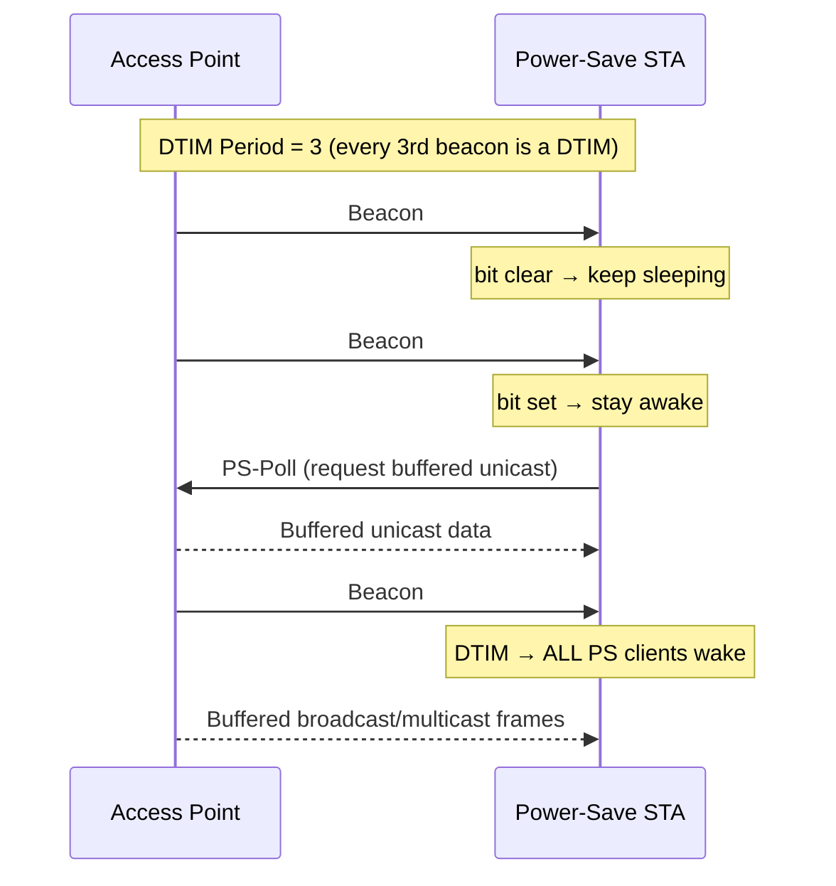

**Trade-off:** a **longer DTIM period** = more power saving (clients sleep through more beacons) but **higher latency** for multicast/broadcast traffic; a **shorter DTIM period** wakes clients more often (less battery saving) but delivers group traffic with lower delay.

---

### 📶 Beacon Frame Properties

| **Property**           | **Value**               |
|------------------------|-------------------------|
| **Frame Type/Subtype** | Management / Subtype 8  |
| **Transmission Mode**  | Broadcast (to all clients) |
| **Reliability**        | Not ACKed (unreliable delivery) |
| **Frequency**          | Sent on primary channel only |
| **Encryption**         | Never encrypted         |

---

### 🔍 Real-World Use Cases

- Wi-Fi scanners (e.g., in phones or `Wireshark`) **rely on beacon frames** to detect nearby SSIDs.
- Beacons are **always sent**, even if the SSID is "hidden" (though in that case, SSID field is null).
- Client devices use the **timestamp and interval** to sync their sleep/wake schedules (important for power saving).

---

### ⚠️ Security Note

- Beacon frames **advertise the presence of a network**, so:
  - Hidden SSIDs don't offer real security — they just omit the SSID name
  - Attackers can still detect networks based on beacon frame traffic

---

## ✅ Summary

| **Why Beacons Matter** |
|------------------------|
| 📡 They announce the Wi-Fi network to nearby devices |
| 🕒 Help clients stay synchronized and manage power |
| 🔑 Carry critical info like supported rates, channel, and security |
| 🧭 Clients scan and connect based on beacon frame contents |

> 💡 Without beacon frames, Wi-Fi devices wouldn’t even know which networks exist — they're like digital lighthouses!

> ➡️ **Part 3 ends here.** You can read a frame and you know why beacons exist. Part 4 is the **journey from “I hear a beacon” to “I have an IP and can browse”** — modes, scan, associate, encrypt, DHCP, then the AP’s side of the same story.

---

# 🧱 PART 4 · Connecting & Securing a Device

> **What's ahead:** first the **operating modes** (infrastructure is the default; the others exist so you recognise them). Then one connection path, in order: **scan → open / WPA2 / WPA3 / Enterprise → 4-way handshake → DHCP**. After the client story, the same steps from the **AP’s point of view**, then how the AP actually reaches the internet (bridge, NAT, DNS). The 4-way handshake appears more than once — WPA2-Personal, WPA3 (after SAE), and Enterprise (after EAP). Same four EAPOL-Key messages; only the *source of the PMK* changes.

---

# 📡 Wireless Network Modes

Wlan can operate in several modes, each designed for specific purposes. Below are the common Wi-Fi modes:

## **1. Infrastructure Mode**
- **Most common mode** used in Wi-Fi networks.
- Devices (stations) communicate through a central **Access Point (AP)**.
- AP manages traffic and facilitates communication between devices and external networks (e.g., internet).

## **2. Ad-Hoc Mode (IBSS - Independent Basic Service Set)**
- Peer-to-peer communication **without** an Access Point.
- Devices connect directly in a **decentralized** network.
- Suitable for small or temporary networks.

## **3. Monitor Mode (Promiscuous Mode)**
- NIC listens to all wireless frames in the air, even if not addressed to it.
- Used for:
  - Packet sniffing
  - Wireless troubleshooting
  - Network analysis and security auditing
- Unlike promiscuous mode in Ethernet, monitor mode works at the radio level.

## **4. Master Mode**
- Typically used by **Access Points**.
- The device acts as a central controller allowing other devices (clients) to connect.

## **5. Repeater Mode**
- Extends the range of an existing wireless network.
- Receives signal from an AP and rebroadcasts it.

## **6. Bridge Mode**
- Connects two different network segments, often wired and wireless.
- Used to link two LANs using wireless communication.

## **7. Mesh Mode**
- Devices (nodes) act as both clients and routers.
- Creates a **self-healing, self-configuring** wireless network.
- Common in large area deployments like campuses or smart cities.

## **8. Client Mode**
- Standard mode where a device (e.g., laptop, phone) connects to an AP to access the network.

---

## 🔍 Scanning and Association

### 🧭 The whole connection, end to end (keep this map in mind)

Everything in this chapter and the security chapters that follow are stages of **one** journey from "radio off" to "I can browse." Here is the full state machine:

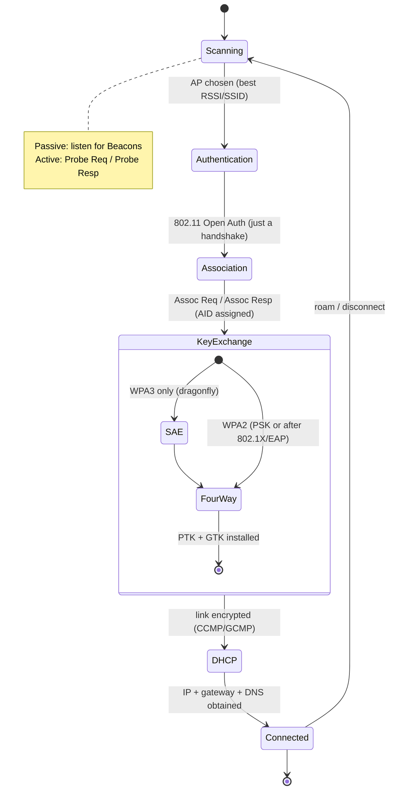

> 🔑 **Read it as four gates:** (1) **find** the AP, (2) **authenticate + associate** (you become a known station with an AID), (3) **derive keys** so traffic is encrypted, (4) **get an IP** at Layer 3. Only after all four can real data flow. The sections below zoom into each gate.

### What is Scanning?

The process by which a station discovers available wireless networks(AP) before associating with an AP.

### Scanning Steps:

1. Station sends a **probe request frame**.
2. Nearby APs respond with **probe response frames**.
3. Station sends an **association request** to the chosen AP.
4. AP sends back an **association response**.

### Scanning Types:

- **Active Scanning**: Station sends probe request → AP responds.
- **Passive Scanning**: APs periodically send **beacon frames**( advertising packets illustrating its capability to all stations).

---
## 🔐 Open (No Encryption) Connection Process

1. AP sends **beacon frame** (broadcast).
2. Client sends **probe request** with SSID.
3. AP replies with **probe response**.
4. Client sends **authentication request**.
5. AP sends **authentication response**.
6. Client sends **association request**.
7. AP sends **association response**.
8. Client may later send **disconnect frame**.

## 🔐 WPA2 Encrypted Connection Process

The process of establishing a secure WPA2 connection between a **client station (STA)** and an **Access Point (AP)** involves several key steps:

1. **🔎 Probe Request**
   - The **station** sends a **probe request** to discover nearby APs.
   - It includes supported data rates, security capabilities, and SSID (if known).

2. **📡 Probe Response**
   - The **AP** responds with a **probe response** containing its capabilities and supported configurations.

3. **🛂 Authentication Request**
   - The **station** sends an **authentication request** to the AP (Open System Authentication is used in WPA2).

4. **🛡️ Authentication Response**
   - The **AP** sends back an **authentication response**, typically approving the request.
   - At this stage, the station is **authenticated but not yet associated**.

5. **🔗 Association Request**
   - The **station** sends an **association request** to the AP.
   - This includes supported features and the **encryption type** (e.g., WPA2 with AES).

6. **📶 Association Response**
   - The **AP** sends an **association response** containing a **status code** and an **Association ID (AID)**.

7. **🔐 Four-Way Handshake (WPA/WPA2)**
   - If WPA or WPA2 is in use, the AP and station perform a **Four-Way Handshake** to:
     - Confirm mutual possession of the **Pairwise Master Key (PMK)**
     - Derive **session keys** for encryption (PTK & GTK)
     - Ensure secure communication is established
   - *(Note: WEP does **not** use a Four-Way Handshake — it relies on a static shared key with optional Shared-Key Authentication.)*

---

### ✅ Summary
Once the Four-Way Handshake is complete, the station is **fully connected and encrypted** using WPA2, and can securely send and receive data over the wireless network.


---
## 🔐 Four-Way Handshake (WPA2)

Used for secure key exchange between client and AP. **Important idea first:** both sides *already* share a secret called the **PMK** (Pairwise Master Key) — derived from the Wi-Fi password in WPA2-Personal, or from 802.1X/EAP in Enterprise, or from SAE in WPA3. The 4-way handshake does **not** send the password or the PMK over the air. Instead, it proves *both* sides know the PMK and derives fresh per-session keys.

### 🔑 Key hierarchy (what is derived from what)

```text
        Wi-Fi password + SSID  (WPA2-Personal)
                    │  PBKDF2
                    ▼
                 PMK  ── (never transmitted; both sides already have it)
                    │  + ANonce + SNonce + AP-MAC + STA-MAC   (PRF)
                    ▼
                 PTK  ── split into:
                    ├── KCK  (Key Confirmation Key → computes the MIC)
                    ├── KEK  (Key Encryption Key → wraps the GTK in Msg 3)
                    └── TK   (Temporal Key → actually encrypts your data, CCMP/AES)

        AP also holds:  GTK (Group Temporal Key → encrypts broadcast/multicast)
```

### Steps:

1. **AP** generates a random **ANonce** and sends it to the **station** (Message 1 — begins key derivation).
2. **Station** already has the **PMK**, generates its own random **SNonce**, and now has everything to derive the **PTK** (PMK + ANonce + SNonce + both MACs).
3. **Station** sends **SNonce + MIC** to the AP (Message 2). The **MIC** proves the station computed a valid PTK (i.e., it really knows the PMK).
4. **AP** derives the same **PTK**, verifies the MIC, then sends **Message 3** containing the **GTK** (encrypted with the KEK) + its own MIC. This proves the AP also knows the PMK.
5. **Station** installs the PTK + GTK and sends **Message 4** (ACK) to confirm. Encrypted data can now flow.

### 📶 Message sequence (EAPOL-Key frames)

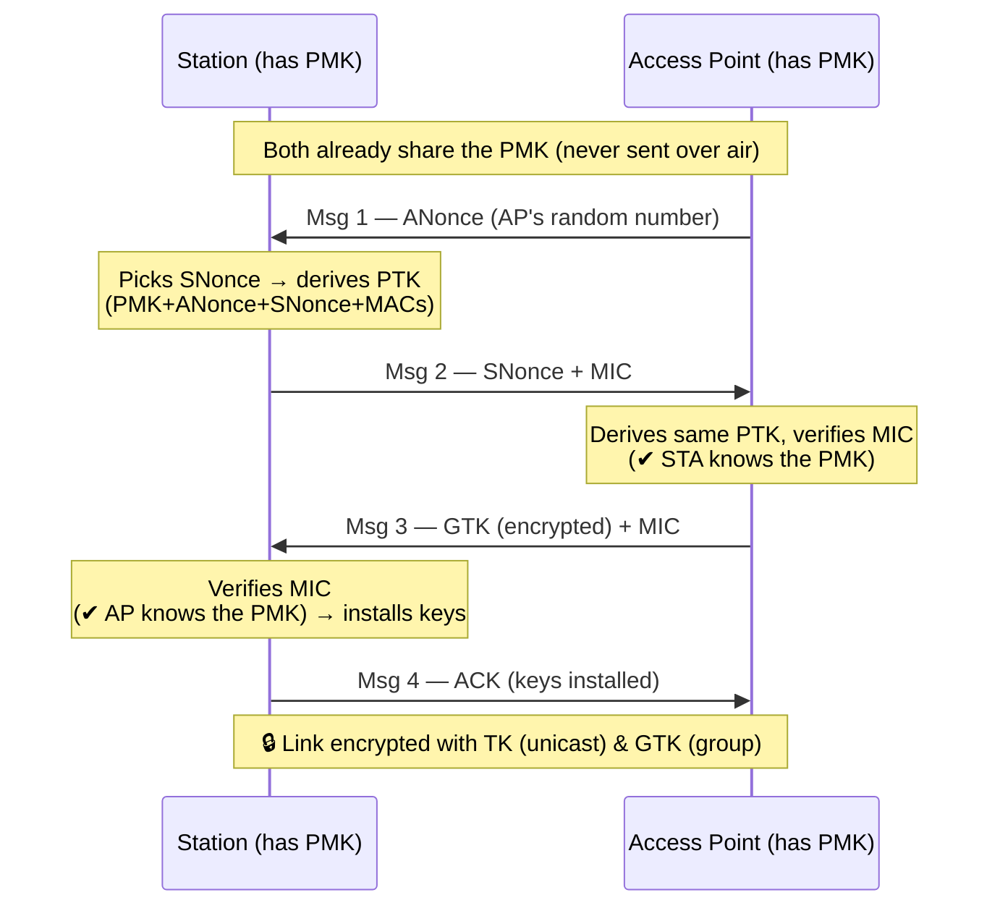

> 🔑 **Why four messages?** Msg 1→2 lets *both* sides derive the PTK and lets the AP verify the station (via the MIC). Msg 3→4 lets the station verify the AP *and* safely receive the group key (GTK). The two nonces guarantee a **fresh** key every session, so a captured handshake can't be replayed. This is also the exact exchange a "KRACK"-style attack targeted by forcing a nonce reuse on Msg 3 — fixed in patched clients.

> ➡️ **You just watched one handshake.** The next table is a **name map** (WEP / WPA / WPA2 / WPA3, CCMP vs GCMP, SAE vs EAP) so WPA3 and Enterprise in the following sections don't feel like a new language.

---
## 🔐 Wi-Fi Security Standards, Encryption, and Authentication Overview

| **Name**   | **Category**             | **Purpose**                                         | **Encryption**                  | **Authentication**                        | **Status / Notes**                             |
|------------|--------------------------|-----------------------------------------------------|----------------------------------|--------------------------------------------|-------------------------------------------------|
| **WEP**    | Security Protocol         | Original Wi-Fi security (weak)                     | RC4                              | Static pre-shared key                     | ❌ Obsolete / Insecure                          |
| **WPA**    | Security Protocol         | Temporary improvement over WEP                     | TKIP (uses RC4)                  | PSK / 802.1X                              | ⚠️ Deprecated                                   |
| **WPA2**   | Security Protocol         | Strong standard since 2004                         | AES (via CCMP)                   | PSK / 802.1X                              | ✅ Secure / Widely adopted                     |
| **WPA3**   | Security Protocol         | Latest standard (2018), improves WPA2              | AES (with GCMP-256 or CCMP-128)  | SAE (Personal) / 802.1X + EAP (Enterprise) | ✅ Modern / Strongest available                |

---

| **Name**   | **Category**             | **Purpose**                                         | **Encryption**                  | **Used In**                                | **Status / Notes**                             |
|------------|--------------------------|-----------------------------------------------------|----------------------------------|---------------------------------------------|------------------------------------------------|
| **TKIP**   | Encryption Algorithm      | Fix WEP flaws using per-packet keying              | RC4 + MIC + IV mixing            | WPA                                          | ❌ Deprecated / Weak                           |
| **CCMP**   | Encryption Algorithm      | Strong AES-based encryption + data integrity       | AES (CTR + CBC-MAC)              | WPA2, WPA3                                  | ✅ Secure and mandatory in WPA2 and WPA3       |
| **GCMP**   | Encryption Algorithm      | More efficient & secure than CCMP (used in WPA3)   | AES (Galois/Counter Mode)        | WPA3                                        | ✅ Stronger, used in high-security deployments |

---

| **Name**   | **Category**             | **Purpose**                                         | **Encryption Varies?**          | **Used In**                                | **Status / Notes**                             |
|------------|--------------------------|-----------------------------------------------------|----------------------------------|---------------------------------------------|------------------------------------------------|
| **SAE**    | Auth Protocol (WPA3-Personal) | Replaces PSK with secure key exchange             | Yes (AES + GCMP/CCMP)           | WPA3-Personal                               | ✅ Secure / Resists offline dictionary attacks |
| **EAP**    | Auth Framework (WPA2/WPA3-Enterprise) | Flexible authentication in enterprise networks | Depends on EAP type              | WPA2/WPA3-Enterprise                        | ✅ Secure with certificates (e.g. EAP-TLS)     |

---

### 📝 Quick Definitions:
- **Security Protocol**: Overall system that defines how Wi-Fi is secured.
- **Encryption Algorithm**: Technique used to encrypt and ensure data integrity.
- **Authentication Method**: How users/devices prove their identity.

## 🔐 WPA3 Encrypted Connection Process (with SAE)

In **WPA3-Personal**, the connection process enhances security by replacing the traditional **Pre-Shared Key (PSK)** mechanism with **SAE (Simultaneous Authentication of Equals)**. SAE provides forward secrecy and robust protection against offline dictionary attacks.

Below is a step-by-step overview of how a WPA3 connection is established:

---

### 1. 🔎 **Probe Request**
- The **station (STA)** broadcasts a **probe request** to discover nearby access points (APs).
- This request includes the SSID (optionally) and the station's supported security capabilities.

---

### 2. 📡 **Probe Response**
- The **access point (AP)** replies with a **probe response**.
- It advertises its capabilities, including support for WPA3 and SAE.

---

### 3. 🤝 **SAE Handshake (Authentication)**
- The traditional open-system authentication used in WPA2 is replaced by **SAE**, a password-authenticated key exchange (PAKE).
- SAE performs a secure **Diffie-Hellman key exchange** using the shared password:
  - Both the STA and the AP generate cryptographic elements derived from the password.
  - They exchange **commit messages** (containing public values) and **confirm messages** to verify authenticity.
  - Both sides independently derive the same **Pairwise Master Key (PMK)**.
- Key Features:
  - **Mutual authentication** is achieved without revealing the password.
  - Resistant to **offline dictionary attacks** and **passive eavesdropping**.
- Upon successful SAE handshake, the **station is authenticated**.

#### 🧠 Why SAE beats WPA2-PSK (the key insight)

In **WPA2-PSK**, the 4-way handshake's MIC is computed *directly* from the password. An attacker who captures one handshake can sit offline and try **millions of password guesses per second** against it — if your password is weak, it falls. In **WPA3-SAE (dragonfly)**, the two sides instead run a **Diffie-Hellman exchange seeded by the password**, and only *commit* and *confirm* values cross the air — never anything you can test a password guess against offline.

```text
  WPA2-PSK (vulnerable)                 WPA3-SAE (resistant)
  ─────────────────────                 ────────────────────
  password ──► MIC ──► on air           password ──► DH element ──► commit
      ▲ attacker captures MIC               ▲ attacker captures commit
      │ then guesses password               │ but CANNOT test a guess
      │ OFFLINE (fast, unlimited)           │ offline → math doesn't reveal it
      ✗ weak password cracked               ✓ every guess needs a LIVE exchange
                                              with the AP (slow, rate-limited,
                                              detectable) → brute force impractical
```

- **Forward secrecy:** because fresh DH values are generated each time, cracking *today's* password still can't decrypt *yesterday's* captured traffic.
- **Online-only guessing:** an attacker must make one *live* attempt per guess against the real AP, which is slow and easy to detect/block.

---

### 4. 🔗 **Association Request**
- The **station** sends an **association request** to the AP, expressing intent to join the network.
- This message includes supported features and confirms WPA3 capabilities.

---

### 5. 📶 **Association Response**
- The **access point** replies with an **association response**.
- If successful, it assigns an **Association ID (AID)** to the station, completing the association phase.

---

### 6. 🔐 **Four-Way Handshake**
- As in WPA2, WPA3 uses the **Four-Way Handshake** to derive session keys and ensure key confirmation.
- The difference: WPA3 uses the **PMK derived from the SAE handshake** instead of a PSK.
- Steps:
  1. The AP sends a **nonce (ANonce)** to the station.(sent to client to begin key derivation)
  2. The station replies with its **nonce (SNonce)**, computes the **Pairwise Transient Key (PTK)**, and includes a MIC (Message Integrity Code).(Sent to the AP/GO to complete key derivation)
  3. The AP derives the PTK, verifies the MIC, and sends the **Group Temporal Key (GTK)** encrypted using the PTK.
  4. The station confirms receipt and key installation.

- Outcome:
  - Both parties confirm possession of matching keys.
  - The connection is now fully encrypted with **unique session keys**.

---

✅ **Conclusion**:
WPA3 with SAE significantly improves Wi-Fi security by eliminating vulnerabilities in WPA2's PSK model. It ensures robust authentication, forward secrecy, and resistance to offline attacks while maintaining interoperability with familiar connection procedures.

---
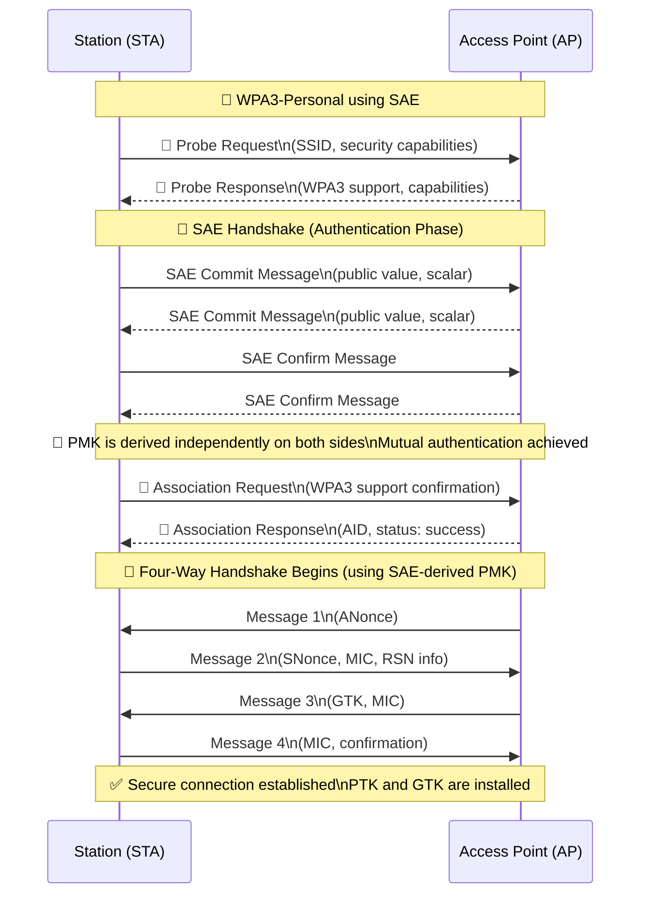
### ✅ Summary
Once the SAE handshake and Four-Way Handshake are completed:
- The **station is securely authenticated**.
- All data transmission is **encrypted using AES (CCMP or GCMP)**.
- The connection offers **forward secrecy** and stronger protection against brute-force attacks.

> ➡️ **Home / personal Wi-Fi is done** (password → SAE or PSK → 4-way). **Enterprise** adds a third party: a **RADIUS server**. The air link still ends in the same 4-way handshake; only the PMK is born from **802.1X / EAP** instead of a shared password.

## 🏢 WPA2-Enterprise Connection Process (with EAP-TLS / PEAP)

**WPA2-Enterprise** leverages **IEEE 802.1X** and the **Extensible Authentication Protocol (EAP)** to provide **strong, centralized authentication** — ideal for enterprise networks. It differs from WPA2-Personal by using a **RADIUS server** for back-end authentication and may involve **client/server certificates**, depending on the EAP method.

---

## 🔄 WPA2-Enterprise Connection Workflow

### 1. 🔍 Probe Request / Response
- The **station (STA)** sends a **probe request** to discover nearby APs.
- The **AP** responds with a **probe response**, listing supported security capabilities (e.g., WPA2-Enterprise).

### 2. 🛂 Open System Authentication
- A basic Layer 2 **authentication frame exchange** occurs.
- This does **not provide security**, just network initiation.

### 3. 🔗 Association Request / Response
- The **STA** sends an **association request** to join the AP.
- The **AP** responds with an **association response**, assigning an **Association ID (AID)**.

### 4. 🧠 802.1X Authentication Begins
- The **AP acts as a pass-through proxy** for EAP messages between the STA and the **RADIUS server**.
- The EAP method (e.g., **EAP-TLS**, **PEAP**) is negotiated.

---

## 🔐 802.1X EAP-TLS Authentication Process (Phase-by-Phase)

The 802.1X authentication mechanism, often used in enterprise Wi-Fi (including WPA2-Enterprise), relies on the **Extensible Authentication Protocol (EAP)**, a **RADIUS server**, and often the **EAP-TLS method** for certificate-based mutual authentication. Below is a step-by-step explanation.

---

### 🔁 Phase 0: Initialization

- **Message Type**: `EAPOL-Start`
- **Sender**: Supplicant (STA/client)
- **Purpose**:
  - The client sends an `EAPOL-Start` frame to the Authenticator (AP or GO) to indicate it wants to start the 802.1X authentication process.

---

### 🔐 Phase 1: EAP Identity Exchange

- **Message Type**: `EAP-Request/Identity` and `EAP-Response/Identity`
- **Flow**:
  1. The Authenticator (AP) forwards `EAP-Request/Identity` to the client.
  2. The client replies with `EAP-Response/Identity`.
  3. The AP forwards this to the RADIUS server.
- **Purpose**:
  - Establish the client's identity before selecting the EAP method (e.g., EAP-TLS).

---

### 📜 Phase 2: EAP-TLS Handshake

- **Message Type**: EAP encapsulates the full TLS handshake
- **Exchanged Contents** (in TLS order):
  - `ClientHello` (client starts the handshake)
  - `ServerHello` + Server Certificate (+ CertificateRequest)
  - `ClientCertificate` + `ClientKeyExchange` + `CertificateVerify`
  - `TLS Finished` messages (both sides)
- **Flow**:
  1. The server sends its certificate to the client.
  2. The client validates the server certificate and replies with its own certificate.
  3. Key exchange (e.g., Diffie-Hellman or RSA) takes place.
  4. TLS Finished messages are exchanged to confirm secure session setup.
- **Purpose**:
  - Authenticate both client and server using certificates.
  - Establish a secure TLS tunnel.
  - Derive a **Master Session Key (MSK)**.

---

### ✅ Phase 3: EAP Success

- **Message Type**: `EAP-Success`
- **Flow**:
  1. After the TLS handshake succeeds, the RADIUS server sends an `EAP-Success` message to the AP.
  2. The AP relays it to the client.
- **Purpose**:
  - Officially mark the authentication as successful.
  - Close the EAP session.

---

### 🔑 Phase 4: MSK Delivery

- **Key Type**: `MSK` (Master Session Key)
- **Flow**:
  - The RADIUS server securely delivers the MSK to the AP (via RADIUS protocol).
- **Purpose**:
  - The MSK is used as the root key to derive encryption keys for the Wi-Fi session (e.g., PTK and GTK).

---

### 🔒 Phase 5: Key Derivation and 4-Way Handshake

- **Process**:
  - The AP and client perform the **WPA2 4-Way Handshake** using the MSK as input.
- **Key Outcomes**:
  - **PTK** (Pairwise Transient Key): For unicast encryption
  - **GTK** (Group Temporal Key): For broadcast/multicast
- **Purpose**:
  - Ensure both sides independently derive the same encryption keys.
  - Finalize secure connectivity at the link layer.

---

## 🛡️ Security Properties of EAP-TLS

- ✅ Mutual Authentication via certificates
- ✅ TLS ensures confidentiality and integrity
- 🔐 No passwords are exchanged
- 🚫 Resistant to phishing and MITM attacks
- 🔑 Strongest EAP method (ideal for enterprise Wi-Fi)

---

## 📌 Summary Table

| Phase | Message Type                  | Contents                                              |
|-------|-------------------------------|-------------------------------------------------------|
| 0     | `EAPOL-Start`                 | Supplicant asks to begin 802.1X                      |
| 1     | `EAP-Identity Exchange`       | Identity sent from STA to RADIUS                     |
| 2     | `EAP-TLS Handshake`           | Certificates, key exchange, TLS Finished             |
| 3     | `EAP-Success`                 | Sent from RADIUS → AP → STA after successful TLS     |
| 4     | `MSK (Master Session Key)`    | Delivered from RADIUS to AP securely                 |
| 5     | `PTK + GTK` via WPA Handshake | Encryption keys derived from MSK                     |

---

## 🔐 PEAP — same 802.1X pipe, password instead of a client certificate

You just walked **EAP-TLS** (both sides have certificates). **PEAP** uses the *same* outer EAPOL / RADIUS path, but only the **server** has a certificate. It builds a TLS tunnel first, then runs a simpler inner method (usually **MSCHAPv2**: username + password) *inside* that tunnel. The numbering below continues the EAP story: Phase 2 = outer tunnel, Phase 3 = inner login. After both, you still do the **4-way handshake** — same as TLS.

## 🔐 Phase 2: TLS Tunnel Setup (Outer)

- Only the **server presents a certificate**.
- The **client validates** the server certificate to ensure authenticity.
- A **secure TLS tunnel is formed** between the client and the RADIUS server.
- This tunnel protects the subsequent authentication exchange from eavesdropping or tampering.

---

## 🔑 Phase 3: Inner EAP Authentication (Inside Tunnel)

If using **MSCHAPv2** (most common with PEAP):

1. **STA sends Username**  
   - The client begins authentication by submitting its identity within the tunnel.

2. **RADIUS sends MSCHAPv2 Challenge**  
   - The server issues a challenge (a random number) that the client must encrypt using its password.

3. **STA responds with MSCHAPv2 Response**  
   - The client calculates a hashed response using the password and sends it back.

4. **RADIUS verifies and sends Success**  
   - The server compares the response to an expected value. If correct, authentication succeeds.

✅ **No password is transmitted directly** — instead, authentication uses a challenge/response mechanism for security.


## 🔄 4-Way Handshake

After EAP authentication succeeds:
- A **Pairwise Master Key (PMK)** is derived and shared with the AP.
- The **STA and AP perform the Four-Way Handshake** using **EAPOL-Key frames**:
  - Generate **Pairwise Transient Key (PTK)**
  - Exchange the **Group Temporal Key (GTK)**
  - Confirm key installation
- Enables **encrypted communication** using AES (CCMP)

---

## 🧾 EAP-TLS vs PEAP: Comparison Table

| Feature                   | **EAP-TLS**                          | **PEAP (e.g., MSCHAPv2)**                    |
|---------------------------|--------------------------------------|----------------------------------------------|
| Auth Method               | Mutual certificate-based             | Username/password in TLS tunnel              |
| Client Certificate Needed | ✅ Yes                                | ❌ No                                         |
| Server Certificate Needed | ✅ Yes                                | ✅ Yes                                        |
| Mutual Authentication     | ✅ Yes                                | ⚠️ Only server authentication                 |
| Security Level            | 🔒 Very High                          | 🔐 Moderate to High                           |
| Deployment Complexity     | ⚠️ Higher (certs needed on clients)  | ✅ Easier for large orgs                      |

---

## 📡 What is EAPOL?

**EAPOL (Extensible Authentication Protocol over LAN)** is the Layer 2 protocol used to transport EAP messages between the **STA** and **AP** in 802.1X authentication workflows.

- 📘 Defined in: **IEEE 802.1X**
- 🌐 Used in: Both **wired and wireless networks**
- 🔄 Purpose: Carry **EAP Identity**, **TLS handshake**, and **4-Way Handshake** frames

---

### 📥 Role of EAPOL in WPA2-Enterprise

| Step | Action | Protocol |
|------|--------|----------|
| 1 | STA associates with AP | Standard Wi-Fi frames |
| 2 | AP sends `EAP-Request/Identity` | EAPOL |
| 3 | STA replies with `EAPOL-Response/Identity` | EAPOL |
| 4 | AP relays EAP messages to/from RADIUS | EAP over UDP |
| 5 | On success, 4-Way Handshake begins | EAPOL-Key frames |

---

## 🧠 Summary: EAPOL and WPA2-Enterprise

- **EAPOL** is not an EAP method itself — it is a **transport protocol** used during:
  - **EAP authentication**
  - **4-Way Handshake**
- It ensures the station and AP can negotiate and apply encryption keys securely.
- **After authentication**, the client can exchange **encrypted traffic** on the WLAN.

---

## ✅ Final Outcome

After all steps:
- The client is **authenticated centrally** via RADIUS.
- **Encryption is enabled** using AES (CCMP).
- Network access is **granted based on identity and policy** — ideal for enterprise environments.

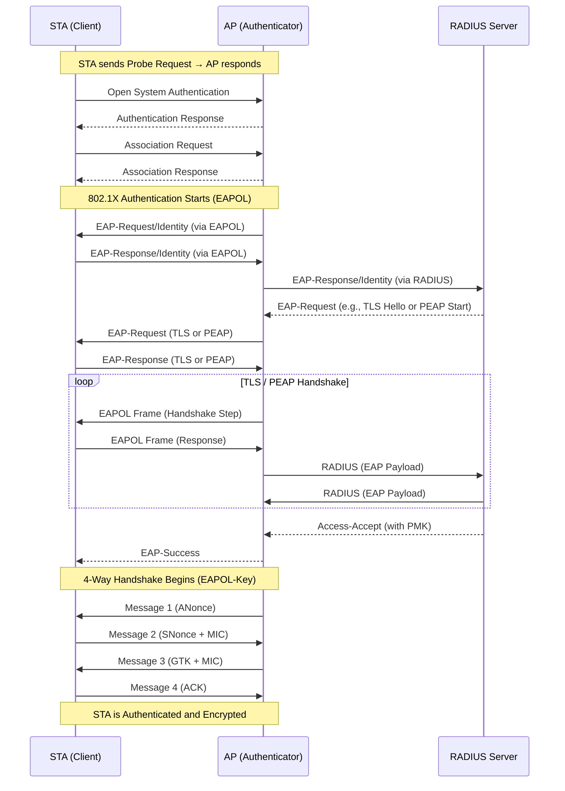

## 🌍 Layer 3 – DHCP Process + Network Info

After a successful Layer 2 (Wi-Fi) connection, your device begins the **DHCP (Dynamic Host Configuration Protocol)** process to obtain Layer 3 network configuration.

---

### 🔁 DHCP Exchange & Network Info

| **DHCP Step**         | **Who Sends It**         | **Message Type**       | **Purpose**                                                                 |
|-----------------------|---------------------------|-------------------------|------------------------------------------------------------------------------|
| **1. DHCP Discover**  | 📱 Your device             | 🔊 Broadcast            | "Is there a DHCP server? I need an IP address!"                            |
| **2. DHCP Offer**     | 📡 Router/AP               | 📢 Unicast/Broadcast    | "Here’s an IP config you can use!"                                         |
|                       |                           |                         | → Offers: IP address, subnet mask, gateway, DNS                            |
| **3. DHCP Request**   | 📱 Your device             | 🔊 Broadcast            | "Yes, I accept this configuration. Please assign it to me."                |
| **4. DHCP ACK**       | 📡 Router/AP               | 📩 Unicast              | "Confirmed! The IP and network settings are now officially assigned to you."|

---

### 📦 Network Info Received in DHCP Offer & ACK

| **Network Info**        | **Example**              | **Received In**         | **Purpose**                                              |
|-------------------------|--------------------------|--------------------------|----------------------------------------------------------|
| **IP Address**          | `192.168.0.101`           | 📩 DHCP Offer & ACK      | Identifies your device on the local network              |
| **Subnet Mask**         | `255.255.255.0`           | 📩 DHCP Offer & ACK      | Defines which IPs are in the same network                |
| **Default Gateway**     | `192.168.0.1`             | 📩 DHCP Offer & ACK      | Where to send traffic destined for the internet          |
| **DNS Server**          | `8.8.8.8` or router IP    | 📩 DHCP Offer & ACK      | Resolves domain names like `google.com` to IP addresses  |

---

### ✅ Final Summary

- DHCP is part of the **Layer 3 setup** after the device joins Wi-Fi at Layer 2.
- It gives your device everything it needs to **communicate beyond the local network**.
- Without DHCP, you'd need to configure all these values **manually** (static IP).

> 🧠 DHCP is the bridge between being connected to Wi-Fi and actually accessing the internet.

> ➡️ **You just lived the client side.** The next two chapters are the **same connection**, seen from the AP: first what the AP does on the air (beacon, auth, assoc, keys, TIM), then how it actually **forwards packets to the internet** (bridge vs router, NAT, DNS).

# 📡 Wi-Fi Access Point (AP) Process

A **Wi-Fi Access Point (AP)** is a Layer 2 device that acts as a bridge between wireless client devices and the wired network (LAN).

It plays a central role in managing communication, association, and data forwarding in wireless networks.

---

## 🔁 Access Point Roles

- **Beacon Broadcasting**: Periodically advertises its presence and capabilities.
- **Authentication & Association Handling**: Manages connection requests from stations.
- **Frame Forwarding**: Routes data between wireless clients and the wired network.
- **Encryption Management**: Initiates and completes secure key handshakes (e.g., WPA2/WPA3).
- **QoS & Buffering**: Supports traffic prioritization and manages buffers (especially for sleeping clients).

---

## 🔄 Wi-Fi AP Process Workflow

### 1. **Beacon Frame Broadcast**

- AP periodically sends **beacon frames** on its operating channel.
- Beacon includes:
  - **SSID**
  - **Channel info**
  - **Supported data rates**
  - **Security capabilities**
  - **QoS and TIM (Traffic Indication Map)**

> 🔔 This is part of **passive scanning**—clients listen to beacons to discover networks.

---

### 2. **Handling Probe Requests (Active Scanning)**

- Client sends a **probe request** (with or without SSID).
- AP responds with a **probe response** containing:
  - Network info
  - Capabilities
  - Encryption methods

---

### 3. **Authentication Request**

- The client sends an **authentication request** to the AP.
- AP replies with an **authentication response** (accept or reject).

> 📌 This is **open system authentication** in most modern networks (pre-shared key authentication handled later via 4-way handshake).

---

### 4. **Association Request/Response**

- Once authenticated, client sends an **association request**:
  - SSID
  - Supported rates
  - Security capabilities
- AP sends an **association response**:
  - Status (success/failure)
  - Association ID (AID)

> ✅ After this, the client is fully associated and allowed to exchange data frames.

---

## 🔐 Optional: WPA2/WPA3 Four-Way Handshake

If encryption is enabled (WPA2/WPA3):

1. **AP sends ANonce** to client.(sent to client to begin key derivation)
2. **Client generates PMK/PTK**, sends SNonce.(Sent to the AP/GO to complete key derivation)
3. **AP generates PTK**, derives GTK, sends it to client.
4. **Client sends ACK** to complete the handshake.

> 🔑 This step ensures both sides share secure session keys.

---

## 🔁 Frame Forwarding & Data Handling

- Once associated:
  - AP receives **data frames** from clients.
  - Forwards them to:
    - Another wireless client (intra-BSS)
    - Or a wired LAN endpoint (via **DS** – Distribution System)

---

## 💤 Power Save Mode Handling

- AP buffers packets for clients in **sleep mode**.
- AP sets **TIM flag** in beacon to notify pending data.
- Client wakes up and sends **PS-Poll frame** to retrieve data.

---

## 📶 AP Channel Management

- Operates on a fixed or dynamic channel in 2.4GHz/5GHz/6GHz bands.
- May support:
  - **Channel bonding** (40/80/160 MHz)->(combine two or more adjacent frequency channels into a single wider channel, allowing for higher data rates and throughput.By bonding two of them (e.g., Channel 1 + 5), you get 40 MHz → more bandwidth = faster speeds)
  - **DFS** (Dynamic Frequency Selection)
  - **Band Steering** (2.4 → 5GHz steering)

---

## 🧠 Other AP Features

- **QoS Management**: Uses WMM (Wi-Fi Multimedia) to prioritize traffic.
- **Load Balancing**: Distributes clients among neighboring APs (in ESS).
- **Client Isolation**: Prevents client-to-client traffic on the same BSS.
- **Roaming Support**: Coordinates with other APs in ESS for seamless handover.

---

## 🧾 AP Responsibilities Summary

| Task                        | Description                                                                 |
|-----------------------------|-----------------------------------------------------------------------------|
| Beacon Broadcast            | Periodically sends management frames to advertise network presence         |
| Handle Probe Requests       | Replies to active scan requests from client devices                        |
| Manage Authentication       | Handles client authentication using open/shared key                        |
| Manage Association          | Accepts or denies client association requests                              |
| Encryption Setup            | Coordinates 4-way handshake for WPA2/WPA3                                  |
| Frame Forwarding            | Forwards frames to other wireless clients or wired LAN                     |
| Power Save Support          | Buffers data and uses TIM/PS-Poll mechanism for sleeping clients           |
| QoS / WMM Support           | Enables traffic prioritization (voice, video, best-effort, background)     |
| Roaming & Load Balancing    | Part of ESS to support seamless mobility and balanced network usage        |

---

# 🌐 How a Wireless Access Point (AP) Provides Internet/Data Access

When you connect your phone or laptop to Wi-Fi, you're actually communicating with a **Wireless Access Point (AP)**. But how does that AP give you access to the internet? Let's break it down step by step.

---

## 📡 Step 1: Device Connects to the AP

1. Your device (called a **station** or **STA**) turns on Wi-Fi.
2. It scans for available networks (either **passively** by listening to beacon frames or **actively** by sending probe requests).
3. When you select a network (SSID), your device sends:
   - **Authentication Request**
   - **Association Request**
4. AP responds and **establishes the connection**.

✅ Now your device is connected **to the AP**, but it doesn’t yet have internet access.

---

## 🧠 Step 2: AP Acts as a Bridge or Gateway

Once connected, the AP needs to **bridge your device to the internet**. It does this in one of two roles:

### 1. **Bridge Mode**

- The AP is **just a wireless extension** of a wired router.
- It passes traffic back and forth **without assigning IP addresses**.
- The **router** handles DHCP (assigning IPs) and internet routing.

### 2. **Router Mode (Standalone AP)**

- The AP itself has **routing capability**.
- It performs **DHCP, NAT, DNS**, and **routes traffic** to the internet.

> 📝 Most home routers combine both AP + Router + DHCP Server in one device (like TP-Link, Netgear, etc.).

---

## 🗂️ Step 3: Device Gets an IP Address (DHCP)

To talk on any network, your device needs an **IP address**.

### Here's how it works (automatically via DHCP):

1. Your device sends a **DHCP Discover** message (broadcast).
2. The AP (or router) replies with a **DHCP Offer** (suggesting an IP address).
3. Your device responds with **DHCP Request** (accepting the offer).
4. The AP replies with **DHCP ACK** (confirmation).

> 🎯 Now your device has:
> - IP address (e.g., `192.168.0.101`)
> - Subnet mask (e.g., `255.255.255.0`)
> - Default gateway (the AP/router IP, e.g., `192.168.0.1`)
> - DNS server address

---

## 🌍 Step 4: Device Sends a Request to the Internet

Let’s say you open a browser and go to `www.google.com`.

1. Your device sends a **DNS request** to find Google’s IP.
2. DNS server replies: `www.google.com` → `142.250.182.36`
3. Your device sends a **data packet** to that IP address.
4. The AP/router **receives the packet** it replaces your private IP (192.168.1.5) with your public IP (from your ISP)and forwards it to your **internet provider (ISP)** via the modem.

---

## 🔄 Step 5: AP Uses NAT (Network Address Translation)

Your AP shares one **public IP address** (from the ISP) among multiple devices.

- It keeps a **mapping table** of who sent what request.
- This process is called **NAT (Network Address Translation)**.
- So when Google replies, the AP knows which internal device (you) to send it to.

> 📦 NAT allows **many private devices** to use **one public IP**.

---

## 🚥 Step 6: Internet Data Comes Back

- The internet server (like Google) replies to your request.
- The AP receives the data, looks up the correct client, and **forwards it to your device over Wi-Fi**.
- This happens **in milliseconds**.

✅ Congratulations! You now have internet access.

---

## 📶 Wi-Fi Data Flow Summary

Here’s a simplified diagram of the flow:

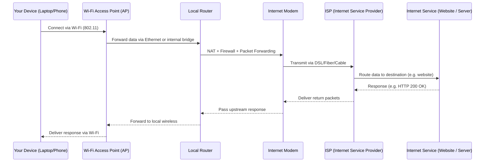
# 📚 Key Terms for Beginners

| **Term**         | **Meaning**                                                                 |
|------------------|------------------------------------------------------------------------------|
| **SSID**         | Network name (e.g., *"HomeWiFi"*)                                            |
| **DHCP**         | Automatically assigns an IP address to your device                          |
| **NAT**          | Shares one public IP among multiple private devices                         |
| **IP Address**   | A unique number identifying your device on a network                        |
| **DNS**          | Converts website names (like `google.com`) into IP addresses                |
| **Gateway**      | Routes traffic between your local network and the internet                  |
| **Subnet Mask**  | Defines the network range (usually `255.255.255.0` for home networks)        |
| **ISP**          | Internet Service Provider (e.g., **Jio**, **Airtel**, **BSNL**)              |

---

# 🏠 Real-World Analogy

**Think of your Wi-Fi Access Point like a receptionist at an office:**

- 🧑‍💻 You (*the device*) ask the receptionist for internet access.
- 🪪 The receptionist gives you an **ID badge** (*IP address*).
- 📤 When you send a letter (*data*), the receptionist logs your name and sends it out.
- 📥 When mail comes back (*a reply*), the receptionist knows it's for you and hands it over.

---

# ✅ Final Summary

📶 Your **device** connects to the **Access Point (AP)** via **Wi-Fi**.

- The **AP/router** assigns your device an IP address using **DHCP**.
- Your device sends **data to the internet**, and the AP handles the forwarding.
- The AP uses **NAT** to allow multiple devices to **share one internet connection**.
- Incoming data is routed **back to the correct device** using the IP address.

---

# 📡 The AP is your **wireless gateway** to the digital world!

> ➡️ **Part 4 assumed an Access Point.** Part 5 asks: what if there is *no* AP — or the AP is a public hotspot that should feel like cellular? Ad-Hoc, Wi-Fi Direct, Passpoint, then Wi-Fi Aware.

---

# 🧱 PART 5 · Peer-to-Peer & Public Wi-Fi

> **What's ahead:** **Ad-Hoc (IBSS)** first (the old no-AP mode), then **Wi-Fi Direct** (a Group Owner *emulates* an AP). Direct is covered in two passes: a protocol walk, then a **formation-types** recap — same mechanism, two angles. Then **Hotspot 2.0 / Passpoint** (public Wi-Fi that logs you in like a SIM), then **Wi-Fi Aware / NAN** (discover neighbors with no AP and no internet).

---

# 📡 Ad-Hoc & Wi-Fi Direct (P2P) Operation - Deep Technical Dive

This guide explores two decentralized wireless networking models:

* **Ad-Hoc Mode** (IBSS - Independent Basic Service Set)
* **Wi-Fi Direct** (P2P - Peer-to-Peer Mode)

---

## 🧩 1. Ad-Hoc Mode (IBSS)

### 🔍 Concept

Ad-Hoc mode allows Wi-Fi-capable devices to communicate directly without an access point (AP). It's useful for simple, short-term or mesh-like wireless networks.

### ⚙️ Technical Characteristics

- **No Access Point**: Fully peer-to-peer.
- **Shared SSID**: All devices use the same SSID and channel.
- **Randomized BSSID**: Typically the MAC address of the initiating node.
- **Beaconing**: All nodes may send beacon frames; one acts as a timing master.
- **Frame Addressing**:
  - `To DS = 0`, `From DS = 0`
  - `Address1 = Destination`, `Address2 = Source`, `Address3 = BSSID`

### 🔄 Formation Process

1. One device creates an IBSS with an SSID and channel.
2. Others scan and join by matching SSID and channel.
3. Synchronization and periodic beaconing occur.

### ⚠️ Limitations

- ❌ No QoS
- ❌ No security enforcement (encryption optional)
- ❌ Poor power management
- ⚠️ Poor scalability; not suitable for complex networks
- ⚠️ Largely deprecated in modern OSes

> ➡️ **Ad-Hoc is the old, unstructured no-AP mode.** Wi-Fi Direct keeps the “no traditional AP” idea but elects a **Group Owner** so security and DHCP work like infrastructure.

---

# 🔁 Wi-Fi Direct (P2P) – Deep Technical Dive

---

## 🧠 Concept

Wi-Fi Direct allows two or more Wi-Fi-enabled devices to communicate directly **without needing a traditional Access Point (AP)**. It builds upon the **IEEE 802.11 standard** and adds functionality via the **Wi-Fi Alliance P2P specification**.

Unlike Ad-Hoc (IBSS), Wi-Fi Direct introduces structure and security by **emulating infrastructure mode** — one device becomes a **Group Owner (GO)**, and others become **clients**.

---

## 🏗️ System Architecture

### 👤 Entities and Their Roles

| Entity             | Role                                                                 |
|--------------------|----------------------------------------------------------------------|
| **P2P Device**     | A Wi-Fi-capable device with P2P support (e.g., smartphone, printer)  |
| **Group Owner (GO)**| Becomes a soft AP for the group                                      |
| **P2P Client**     | Joins a group managed by the GO                                      |
| **Persistent Group**| Previously formed group remembered for seamless reconnection         |
| **WPS Registrar**  | Manages key exchange and PIN/PBC security during provisioning        |

---

## 📶 Under-the-Hood Protocol Stack

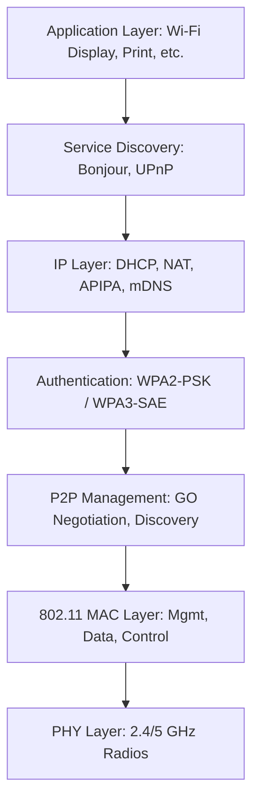

## 🧭 Group Formation - Deep Protocol Phases

### Phase 1: **Device Discovery**

- Uses **social channels** (1, 6, 11).
- Devices alternate between **search** and **listen** states.
- **Probe Requests** and **Probe Responses** carry **P2P IE (Information Element)**:
  - `P2P Capability`
  - `Device Info` (MAC, device name, etc.)
  - `Group Info`
  - `Channel List`
  - `Intended P2P Interface Address`

🧪 Tools: Capture traffic in **Wireshark** (Monitor Mode), filter on `wlan.fc.type_subtype == 0x04` (probe req) and `0x05` (probe resp)

---

### Phase 2: **GO Negotiation**

A three-way handshake to decide who becomes **Group Owner**:

1. **GO Negotiation Request**
2. **GO Negotiation Response**
3. **GO Negotiation Confirmation**

> 📌 Each device declares a **GO Intent value (0–15)** in the P2P IE.
> The higher number wins. If equal, a **tie-breaker bit** is used.

P2P IE contains:

- `GO Intent`
- `GO Device Address`
- `Config Timeout`
- `Operating Channel`

---

### Phase 3: **Provisioning (Authentication)**

Once the GO is elected:

- The group is provisioned via **Wi-Fi Protected Setup (WPS)** using:
  - **Push Button Configuration (PBC)**
  - **PIN Entry** (display or input)

> 🔐 WPA2-PSK or WPA3-SAE key generation occurs here.

Each device undergoes a **4-way handshake** post-WPS to establish **Pairwise Temporal Keys (PTKs)**.

---

### Phase 4: **Group Formation**

- GO creates a **soft AP interface** (e.g., `p2p-wlan0-0`)
- Starts **beaconing** with:
  - SSID like `DIRECT-XY-[DeviceName]`
  - Beacon frames carry **P2P IE** and **WPS IE**
- Clients scan, authenticate, associate, and obtain an IP via **DHCP** or **APIPA**

---

### Phase 5: **Persistent Groups**

- Devices cache:
  - Group SSID
  - PSK credentials
  - Roles (GO or Client)
- On rediscovery, they reconnect **without repeating GO negotiation**.

---

### Phase 6: **Autonomous Group Formation**

- A device **preemptively** becomes GO:
  - Creates a group locally
  - Beacon frames announce the group
- Other P2P devices may scan and connect directly

---

## 🌐 After Group Formation - Layer Breakdown

| Layer        | Description                                                                 |
|--------------|------------------------------------------------------------------------------|
| **Beaconing**| GO sends beacon frames with P2P IE and SSID                                 |
| **Auth**     | WPA2/WPA3 encryption (like standard AP-based Wi-Fi)                         |
| **IP Address**| GO typically runs a **DHCP server**; Clients get IP dynamically            |
| **Power Save**| P2P clients can enter PS mode; GO uses **Notice of Absence (NoA)**         |
| **Service Discovery** | Clients query GO using **DNS-SD**, **Bonjour**, or **UPnP**        |

---

## 🖥 Implementation Details

### 🧪 Linux Stack

| Layer               | Implementation Tool             |
|---------------------|---------------------------------|
| User API            | `wpa_cli`, `wpa_supplicant.conf`|
| Control Interface   | `D-Bus` or `wpa_cli`            |
| Driver Interface    | `nl80211` (netlink interface)   |
| Kernel Driver       | `mac80211` + vendor-specific    |
| Interface Names     | `p2p-dev-wlan0`, `p2p-wlan0-0`  |

### 🧪 Android APIs

- **WifiP2pManager**
  - `initialize()`
  - `discoverPeers()`
  - `connect()`
  - `createGroup()`
  - `requestConnectionInfo()`

📦 Framework interacts with `wpa_supplicant` via Android's HAL → netd → kernel.

---

## 🔁 Wi-Fi Direct Group Formation: Sequence Diagram

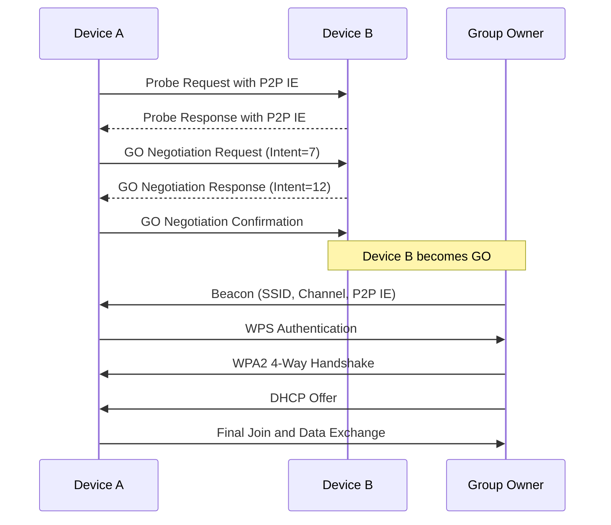


## 🗂️ Comparison Table

| Feature                 | Ad-Hoc (IBSS)     | Wi-Fi Direct (P2P)       |
|------------------------|------------------|--------------------------|
| Central Control         | ❌ None           | ✅ GO as soft AP          |
| Security                | ❌ Optional       | ✅ WPA2/WPA3               |
| Power Management        | ❌ Poor           | ✅ NoA, P2P PS             |
| Discovery               | ❌ Manual         | ✅ Standardized            |
| Persistent Groups       | ❌ Not supported  | ✅ Auto reconnect          |
| Service Discovery       | ❌ No             | ✅ Bonjour, UPnP, mDNS     |
| MAC Header Format       | IBSS style        | Infrastructure style      |
| IP Assignment           | ❌ Manual/Static  | ✅ DHCP/APIPA              |
| OS Support              | ⚠️ Deprecated     | ✅ Widely supported        |
| Internet Sharing        | ❌ Manual NAT     | ✅ GO shares via NAT       |
| Multi-hop Support       | ❌ Not supported  | ⚠️ Limited                 |

---

## 🧪 Use Cases

### Ad-Hoc (IBSS)

- Quick file sharing (legacy devices)
- Sensor networks
- Military/field communications
- Offline, infrastructure-less networking

### Wi-Fi Direct (P2P)

- Android Nearby Share, AirDrop-style transfers
- Wi-Fi printing (printer is GO)
- Wireless displays (Miracast)
- IoT provisioning
- Game console linking

---

# 🔁 Wi-Fi Direct (P2P) Group Formation – Deep Dive

> **Note:** This section expands on the *Group Formation – Deep Protocol Phases* covered earlier. The earlier section walks through the phases sequentially (Discovery → GO Negotiation → Provisioning → Group Formation → Persistent → Autonomous); this one re-frames the same mechanisms as four **formation types**. Read them together rather than as separate processes.

Wi-Fi Direct allows two or more Wi-Fi devices to communicate **without a traditional access point**, using standard 802.11 protocols enhanced by P2P negotiation, provisioning, and discovery mechanisms.

---

## 📚 Overview of Group Formation Types

| Type                 | Description                                                                 |
|----------------------|-----------------------------------------------------------------------------|
| **Standard GO Negotiation** | Two devices negotiate a GO (Group Owner) via intent value exchange        |
| **Persistent Group**        | Devices remember credentials and roles from a previous session            |
| **Autonomous GO**           | One device self-declares as GO and starts broadcasting                   |
| **Invitation Procedure**    | Reconnection to a persistent group using invitation request/response     |

---

## 1️⃣ Standard GO Negotiation (Dynamic Formation)

### ✅ Use Case:
- First-time connection between devices.
- Neither device pre-configured as GO.

### 🧭 Step-by-Step:

1. **Device Discovery**
   - Devices scan social channels (1, 6, 11)
   - Exchange `Probe Request/Response` with P2P IE (Information Element)

2. **GO Negotiation Phase**
   - Device A sends: `GO Negotiation Request (Intent = 7)`
   - Device B replies: `GO Negotiation Response (Intent = 10)`
   - Device A confirms: `GO Negotiation Confirmation`
   - Higher `Intent` wins; if tied, a tiebreaker bit is used.

3. **Provisioning Phase**
   - WPS setup (Push Button / PIN)
   - Device roles are temporarily established
   - Credentials (PSK or SAE) exchanged securely

4. **Group Formation**
   - GO starts beaconing with `DIRECT-XXXX` SSID
   - Client performs `WPA2 4-Way Handshake`
   - DHCP negotiation assigns IP to client

### 📊 Packet Exchange:

| Sender     | Message                                  |
|------------|------------------------------------------|
| A          | Probe Request (P2P IE)                   |
| B          | Probe Response (P2P IE)                  |
| A → B      | GO Negotiation Request                   |
| B → A      | GO Negotiation Response                  |
| A → B      | GO Negotiation Confirmation              |
| B (GO)     | Beacon Frames (SSID, P2P Group Info)     |
| A → GO     | WPS Authentication                       |
| GO ↔ A     | WPA2 4-Way Handshake                     |
| GO → A     | DHCP Offer (if using DHCP)               |

---

## 2️⃣ Persistent Group

### ✅ Use Case:
- Devices have connected before.
- Bypass full GO negotiation next time.

### 🧭 Key Characteristics:

- During provisioning, both devices may agree to **store credentials** (via `Persistent` flag).
- On reconnection, either side can send an **Invitation Request** to rejoin a group.
- The previously elected GO resumes its role.

### 📦 Messages:
- `Invitation Request` → contains Group Info and optional GO role indication
- `Invitation Response` → acknowledges group restoration

---

## 3️⃣ Autonomous GO

### ✅ Use Case:
- A device wants to act as an AP-like server without negotiation.

### 🧭 Behavior:

- Device configures itself as a **Group Owner** in advance.
- Immediately starts beaconing with `DIRECT-XXXX` SSID on a chosen channel.
- Waits for peers to join (like a soft AP).
- No GO negotiation is required.

### 📝 Real-World Examples:
- Smart TVs, printers, or file servers acting as permanent GOs.
- Miracast source devices like laptops.

---

## 4️⃣ Invitation Procedure (Re-Forming Persistent Groups)

### ✅ Use Case:
- Fast reconnection to an existing group.
- Especially useful for app-to-app communications.

### 🧭 Steps:

1. Device A sends `P2P Invitation Request`
   - Includes: Persistent Group ID, Device Address, and optionally GO intent
2. Device B responds with `P2P Invitation Response`
   - Includes status (accepted, rejected, timed out)

---

## 🛠️ Architecture Summary Diagram (Mermaid)

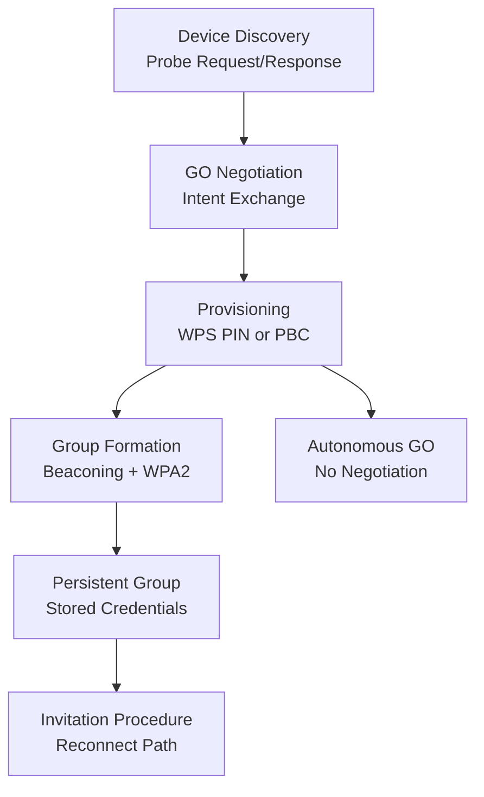

## 📦 P2P Information Elements (IE) in Wi-Fi Frames

P2P-specific data is embedded in standard Wi-Fi frames (e.g. Beacons, Probe Requests, GO Negotiation frames).

### 🧬 P2P IE Structure

Each P2P IE follows this format:

* **Element ID**: `0xDD` (Vendor Specific)
* **Length**: Total length of this IE
* **OUI**: `50 6F 9A` (Wi-Fi Alliance OUI)
* **OUI Type**: `09` (P2P)
* **P2P Attributes**: Sequence of TLV (Type-Length-Value) blocks

### 📄 Example P2P Attributes

| Type | Attribute Name        | Description                    |
| ---- | --------------------- | ------------------------------ |
| 2    | P2P Capability        | Group/Device capabilities      |
| 3    | P2P Device ID         | MAC address of device          |
| 4    | Group Owner Intent    | GO score: higher wins          |
| 5    | Configuration Timeout | Timeout during connection      |
| 9    | P2P Group ID          | SSID + Device Address          |
| 11   | Channel List          | Supported channels/frequencies |
| 12   | Notice of Absence     | Power saving scheduling        |
| 13   | Device Info           | Manufacturer, device name, etc |

> *(Attribute Type values follow the Wi-Fi Alliance P2P Technical Specification; the exact numbering is what distinguishes each attribute inside the P2P IE.)*

### 📘 Used In Frames:

* Probe Request/Response
* GO Negotiation Request/Response/Confirm
* Association Request
* Beacon (for GO)

### 🧠 Notes:

* Devices parse P2P IE to evaluate capabilities of peers.
* Helps determine channel, WPS method, intent score, etc.
* `Group Owner Intent` plays a major role in deciding who becomes GO.

---

## ⚖️ Ad-Hoc vs P2P (Wi-Fi Direct)

> See the fuller **Comparison Table** in the previous Wi-Fi Direct section (Central Control, Security, Power Management, Discovery, Persistent Groups, Service Discovery, MAC Header Format, IP Assignment, OS Support, Internet Sharing). In short: Wi-Fi Direct requires no AP yet behaves like infrastructure mode (a Group Owner acts as a soft AP), automates setup via WPS, supports persistent groups and standardized service discovery, and is widely deployed (Miracast, printing, file sharing) — whereas Ad-Hoc/IBSS is manual, largely deprecated, and rarely used today.

---

## 🔍 Key Takeaways

* **Wi-Fi Direct** is more feature-rich and secure than **Ad-Hoc**.
* Uses **standard Wi-Fi infrastructure** (beacons, authentication).
* **Group Owner Negotiation** is core to the protocol.
* IEs are crucial for capability sharing and negotiation.
* Often abstracted by software like **wpa\_supplicant**, but you can observe it via packet capture tools (e.g. Wireshark).

---

# 📡 Wi-Fi Direct, Hotspot 2.0 and Advanced Wi-Fi Operation

> ➡️ **P2P was devices talking to each other.** Hotspot 2.0 is the opposite problem: a **public AP** that should connect you automatically and securely — like walking into a cell tower, not typing a café password.

---

## 🌐 Hotspot 2.0 / Passpoint Deep Dive

### 📘 What is Hotspot 2.0 / Passpoint?

* **Hotspot 2.0**, also known as **Passpoint**, is a Wi-Fi Alliance certification aimed at making public Wi-Fi access seamless and secure—just like cellular networks.
* Built on **IEEE 802.11u**, with extensions for secure authentication, automatic provisioning, and roaming.

### 🧠 Key Concepts

| Term          | Meaning                                                                                             |
| ------------- | --------------------------------------------------------------------------------------------------- |
| **ANQP**      | Access Network Query Protocol — protocol for client to discover network details before associating  |
| **OSU**       | Online Sign-Up — secure method to provision credentials over HTTPS                                  |
| **EAP**       | Extensible Authentication Protocol — supports secure authentication like EAP-TTLS, EAP-SIM, EAP-AKA |
| **AAA**       | Authentication, Authorization, Accounting — back-end service, often RADIUS                          |
| **NAI Realm** | Network Access Identifier — identifies home service provider                                        |
| **HESSID**    | Homogeneous Extended Service Set ID — like BSSID, used to identify network groups                   |

### 📡 Operational Flow

1. **Discovery Phase**

   * Client sends Probe Request
   * AP responds with **ANQP Response** containing:

     * Supported Roaming Consortium
     * Venue Name
     * Network Type (e.g., free, commercial)
     * NAI Realms
     * IP Capability
     * WAN Metrics

2. **Authentication**

   * If client has credentials for roaming consortium, it connects using EAP (e.g., EAP-SIM/TTLS/AKA)
### 🔧 Backend RADIUS + EAP (TTLS / SIM / AKA)

When the client decides to authenticate, the access point forwards the authentication to a **RADIUS server**, which handles AAA (Authentication, Authorization, Accounting).

#### 🔐 EAP-TTLS Flow (Username + Password)

1. Client sends EAP-Request to AP
2. AP forwards to RADIUS server
3. RADIUS and client set up TLS tunnel
4. Inside the tunnel, user credentials are validated
5. If valid, server sends EAP-Success
6. Session keys are derived → 802.11 association completed

#### 📱 EAP-SIM / EAP-AKA (SIM-Based Auth)

* Used in mobile devices (smartphones, tablets)
* SIM card generates authentication tokens
* RADIUS server forwards to **Mobile Core** or **HSS/HLR** to validate SIM
## 🔐 What Happens After SIM Authentication Request?

Once the RADIUS server forwards the SIM-based request to the HSS/HLR, the authentication proceeds as follows:

### 1. HSS/HLR Generates Authentication Vectors
- **RAND**: Random challenge
- **AUTN**: Authentication token
- **XRES**: Expected response
- **Kc** (EAP-SIM) or **CK/IK** (EAP-AKA)

### 2. Challenge Sent to Client
- RADIUS forwards **RAND** and **AUTN** to the client via the AP.

### 3. SIM Processes Challenge
- Verifies **AUTN** for freshness.
- Computes **RES** (Response) using internal keys and RAND.

### 4. Client Sends EAP-Response
- Sends **RES** back to the RADIUS server.

### 5. RADIUS Validates
- Compares RES with **XRES** from HSS.
- If matched → sends **EAP-Success**.
- If not → sends **EAP-Failure**.

### 6. Secure Key Derivation
- **MSK** derived and sent to the AP.
- AP and client derive session keys (**PTK**) for encryption.

> ✅ At this point, the device is fully authenticated and securely connected.
  
* Enables **seamless roaming** just like LTE/5G

#### 🔐 Certificates (EAP-TLS)

* Uses X.509 certificates on both client and server
* Strongest security, but provisioning is harder

### 🧪 Real Frame Exchange

* **Client sends:** Probe Request (with Hotspot 2.0 capability)
* **AP replies with:** Probe Response + ANQP advertisement
* **Client issues:** ANQP Query (NAI Realm, Roaming Consortium, etc.)
* **AP sends:** ANQP Response
* **Client decides:** Whether to authenticate or use OSU provisioning
* **Authentication:** EAP-based (handled via RADIUS)

3. **Provisioning (if no credentials)**

   * Client connects to **OSU SSID**
   * HTTPS used to securely download a profile
   * Device stores credentials for future use
## 🛠️ Post-OSU Behavior in Hotspot 2.0

After the client completes OSU (Online Sign-Up), the next steps are critical for full connectivity.

### 🔁 What Happens After OSU?

1. **Connects to OSU SSID**
   - A special open SSID, used only for provisioning (not regular internet access)

2. **Secure Profile Download via HTTPS**
   - Profile includes:
     - Credentials (certificate, SIM ID, or user/pass)
     - EAP method to use
     - Provider and roaming info

3. **Profile Installation**
   - Client stores the downloaded Passpoint configuration securely

4. **Disconnect from OSU SSID**
   - OSU SSID is temporary — not used for data communication

5. **Reconnect to Passpoint SSID**
   - Client scans for Passpoint networks
   - Matches a provider from the installed profile
   - Authenticates using 802.1X (EAP method)
   - Secures a full connection

> ✅ Final connection is encrypted and authenticated — suitable for real internet usage.

4. **Roaming**

   * Once provisioned, user can roam between providers using same identity (SIM, certificate, username)

### 📦 Hotspot 2.0 Information Elements

| IE Name                 | Description                                                   |
| ----------------------- | ------------------------------------------------------------- |
| Interworking IE         | Advertises network type, access (emergency, chargeable, etc.) |
| Roaming Consortium IE   | Lists OI (Organization Identifiers) for partner networks      |
| HESSID                  | Identifies the extended network group (like cellular PLMN)    |
| WAN Metrics IE          | Indicates network bandwidth, load, etc.                       |
| Venue Name IE           | Human-readable venue description                              |
| IP Address Availability | Shows whether IPv4/IPv6 is supported                          |
| Connection Capability   | Lists accessible TCP/UDP ports                                |


# Hotspot 2.0 (Passpoint) Connection Flow – Real-World Example: Starbucks in Seoul (KT)

> ➡️ **Same Passpoint protocol, one walk-through.** ANQP → match profile → EAP (or OSU) → 4-way. Read this as a story, not a new standard.

## ☕ You walk into Starbucks in Seoul
You’re carrying an Android phone with **Passpoint (Hotspot 2.0)** support.

**Starbucks Wi-Fi** is managed by **KT (Korea Telecom)**, a Passpoint provider.

---

## 📶 Step 1: Device detects Passpoint SSID

- The SSID might look like: `KT_WiFi_Passpoint` (or it may not be visible at all if it's hidden).
- Android scans and sees this is a **Hotspot 2.0-capable** access point, based on **beacon frames** containing:
  - `Interworking` element
  - `Roaming Consortium`, `NAI Realm`, and `Venue Info` advertised

➡️ This triggers the **ANQP (Access Network Query Protocol)** process.

---

## 🔍 Step 2: ANQP Query sent by device

The device sends a **GAS (Generic Advertisement Service)** request to ask the AP:

- “What **realms** do you support?”
- “What **roaming partners** do you have?”
- “What’s your **venue name**, **WAN status**, **OSU providers**?”

> These are ANQP queries encapsulated in **802.11u** frames.

---

## 📬 Step 3: AP responds with ANQP Response

The AP sends back the **ANQP advertisement**, containing:

| Field | Value |
|-------|-------|
| **NAI Realm** | `kt.com` |
| **Roaming Consortium OIs** | `50-6F-9A` (KT), `00-1B-2F` (Boingo) |
| **WAN Metrics** | Up, 150Mbps DL / 40Mbps UL, unmetered |
| **Venue Name** | `"Starbucks Korea"` |
| **OSU Provider Info** | `"KT Wi-Fi Pass"` with `https://osuserver.kt.com/signup` |

---

## 🧠 Step 4: Phone matches ANQP info to its profiles

### 📱 Case 1: KT SIM user

- Device sees `NAI Realm: kt.com`
- It checks its SIM and finds it belongs to `kt.com`
- Auth method supported: **EAP-SIM**

✅ **Decision**: Proceed with **EAP-SIM authentication** automatically.

---

### 📱 Case 2: Boingo Subscriber

- SIM isn’t from KT
- But device has a **provisioned profile** for **Boingo**
- It compares **Roaming Consortium OI**: `00-1B-2F` matches
- EAP-TTLS or EAP-TLS may be supported

✅ **Decision**: Proceed with authentication using **Boingo credentials**

---

### 🚫 Case 3: No match

- No SIM from KT
- No roaming OI match
- Device sees there's an **OSU (Online Sign-Up) Provider**

✅ **Decision**: Show user a **signup screen** using OSU server:  
`https://osuserver.kt.com/signup`

---

## 🔐 Step 5: Authentication (EAP)

If a profile matches:

| EAP Method | Use Case |
|------------|----------|
| **EAP-SIM / EAP-AKA** | Mobile operator SIM authentication |
| **EAP-TTLS** | Username/password or tunneled auth |
| **EAP-TLS** | Certificate-based authentication (OpenRoaming, Eduroam) |

- The AP acts as an **EAP Authenticator**
- It forwards credentials to a **RADIUS server** (typically run by KT or a federation partner)

✅ If accepted → **Client joins the secure network**

---

## 🧾 Step 6: Online Sign-Up (OSU) – If No Auth Info

If user has **no profile or roaming credentials**, but sees the **OSU provider**:

1. Android shows: _“Sign up with KT Wi-Fi Pass”_
2. User taps to launch **OSU provisioning**
3. This opens a **web browser or app** using **SOAP-based OMA-DM** (behind the scenes)

The client:

- Retrieves provisioning info (EAP method, root CA, credential)
- Installs a **Passpoint profile**
- Reconnects and authenticates **automatically**

✅ **Seamless onboarding!**

---

### 🆚 Regular AP vs Passpoint AP

| Feature              | Regular Wi-Fi   | Passpoint (HS2.0)    |
| -------------------- | --------------- | -------------------- |
| Auto Sign-In         | ❌ Manual        | ✅ Seamless           |
| SIM Auth             | ❌ No            | ✅ Yes (EAP-SIM/AKA)  |
| Roaming              | ❌ Rare          | ✅ Standardized       |
| Security             | WPA2-PSK        | WPA2/WPA3 Enterprise |
| Venue Info           | ❌ No            | ✅ Venue IE           |
| Profile Provisioning | ❌ Not supported | ✅ OSU                |

---

# 📡 Wi-Fi Aware (NAN) and Advanced Wi-Fi Operation

> ➡️ **Direct needs a Group Owner. Passpoint needs an AP.** NAN is the third peer model: devices form a **cluster**, sync on a clock, and **publish/subscribe** services — no AP, no internet, no GO.

---

## 📘 What is Wi-Fi Aware (NAN - Neighbor Awareness Networking)?

* **Wi-Fi Aware** is a peer-to-peer discovery and communication protocol defined by the **Wi‑Fi Alliance Neighbor Awareness Networking (NAN) specification** (built on top of standard 802.11 management/data frames). ⚠️ *Note: NAN is a Wi‑Fi Alliance spec, **not** an IEEE amendment — don't confuse it with **802.11mc**, which is the maintenance revision that standardized **FTM/RTT** (ranging), a different feature covered later in this guide.*
* Enables continuous background discovery without requiring an internet connection or access point.
* Built for **proximity-based services**: file sharing, multiplayer gaming, location-aware apps, etc.
* Unlike Wi-Fi Direct, Wi-Fi Aware focuses more on discovery and low-latency communication using a shared aware infrastructure.

---

## 🧠 Key Concepts

| Term                            | Meaning                                                               |
| ------------------------------- | --------------------------------------------------------------------- |
| **NAN Master Indication (NMI)** | Indicates which peer acts as the synchronization anchor               |
| **Service Hash**                | Unique hash that represents a service being advertised                |
| **Discovery Window**            | Time interval when nodes wake up to listen or transmit                |
| **Publish / Subscribe**         | Core paradigm — advertise (publish) or listen (subscribe) to services |
| **SDF / FSD / USF**             | Types of Service Discovery Frames: Solicited/Unsolicited              |
| **NAN Cluster**                 | Group of devices synchronized via a Master Election protocol          |
| **Synchronization Beacon**      | Broadcast by master to maintain time sync across cluster              |

---

## 🔄 Operational Workflow

## 📡 Cluster Formation in Wi-Fi Aware (NAN)

When devices participate in a Wi-Fi Aware (NAN) network, they go through the **Discovery and Synchronization Phase** to form or join a cluster.

---

### 🔍 1. Passive Scanning for NAN Beacons
- Each device **listens on social channels** (usually 2.4 GHz: ch 6 and/or 5 GHz).
- They **scan for existing NAN Sync Beacons** to check if a cluster is already active.

---

### 🧠 2. Cluster Detection Logic
- If a device **detects existing beacons**, it may:
  - Join the cluster as a **synchronized node (Slave)**.
  - Align its **Timing Synchronization Function (TSF)** with the Master.

- If **no beacons are found** within a given scan period:
  - The device **elects itself as Master**.

---

### 🕒 3. Sync Beacon Transmission
- The **Master node** begins sending periodic **NAN Sync Beacons**.
- These beacons include:
  - **NAN Timing Window (NTW) schedule**
  - **Cluster ID**
  - **Master Preference**
  - **Availability windows (for data exchange)**

---

### 🤝 4. Cluster Joining by Other Devices
- Other NAN-capable devices receive the Sync Beacons.
- They evaluate:
  - Master preference
  - Clock stability
  - Signal strength
- Then they **synchronize to the Master** and join as **Slaves**.

---

### 🔁 5. Master Reelection (if needed)
- Devices may monitor **Master quality** (e.g., missed beacons, low preference).
- If the Master fails or a better Master appears:
  - A new Master may be **elected dynamically**.

---

### 📦 Protocol Elements in NAN Sync Beacon
- **Service Discovery Frame (SDF)**
- **NAN Sync Parameters**
- **Timing Sync Info**
- **Cluster Information**

---

### 📘 Summary:
| Role          | Function                                 |
|---------------|------------------------------------------|
| Master        | Sends Sync Beacons; defines NTW schedule |
| Slave         | Syncs with Master; joins cluster         |
| Beacon        | Broadcasts timing, cluster ID, roles     |
| Reelection    | Triggered by failure or higher preference|

---

> ✅ This cluster formation ensures devices share a common time reference and can discover services or communicate with low power.


### 2. **Service Discovery (Publish / Subscribe)**

* **Publish**:

  * Device announces a service (e.g., multiplayer game available).
  * Can be **solicited** (expects a response) or **unsolicited**.

* **Subscribe**:

  * Another device listens for service hash that matches.
  * If match is found, a response is sent.

* Discovery uses **NAN SDF frames** with TLVs (Type-Length-Value):

  * Service Hash
  * Service Info
  * Match Filter

### 3. **Secure Data Path Setup (NAN Data Path - NDP)**

* After discovery:

  * Devices exchange **NDP Setup Request / Response**
  * Negotiate channel, security (e.g., PMKID, MAC addresses)
  * Establish a **direct peer-to-peer data path** using Wi-Fi

* Uses **NDI (NAN Data Interface)** to send traffic outside of traditional IP stack

---

## 🧬 Wi-Fi Aware Frame Types

| Frame Type                        | Description                                                  |
| --------------------------------- | ------------------------------------------------------------ |
| **Sync Beacon**                   | Sent by master — includes timing, cluster ID                 |
| **Sync + Discovery**              | Combined frame for synchronization and service advertisement |
| **SDF (Service Discovery Frame)** | Carries service name, match filter, etc.                     |
| **NDP Setup Req/Resp**            | Used to initiate and confirm data path setup                 |
| **NDPE**                          | Encapsulation for sending user data over NDP                 |

---

## 🔒 Security

* NAN itself is discovery focused, but for NDP:

  * Encryption is possible with **PMK (Pairwise Master Key)** or **PMKID**
  * Some implementations rely on Wi-Fi Protected Management Frames
  * Identity protection is minimal by default — security is app-layer driven

---

## 🧪 Real-World Use Cases

| Use Case             | Description                                         |
| -------------------- | --------------------------------------------------- |
| Multiplayer Gaming   | Discover nearby players and establish data channel  |
| Contactless Payments | Authenticate and transact via NDP                   |
| Smart Home           | Devices automatically find and sync with each other |
| Location-Based Ads   | Proximity triggers messages or actions              |
| Device Pairing       | No need for QR scan or passwords                    |

---

# 📡 NAN (Wi-Fi Aware) Walkthrough: Discovery & Connection without Wi-Fi or Internet

> ➡️ **Deeper look, same protocol.** The previous chapter defined clusters, sync beacons, and NDP. This walkthrough is one concrete story (two phones in a park) so the same three steps — sync → discover → data path — stick.

## 🧠 What is NAN?

**NAN (Neighbor Awareness Networking)** — also branded as **Wi-Fi Aware** — enables Android (and other devices) to:

- **Discover nearby devices and services** _without internet or Wi-Fi connection_
- **Establish peer-to-peer data links** directly using Wi-Fi (NDP)

---

## 🎯 Use Case Scenario: Peer Discovery in a Park

Imagine you're at a park, and two Android users (Alice and Bob) open a multiplayer game app that supports **Wi-Fi Aware**:

- No mobile data or Wi-Fi
- Devices should discover each other automatically
- Then communicate directly (e.g., to start a game or share a file)

---

## 📶 Step 1: NAN Synchronization (Sync Beacons)

When NAN is enabled:

- Each device periodically sends **NAN Sync Beacons**
- These beacons contain timing and capability info
- Devices synchronize their internal clocks using these beacons

🛰 **Why?**  
To ensure that nearby devices "wake up" and listen at the same time, saving battery and enabling coordinated discovery.

> 💡 Devices can take on roles:
> - **Anchor Master**: Sends Sync Beacons regularly
> - **Master**: Follows Anchor Master timing
> - **Slave**: Follows timing from nearby Masters

---

## 🛰 Step 2: Service Discovery (NAN SDF Frames)

Once synchronized, devices can discover services:

- Apps on Alice and Bob’s phones **publish** or **subscribe** to services
- Example:  
  - Alice publishes: `{"game": "BattleChess", "version": "1.0"}`
  - Bob subscribes: `"game == BattleChess"`

📡 Devices send/receive **NAN Service Discovery Frames (SDFs)** during discovery windows.

| Type | Description |
|------|-------------|
| **Publish** | Advertise a service to nearby devices |
| **Subscribe** | Listen for services of interest |
| **Match** | When a publish matches a subscribe, both devices are notified |

✅ **Result**:  
Alice and Bob’s apps are notified: “A peer has been discovered!”

---

## 🤝 Step 3: Data Path Setup (NDP Negotiation)

Once services are matched, apps can initiate **NDP (NAN Data Path)** setup:

1. **Initiator (Bob)** sends **NDP Request Frame** to Alice
   - Includes: security info, interface, QoS

2. **Responder (Alice)** replies with **NDP Response Frame**
   - May accept or reject the connection

3. If accepted, an **NDP Confirm Frame** finalizes the data path, and:
   - Devices establish a **Wi-Fi peer-to-peer link** (not Wi-Fi Direct!)
   - Operates at Layer 2 (MAC), fast and direct

| Frame | Purpose |
|-------|--------|
| **NDP Request** | Start data session with peer |
| **NDP Response** | Accept/Reject the request |
| **NDP Confirm** | Finalize the data path |

✅ Result: Alice and Bob now have a direct data path (like a virtual LAN)

---

## 🔐 Security Considerations

- **MAC Randomization**: Devices use randomized MACs for privacy
- **Encrypted Payloads**: NDP supports encrypted communication
- **App permissions**: Apps must declare and request Wi-Fi Aware APIs

---

## 🔄 Session Lifecycle

| Phase | Activity |
|-------|----------|
| **Sync** | NAN Sync Beacons exchanged |
| **Discovery** | Service Publish/Subscribe + SDF |
| **Match** | Match event delivered to both devices |
| **NDP** | Request → Response → Confirm |
| **Data** | Secure Wi-Fi communication begins |
| **Teardown** | Either device can end session, resources released |

---

## 🧪 Developer APIs (Android)

To use NAN on Android:

- Use `WifiAwareManager` API
- Declare `android.hardware.wifi.aware` in manifest
- Request `ACCESS_FINE_LOCATION` permission

Example logic:
```java
WifiAwareManager manager = (WifiAwareManager) getSystemService(Context.WIFI_AWARE_SERVICE);
...
manager.attach(...);
session.publish(...);
```
---

## ⚙️ Internal MAC/PHY Layer Flow

1. **MAC Layer: NAN State Machine**

   * Handles cluster formation, master election, DW scheduling
   * Manages publish/subscribe SDF and beacon timing

2. **PHY Layer: Timing + Power Efficiency**

   * Leverages **target wake time (TWT)** and **low duty cycle sync**
   * Ensures high power efficiency for mobile nodes

3. **Data Plane Path (NDP)**

   * Operates outside TCP/IP stack
   * Traffic over **NDI interfaces**, bypassing IP routing
   * Ideal for low-latency, short-lived data transfers

---

## 📉 Comparison: Wi-Fi Direct vs Wi-Fi Aware

| **Feature**          | Wi-Fi Direct    | Wi-Fi Aware (NAN)          |
| ---------------- | --------------- | -------------------------- |
| Discovery        | One-time        | Continuous Background      |
| Sync Model       | Leader-Follower | Distributed Clustered Sync |
| Data Path        | IP-based        | Optional Direct NDP        |
| Power Efficiency | Moderate        | High (TWT, DW)             |
| Group Ownership  | Yes             | No (clustered peers)       |
| Internet Routing | Possible        | No (local only)            |

> ➡️ **Part 5 ends here.** You have three ways to talk without a classic home AP (Ad-Hoc, Direct, NAN) and one way a public AP can feel like cellular (Passpoint). Part 6 returns to **infrastructure**: moving between APs, packing frames efficiently, sleeping the radio, and changing band/channel.

---

# 🧱 PART 6 · Mobility, Efficiency & Power

> **What's ahead:** **802.11k/v/r roaming** (know / decide / skip the security line), then **fragmentation vs aggregation** (noisy air vs clean air), then **power-save** (legacy PS, U-APSD, TWT first look, CAM). Then **band switching** and **DFS** — the radio moving house. TWT gets a full protocol chapter in Part 8; here you only need “sleep on a schedule.”

---

## 🚶‍♂️ Fast & Smart Roaming in Wi-Fi: 802.11k / v / r

When you're moving around (like walking with your phone), Wi-Fi clients need to **switch between APs** — this is called **roaming**. Without optimizations, roaming can be slow or result in dropped packets.

### 📦 Purpose of 802.11k/v/r
| **Standard** | **Focus**         | **Goal**                                |
|--------------|------------------|-----------------------------------------|
| **802.11k**  | Knowledge         | Help clients discover better APs faster |
| **802.11v**  | Direction         | Let APs steer clients toward better APs |
| **802.11r**  | Speed             | Make roaming itself faster (Fast BSS Transition) |

---

## 🔍 802.11k – "Know Before You Roam"

**k = knowledge**

- AP provides a **neighbor report** (a list of nearby APs + their signal strengths, channels, BSSIDs).
- Client uses this to **pre-scan** and decide **where to roam next**.
- Reduces delay because the client **doesn't have to scan every channel** blindly.

### ✨ Example:
- Your phone asks the AP: “Who else is nearby?”
- The AP replies: “Here are 3 APs with good coverage.”

---

## 🧭 802.11v – "You Should Go Now"

**v = direction / suggestion**

- AP can suggest a better AP for the client to connect to.
- The frame is called a **BSS Transition Management (BTM) Request**.
- Used for **load balancing**, a weak signal, or “this AP is about to go away.”

### ✨ Example:
- AP says: “Hey client, your signal is weak. Please roam to AP-2 at -55 dBm.”
- **By default this is only advice.** The client chipset may accept or ignore it.

### ⚠️ When the suggestion becomes a warning — Disassociation Imminent

In a crowded cell, or when the AP is about to reboot, the controller can set the **Disassociation Imminent** flag inside that same BTM request:

1. The AP also includes a **Disassociation Timer** (often a few hundred milliseconds).
2. The client is told: when this timer hits zero, **this association will be cut**.
3. The request carries a **candidate list** (nearby APs, usually fed by the 802.11k neighbor report).
4. The client roams to one of those candidates *before* the timer expires, so a voice or video call does not sit in a long reconnect.

```text
  default 802.11v          AP: "please go to AP-2"     client: may stay
  Disassociation Imminent  AP: "go to AP-2, or I drop  client: roams now,
                           you in 200 ms" + candidates  using the list
```

> 🔑 **k finds the candidates, v points at them (and can set a deadline), r makes the security hop fast.** Together that is the “lightning roam.” The deadline does not magically guarantee zero dropped packets — it removes the long pause of scanning and re-authentication.

---

## ⚡ 802.11r – "Roam Fast (FT)"

**r = rapid roaming**

- Reduces the **authentication delay** when switching APs.
- Implements **Fast BSS Transition (FT)**.
- Pre-shares cryptographic keys (PMK-R0/R1) between APs.
- So when the client switches, it **doesn’t need full WPA2 handshake** again.

### ✨ Example:
- Without 802.11r: Roaming takes 300+ ms → noticeable lag (VoIP, gaming)
- With 802.11r: Roaming in ~50 ms → smooth handoff

### 🔑 Why it's faster — the key hierarchy

Normally, moving to a new AP means redoing the *entire* security dance: 802.1X/EAP (talk to the RADIUS server) **+** a fresh 4-way handshake. That's the 300 ms. 802.11r pre-computes a **tree of keys** from the first login so the new AP *already has* your key material:

```text
            First full login (once, at AP-1)
                      │  802.1X/EAP → MSK
                      ▼
                  PMK-R0   ──────── held by the "R0 Key Holder" (controller)
                 /   │   \
          PMK-R1  PMK-R1  PMK-R1   ← one per AP, pushed in ADVANCE to each AP
            │        │       │
          AP-1     AP-2    AP-3     ← every AP already holds your PMK-R1
```

### 🔄 Full re-auth vs Fast Transition (side by side)

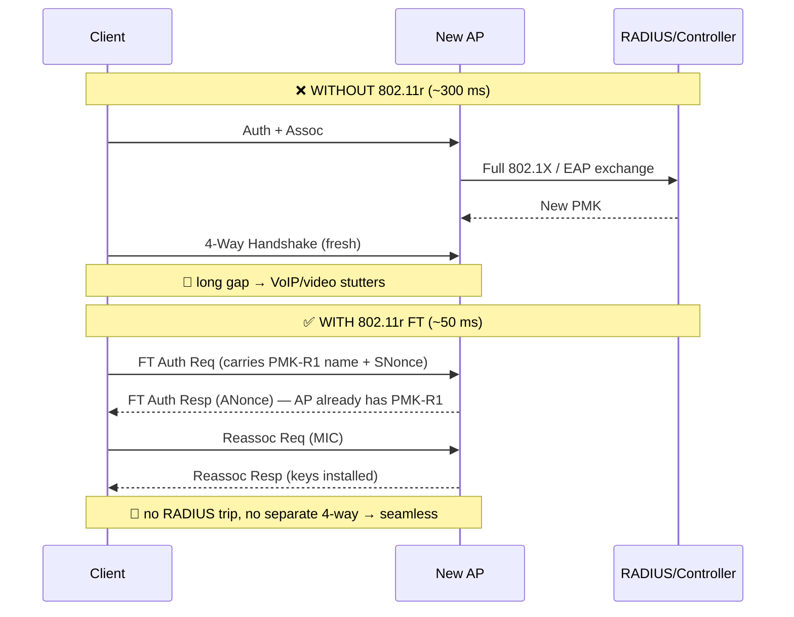

> 🔑 **The trick in one line:** 802.11r folds the 4-way handshake *into* the association frames (FT Auth + Reassociation) and skips the RADIUS round-trip, because every AP was handed your **PMK-R1** ahead of time. That's how a VoIP call survives you walking across a building.

---

## 📶 Summary Table

| **Feature** | **802.11k**              | **802.11v**                  | **802.11r**                          |
|-------------|---------------------------|-------------------------------|--------------------------------------|
| **Goal**    | AP Discovery               | Roaming Decision Assistance   | Fast Authentication Handoff         |
| **Main Idea**| Get neighbor list         | AP recommends better BSS      | Pre-authenticate before roaming      |
| **Client Control?** | Yes               | Yes by default; a **Disassociation Imminent** timer forces the move | Yes                                  |
| **Improves** | Scan time, battery life   | Load balancing, performance   | Handoff speed for real-time traffic  |
| **Best Use Case** | Large campus Wi-Fi   | Mesh / enterprise networks    | VoIP, video calls, low-latency apps  |

---

## ✅ Real World Analogy

> Imagine you're moving between conference rooms in a building with many Wi-Fi hotspots:

- 🧠 **802.11k** gives you a **map** of other nearby access points.
- 🧭 **802.11v** acts like a **guide**, telling you which door to take next.
- ⚡ **802.11r** gives you a **VIP pass**, letting you skip the security line when you arrive.

---

## 🛠️ How to Use These?

- Supported only if **both AP and client device** support these standards.
- Most modern enterprise APs (e.g., Cisco, Aruba, UniFi) support them.
- Most modern phones/laptops support **k/v**, and many also support **r**.
- Configuration is typically done in the **Wi-Fi controller / AP settings**.

> ➡️ **Roaming was about staying connected while you move.** The next chapter is about the **size of what you send**: break a frame up when the air is noisy, glue frames together when it is clean.

---

# 🔗 Fragmentation & Aggregation in Wi-Fi

In Wi-Fi, **performance** and **reliability** are affected by how data is packaged and transmitted. Two techniques that help optimize wireless communication are:

- **Fragmentation** – Breaking data into smaller pieces.
- **Aggregation** – Combining multiple data packets into one.

---

## ✂️ Fragmentation in Wi-Fi

### 📍 What is it?

**Fragmentation** divides a large data frame into smaller parts (fragments) before transmission.

### 💡 Why it’s used:

- To **reduce retransmission time** if a packet is lost or corrupted.
- Smaller fragments have a **higher chance of successful delivery**, especially in noisy environments.

### 🧠 How it works:

1. A large data frame is split into smaller fragments.
2. Each fragment is sent with its own **header** and **checksum**.
3. Only the **lost or corrupted fragment** needs to be retransmitted.

#### ⏱️ Fragmentation timing — a burst locked together by SIFS

The sender transmits fragments **one after another**, each **ACKed** individually, with only a tiny **SIFS** gap between them. Two header fields make it work:
- **More Fragments bit (= 1)** means "another fragment follows" (the last one sets it to 0).
- **Fragment Number** (in Sequence Control) lets the receiver reassemble them in order.

Because each gap is a SIFS (shortest), **no other station can jump in** mid-burst — the sender keeps the medium for the whole frame.

```text
      │◄─Frag0──►│    │◄─Frag1──►│    │◄─Frag2──►│
 TX ──┤ MF=1     ├SIFS┤ MF=1     ├SIFS┤ MF=0     ├──── (done)
      │ seq=5,f0 │    │ seq=5,f1 │    │ seq=5,f2 │
 RX ──────────SIFS┤ACK├──────SIFS┤ACK├──────SIFS┤ACK├─
                  ▲0            ▲1            ▲2
                                                 ▲ MF=0 → last fragment,
                                                   receiver reassembles 0+1+2
```

**If a fragment is lost** (say Frag1's ACK doesn't return), only **Frag1** is resent — not the whole frame:

```text
 TX ──┤Frag0├SIFS┤Frag1├ ...no ACK... ┤Frag1 (retry)├SIFS┤Frag2├
 RX ──────┤ACK├        ✗ lost              ┤ACK├          ┤ACK├
```

> 🔑 **Why bother?** On a noisy link, a *big* frame is very likely to hit at least one bit error — and then the **whole** thing must be resent. Splitting into small fragments means a hit only costs you **one small fragment**. It's the mirror image of aggregation: *fragmentation trades overhead for reliability (noisy air); aggregation trades reliability for efficiency (clean air).*

### ✅ Benefits:

- **Improved reliability** in environments with high interference.
- **Faster recovery** from transmission errors.

### ❌ Drawbacks:

- **More overhead** due to extra headers.
- Can **reduce throughput** if not managed properly.

---

## 📦 Aggregation in Wi-Fi

### 📍 What is it?

**Aggregation** combines multiple data packets into a **single larger frame** before transmission.

> Introduced in **802.11n (Wi-Fi 4)** and enhanced in **Wi-Fi 5/6**, aggregation improves **efficiency**.

### 🧠 Types of Aggregation:

| **Type**    | **Full Name**                        | **Description**                                              |
|-------------|---------------------------------------|--------------------------------------------------------------|
| **A-MSDU**  | Aggregated MAC Service Data Unit     | Combines multiple data units at the **higher MAC layer**     |
| **A-MPDU**  | Aggregated MAC Protocol Data Unit    | Combines multiple MPDUs at the **lower MAC layer**           |

#### 🧱 What they actually look like on the air

The difference is *where* the packing happens. **A-MSDU** packs several payloads under **one** MAC header (one FCS = all-or-nothing). **A-MPDU** glues several *complete* frames (each with its own header + FCS) into one burst, so a single corrupt sub-frame doesn't kill the rest.

```text
A-MSDU — one MAC header, many payloads (smallest overhead, but fragile)
┌───────────┬───────────────────────────────────────────────┬─────┐
│ MAC hdr   │ [subhdr|MSDU-1][subhdr|MSDU-2][subhdr|MSDU-3]   │ FCS │
└───────────┴───────────────────────────────────────────────┴─────┘
             ▲ ONE checksum covers everything → 1 bad bit = resend ALL

A-MPDU — many complete MPDUs back-to-back (slightly more overhead, robust)
┌──────────────────┬──────────────────┬──────────────────┐
│ MPDU-1           │ MPDU-2           │ MPDU-3           │
│ [delim|hdr|data|FCS] [delim|hdr|data|FCS] [delim|hdr|data|FCS]
└──────────────────┴──────────────────┴──────────────────┘
      ▲ each has its OWN FCS → only the bad one is re-sent (via Block Ack)
```

#### 📩 Block Ack — one ACK for the whole burst

Sending a separate ACK for every sub-frame would destroy the efficiency gain. So A-MPDU is paired with **Block Ack (BA)**: the receiver sends **one** BA frame with a **bitmap** marking exactly which MPDUs arrived intact. The sender then retransmits *only* the missing ones.

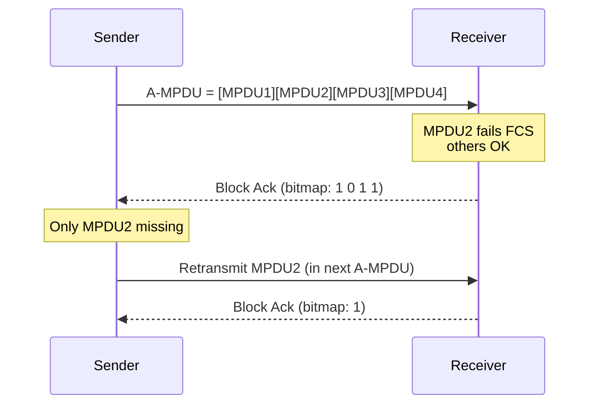

> 🔑 **Rule of thumb:** A-MSDU wins on *overhead* (one header), A-MPDU wins on *reliability* (per-frame FCS + Block Ack). Real devices often **nest** them — several A-MSDUs inside each MPDU, several MPDUs inside one A-MPDU — to get both.

### 🪟 Why TCP window size decides whether aggregation helps

Aggregation can only pack frames that are **already waiting** in the Wi-Fi queue. TCP decides how many segments may be “in flight” before an ACK comes back. That limit is the **TCP window**.

```text
  small TCP window                         large TCP window
  (sender waits after 2 segments)          (sender keeps a queue full)

  Wi-Fi queue: [seg]                       Wi-Fi queue: [seg][seg][seg][seg]...
  air:         one lonely frame            air: one fat A-MPDU
               + preamble + ACK                 one preamble, one Block Ack
               → aggregation has nothing        → this is why aggregation
                 to glue together                 raises real throughput
```

- **Window too small** for the link: the pipe goes idle between ACKs. The MAC sends tiny bursts. You pay Wi-Fi overhead and get little aggregation.
- **Window large enough** (roughly *speed × round-trip time*): the driver queue stays full, the MAC builds a long A-MPDU, one TXOP moves many TCP segments.
- **Wi-Fi retries raise the round-trip time** without always looking like packet loss (see PER above). TCP may stall or shrink the window because ACKs are late, even when the MAC is still recovering the frames.
- **A download still needs a trickle of uplink TCP ACKs.** If the uplink is jammed, those ACKs arrive late, the window stops, and the download slows — even though the AP has plenty of data to send.

> 🔑 **One picture:** TCP window = how many letters you are allowed to hand the post office before a receipt. Aggregation = the post office putting those letters in **one** van. No letters waiting → the van leaves half empty.

### ✅ Benefits:

- **Less overhead** (fewer headers per packet)
- **Higher throughput** and **better efficiency**
- Especially useful in **high-speed** or **low-error** environments

### ❌ Drawbacks:

- If one part of an aggregated frame is corrupted, **entire frame may need retransmission**
- **Delay-sensitive** applications may suffer due to buffering before aggregation

---

## ⚖️ Fragmentation vs Aggregation

|                | **Fragmentation**                          | **Aggregation**                             |
|----------------|---------------------------------------------|----------------------------------------------|
| **Purpose**     | Increase reliability                        | Improve efficiency and speed                 |
| **Use Case**    | Noisy environments, weak signals            | Clean environments, high-speed transmissions |
| **Overhead**    | High (more headers, more frames)            | Low (shared headers across packets)          |
| **Throughput**  | Can reduce throughput                       | Increases throughput                         |
| **Introduced In**| Legacy Wi-Fi (before 802.11n)              | 802.11n and later (Wi-Fi 4, 5, 6)            |

---

## 🏠 Real-World Analogy

### Fragmentation:
> Like sending multiple **smaller envelopes** instead of one big package when mailing fragile items — fewer chances of complete loss.

### Aggregation:
> Like putting several letters into a **single large envelope** to save on postage and time — more efficient, unless the envelope gets damaged.

---

## 🧠 Final Summary

- **Fragmentation** helps improve **reliability** by reducing the size of each transmission.
- **Aggregation** improves **efficiency** and **speed** by sending more data in fewer transmissions.
- **Modern Wi-Fi** standards use both smartly, depending on signal quality, traffic type, and device capability.

> 🚀 Efficient data handling = Faster Wi-Fi + Fewer errors!

> ➡️ **Frames can be small or bundled.** Power-save is the other efficiency: the radio itself sleeps, and the AP **buffers** until the station wakes (the TIM/DTIM you met in Part 3).

---

# 🔋 Power Management in Wi-Fi

Wi-Fi devices (like phones, laptops, and IoT devices) often run on batteries. To **extend battery life**, Wi-Fi includes smart **power-saving mechanisms**.

---

## 🧠 Why Power Management Matters

- 🪫 Devices are **often idle** between data transmissions.
- ⚡ Wireless radios consume **significant power** when active.
- 💡 Power management allows devices to **sleep intelligently** without losing connectivity.

---

## ⚙️ How Power Management Works in Wi-Fi

Wi-Fi power-saving is based on a **client–AP (Access Point)** relationship.

### 🧱 Key Concepts:

| **Term**             | **Meaning**                                                                 |
|----------------------|------------------------------------------------------------------------------|
| **Sleep Mode**       | Client turns off its radio to save power                                     |
| **Listen Interval**  | Tells the AP how often the client wakes up to check for data                 |
| **Traffic Indication Map (TIM)** | Bitmap in beacon frames that indicates if AP has data for sleeping clients  |
| **Beacon Frame**     | Periodic signal from AP that includes the TIM and other control info         |
| **PS-Poll**          | Power Save Poll — client uses this to request queued data from AP            |

---

## 📶 Power Save Mechanism – Step by Step

1. **Client enters Power Save mode** and informs the AP (null frame with the Power Management bit set).
2. AP **buffers data** for that client.
3. Client **wakes up periodically** based on the *Listen Interval* to hear beacons.
4. AP sends a **Beacon** carrying the **TIM**; if the client's **AID bit is set**, unicast data is waiting.
5. Client sends a **PS-Poll** (legacy) or a **trigger frame** (U-APSD) to retrieve its buffered **unicast** data.
6. For **broadcast/multicast**, the client instead waits for the next **DTIM beacon** (every *DTIM-Period* beacons); the AP sends group traffic right after the DTIM, so **all** PS clients must be awake for it.
7. After receiving, the client may **go back to sleep**.

> 🔁 See the **TIM and DTIM** subsection in the Beacon chapter for the distinction: **TIM → per-station unicast**, **DTIM → group-addressed (broadcast/multicast) for everyone**.


## 🔋 Power Saving Mode (Legacy PS Mode only)

- Client sends a **null data frame** with the **Power Management bit set** to indicate it's entering sleep mode.
- The **Access Point (AP)** buffers any incoming data for the client while it’s asleep.
- AP includes a **TIM (Traffic Indication Map)** in its periodic **beacon frames**, signaling which clients have buffered data.
- When the client wakes up and sees its ID in the TIM, it sends a **PS-Poll** frame to request the buffered data from the AP.

---

## 💡 Types of Wi-Fi Power Saving Techniques

### 1. 💤 Legacy Power Save Mode

- Defined in early Wi-Fi standards.
- Based on **PS-Poll** mechanism and **beacon-based** listening.
- Still widely supported, but **not optimal** for modern use.

---

### 2. 🚀 WMM Power Save (U-APSD)

> **WMM = Wi-Fi Multimedia**  
> **U-APSD = Unscheduled Automatic Power Save Delivery**

**WMM Power Save**, also known as **Unscheduled Automatic Power Save Delivery (U-APSD)**, is an enhanced power-saving mechanism introduced with **Wi-Fi Multimedia (WMM)**.

- Introduced to support **VoIP** and **real-time multimedia**.
- More **efficient** than legacy methods.
- Client tells AP when it’s ready, and AP **pushes** buffered packets.

### ⚙️ How It Works

- The client (STA) enters power-save mode.
- Instead of sending **PS-Poll** frames, the client sends a **trigger frame** (like a QoS data or null frame).
- The AP, upon receiving the trigger, delivers **all buffered packets** for that Access Category (AC).
- After delivery, the client may go back to sleep.

---

### 3. 📡 Target Wake Time (TWT) – Wi-Fi 6 (802.11ax) and Beyond

> 📎 This is the quick summary in the power-save context. For the full breakdown (Individual vs Broadcast TWT, wake interval/duration/target-time parameters, the TWT Request/Response negotiation, and teardown), see **"Target Wake Time (TWT) — Wi-Fi 6/6E/7 Power Optimization"** in the *Final Deep Dive* chapter.

- AP and client **negotiate scheduled communication windows** to avoid unnecessary radio activity. 
- Great for **IoT devices** and **smart homes**.
- Dramatically reduces **power consumption** by avoiding unnecessary wakeups.

---
### ⚙️ How It Works

1. Client and AP agree on a **TWT schedule** — e.g., wake every 100ms.
2. Outside of the agreed window, the client **sleeps**.
3. At the TWT time, both AP and client **wake up and exchange data**.
4. The client goes back to sleep until the next window.

### 📋 Key Features (TWT)

| Feature                   | Description                                                  |
|---------------------------|--------------------------------------------------------------|
| **Scheduled**             | AP and client agree on explicit wake times in advance        |
| **Individual & Broadcast**| TWT can be negotiated per-station or announced to a group    |
| **Very low power**        | Radio stays asleep entirely outside the agreed window        |
| **IoT-friendly**          | Ideal for sensors that transmit on a predictable cadence     |

> *(The earlier trigger-based, AC-specific delivery described above belongs to **WMM-PS / U-APSD**, not TWT.)*

### 🧠 Real-World Analogy

> Like telling the receptionist: “I’m ready now, give me **all my messages** at once.”  
> You don’t have to keep asking — just one signal, and you get everything.
---

## ⚖️ Power Save Modes – Summary Comparison

| Feature               | Legacy Power Save         | WMM Power Save (U-APSD)            | TWT (Wi-Fi 6+)                        |
|------------------------|---------------------------|-------------------------------------|---------------------------------------|
| **Wake Trigger**       | TIM + PS-Poll              | Trigger Frame (QoS Null/Data)       | Pre-scheduled wake times              |
| **Best For**           | General traffic            | Voice, Video                        | IoT, battery-powered smart devices    |
| **Latency**            | Medium                     | Low                                 | Very Low (scheduled)                  |
| **Power Efficiency**   | Moderate                   | High                                | Very High                             |
| **Standard**           | 802.11a/b/g/n              | 802.11e (WMM)                       | 802.11ax (Wi-Fi 6 and later)          |
| **Mechanism**       | Beacon + PS-Poll            | Client-triggered AP delivery  | Scheduled wake/sleep windows      |

---
## 🧠 Real-World Analogy

> Imagine a student (device) who doesn’t stay in the classroom (network) all the time:

- 💤 **Legacy Mode**: They peek into the room every 10 minutes to see if there’s homework.
- 🚪 **WMM PS**: They notify the teacher when they’re ready, and the teacher gives all the homework at once.
- 🕐 **TWT**: They and the teacher agree on *exact times* to meet. No wasted trips!

---

## ✅ Final Summary

- Wi-Fi uses **smart power-saving** to help mobile and IoT devices conserve energy.
- **Legacy**, **WMM Power Save**, and **TWT** are different techniques depending on device needs and Wi-Fi generation.
- Modern devices leverage **TWT** for scheduled, ultra-efficient communication.

> 🔋 Smart Wi-Fi = Fast Internet + Longer Battery Life

> ➡️ **Power-save is the default on phones.** The next short chapter is the opposite mode: **CAM** — radio always on — used when latency matters more than battery.

# 💡 CAM (Constantly Awake Mode) in Wi-Fi

## 🔍 What is CAM?

**CAM** stands for **Constantly Awake Mode**. It is the **default power mode** in Wi-Fi where the device's radio is **always on** and actively listening for data or signals from the Access Point (AP).

---

## ⚙️ How CAM Works

In CAM:

- The Wi-Fi radio **never sleeps**.
- The device **immediately processes** all incoming and outgoing data.
- There is **no buffering** of data at the AP — the client is always ready.

---

## ✅ Advantages of CAM

| **Benefit**                  | **Explanation**                                           |
|------------------------------|-----------------------------------------------------------|
| ⚡ Low Latency                | Instant response times; good for real-time applications  |
| 🔁 Immediate Connectivity     | Always ready to send/receive data                        |
| 📶 Reliable Signal Handling   | Better performance in voice, video, or gaming apps       |

---

## ❌ Disadvantages of CAM

| **Drawback**                 | **Explanation**                                           |
|------------------------------|-----------------------------------------------------------|
| 🔋 High Power Consumption     | Constantly running the radio drains the battery faster   |
| 🔥 Not Energy Efficient       | Unsuitable for IoT or battery-powered devices            |

---

## 🧠 Real-World Analogy

> Imagine a **security guard** (your device) who never sleeps, watching the front door **24/7**.  
> They can react instantly — but they'll be **exhausted** and **consume a lot of energy**!

---

## 🔁 CAM vs Power Save Mode – Quick Comparison

| **Feature**           | **CAM (Constantly Awake Mode)** | **Power Save Mode**               |
|------------------------|----------------------------------|-----------------------------------|
| **Radio State**        | Always ON                        | Sleeps when idle                  |
| **Power Usage**        | High                             | Low to Medium                     |
| **Latency**            | Very Low                         | Slight delay (due to wake-ups)    |
| **Best For**           | Video, VoIP, gaming, real-time   | Background apps, IoT, sensors     |

---

## 🔧 When is CAM Used?

- **Laptops and desktops** plugged into power
- **Real-time communication apps** like Zoom or Teams
- **Streaming** or **gaming**
- When **power saving is turned off** in network settings

---

## ✅ Final Summary

- **CAM (Constantly Awake Mode)** keeps the device ready for communication at all times.
- Great for **performance**, not great for **battery life**.
- Choose CAM when **speed and responsiveness** matter more than power savings.

> ⚡ Always awake = always fast, but at a power cost!

> ➡️ **Sleep vs always-on is a station policy.** Band switching is a **radio policy**: the same client may leave crowded 2.4 GHz for faster 5 GHz (the bands you met in the PHY primer).

---
## 🔀 Band Switching: From 2.4 GHz to 5 GHz in Wi-Fi

Modern dual-band Wi-Fi networks operate on both:

- **2.4 GHz** (longer range, lower speed)
- **5 GHz** (shorter range, higher speed, less interference)

---

### 🧠 Why Switch from 2.4 GHz to 5 GHz?

| **Reason**                  | **Explanation**                                                                 |
|----------------------------|----------------------------------------------------------------------------------|
| 🚀 **Faster Speeds**        | 5 GHz supports higher throughput (e.g., 802.11ac/ax), ideal for streaming, gaming |
| 🤫 **Less Congestion**      | 2.4 GHz is crowded (Bluetooth, microwaves, neighbors), 5 GHz has more channels   |
| 🎯 **Better QoS**           | APs may steer capable clients to 5 GHz for better load balancing                |

---

## 🔄 How Band Switching Happens (Client-Side)

When your device connects to Wi-Fi, here's what can happen:

### 1. **Initial Connection**
- Device scans both 2.4 and 5 GHz.
- If signal strength on 5 GHz is **too weak**, it may connect to **2.4 GHz** first.

### 2. **Monitoring Signal Quality**
- Device continuously monitors **RSSI**, **SNR**, **packet loss**, etc.
- If 5 GHz becomes viable (e.g., you walk closer to AP), it considers switching.

### 3. **Switch Triggered**
- The device **disconnects from 2.4 GHz** and **reassociates with 5 GHz** on same SSID.
- The AP may **assist** using **802.11k/v** to suggest a better band.

---

## 📡 AP-Assisted Band Steering

Enterprise-grade or mesh APs use **band steering**:

| **Technique**              | **What AP Does**                                                              |
|----------------------------|--------------------------------------------------------------------------------|
| 🔕 **Ignore 2.4 GHz requests** | If client supports 5 GHz, AP may delay or reject 2.4 GHz probes             |
| 🧭 **802.11v BSS Transition** | AP suggests a 5 GHz BSSID via **BSS Transition Request**                   |
| 📊 **Load Balancing**         | AP monitors client count and may steer clients for better performance       |

> 🧠 Band steering is more like **“client suggestion”** — clients make the final roaming decision.

---

## 📶 Technical Example: iPhone Switches from 2.4 → 5 GHz

1. Initially connects to 2.4 GHz due to strong signal at range
2. As user moves closer, iPhone receives 5 GHz **beacon frames** with good RSSI
3. AP may send **802.11v BSS Transition Request** to 5 GHz BSSID
4. iPhone disconnects from 2.4 GHz and reassociates to 5 GHz using:
   - **Same SSID**
   - New **BSSID** on a 5 GHz channel
5. **DHCP is not redone** (same L3 settings usually retained)

---

## 🛠️ Troubleshooting Tip

| **Symptom**                       | **Possible Cause**                        | **Fix**                          |
|----------------------------------|-------------------------------------------|----------------------------------|
| Stuck on 2.4 GHz                 | Weak 5 GHz signal or client preference    | Adjust AP power/band steering   |
| Flaky switching                  | Poor AP placement, no roaming support     | Enable 802.11k/v/r on AP        |
| No switch even near AP          | Device roaming aggressiveness is low      | Tweak client-side roaming settings (if possible) |

---

## ✅ Summary: Band Switch Flow

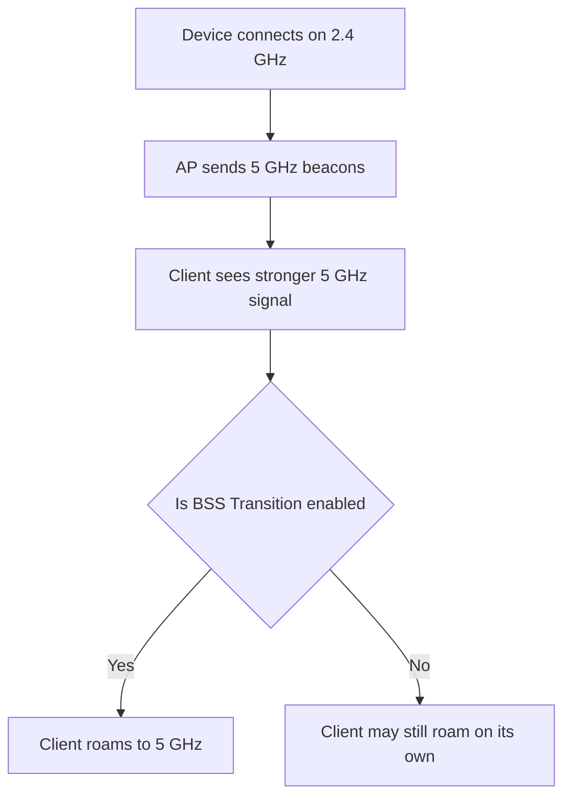

> ➡️ **5 GHz is not all free.** Some 5 GHz channels are shared with **radar**. Before an AP may use one, it must **listen first** — that listen is a **DFS scan**.

# 🔍 DFS Scan in Wi-Fi

> ➡️ **This is the radar listen, not the width knob.** Channel choice, transmit power (TPC), and width (DBA) were the three RRM knobs in Part 2. **DFS** is the rule that blocks some 5 GHz channels until the AP has listened for radar. **DBA** only decides 20 vs 40 vs 80 vs 160 MHz.

DFS Scan is a special type of **passive channel scan** that access points (APs) must perform **before** using any **DFS channel** (radar-sensitive) in the 5 GHz band.

---

## ⚙️ What is a DFS Scan?

- Also known as **Channel Availability Check (CAC)**.
- It is a **mandatory listening period** where the AP checks for radar signals **before transmitting** on a DFS channel.
- The AP must stay **completely silent** during this scan.

---

## ⏱️ How Long Does It Take?

| **Region** | **Scan Duration (CAC Time)** |
|------------|------------------------------|
| 🇺🇸 US (FCC) | **60 seconds**               |
| 🇪🇺 EU (ETSI) | **60 – 600 seconds** depending on channel |
| 🌏 Others     | **Usually 60 seconds**       |

> 🛑 During this time, the AP **won’t broadcast SSID** or allow connections on that channel.

---

## 📶 When Does DFS Scan Happen?

### 💡 Scenario 1: Initial Boot or Channel Change
- AP boots up and selects a DFS channel → **must perform DFS scan first**.
- No Wi-Fi service until the scan completes.

### 💡 Scenario 2: DFS Radar Detected
- AP already operating on a DFS channel.
- Radar appears → AP **immediately switches** to a new channel (DFS or non-DFS).
- If new channel is also DFS → another **DFS scan is triggered**.

---

## 🧠 How the listen actually runs

Nobody tells the AP “radar is here” over the wire. The **AP’s own radio** stays mute and measures energy that looks like radar (a pulse pattern, not a Wi-Fi beacon). The controller is not required for this decision. The law is in the AP.

```text
  Controller (or the AP itself) picks a DFS channel, for example 100
        │
        ▼
  AP tunes to 100 and transmits NOTHING for the CAC time (often 60 s)
        │  no beacons, no probes, no data
        │  chip compares the energy to known radar patterns
        ▼
  Clean?  → AP starts beacons on 100. Clients can associate.
  Radar?  → AP marks 100 unusable (usually for 30 minutes)
            and picks another channel.
            If that one is also DFS, the silent listen starts again.
```

**What the phone sees.** During CAC the SSID is gone, because there are no beacons. A phone already associated cannot follow the AP onto that channel until beacons return. If radar hits **while** the AP is already serving clients, the AP leaves at once (it does not finish a 60 s listen first) and sends clients to the new channel with a CSA when it is allowed to transmit again.

**After the move, the other knobs run again.** A new channel can need a new power (TPC) and a new width (DBA). DFS only answered “may I use this lane?”

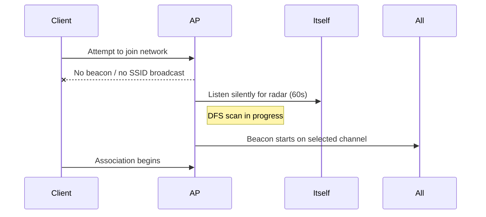

> ➡️ **Part 6 ends here.** You can roam, pack frames, sleep, change band, and respect radar. Part 7 is the **modern stack**: how devices get onboarded (DPP), how they measure distance (FTM), how the radio becomes a sensor — then **Wi-Fi 5 / 6 / 7** in full, with QoS, OFDMA internals, MLO, and the Linux driver path.

---

# 🧱 PART 7 · Modern & Advanced PHY/MAC

> **What's ahead:** three “extra” features first (**DPP, FTM/RTT, sensing**) because they sit on the MAC you already know. Then the **generation chapter** (Wi-Fi 5 → 6 → 7) you have been previewing since BSS Coloring and MU-MIMO. After the generation overview, two deeper looks: **OFDMA / Trigger / MLO internals**, then **captures + Linux drivers + Wi-Fi 8**. Same features, increasing zoom.

---

# 🔐 Advanced Wi-Fi Technologies: DPP, FTM/RTT, and Wi-Fi Sensing

---

## 📶 Device Provisioning Protocol (DPP - Easy Connect)

DPP is a modern, secure, and flexible method to provision Wi-Fi devices without needing default passwords or QR codes.

---

### 🔑 Why DPP?

* Replaces legacy WPA2-PSK (pre-shared key)
* Eliminates default credentials and manual password entry
* Enables secure out-of-band (OOB) device onboarding via QR code, NFC, or BLE
* Designed for smart homes, IoT, and enterprise onboarding

---

### 🧠 DPP Core Concepts

| Term                       | Meaning                                               |
| -------------------------- | ----------------------------------------------------- |
| **Configurator**           | Device that initiates provisioning (e.g., smartphone) |
| **Enrollee**               | Device being provisioned (e.g., IoT device, AP)       |
| **Bootstrapping**          | Establish initial secure contact (QR/NFC/BLE/PKEX)    |
| **Authentication**         | Mutual public key cryptography (Curve25519/ED25519)   |
| **Configurator Connector** | Contains encrypted Wi-Fi credentials and policy       |

---

# 🔐 Wi-Fi Easy Connect (DPP) Walkthrough

Wi-Fi Easy Connect, also known as **Device Provisioning Protocol (DPP)**, replaces insecure WPS with a **secure, public-key-based** method to onboard devices (Enrollees) onto a Wi-Fi network.

---

## 🧰 Roles

| Role         | Description                                           |
|--------------|-------------------------------------------------------|
| **Enrollee** | The device that needs Wi-Fi credentials (e.g. IoT)   |
| **Configurator** | The device that knows the Wi-Fi credentials (e.g. smartphone) |

---

## 📦 Phase 1: Bootstrapping

The goal here is to **safely share bootstrapping information** using an out-of-band (OOB) channel.

### 🔁 Process:

1. **Enrollee** creates a **bootstrapping object**:
   - Contains its **public key**
   - Encoded as a **QR code**, **NFC tag**, or shared over **Bluetooth LE** or **PKEX**

2. **Configurator** reads this data via scanning, tap, or BLE.

3. Configurator stores:
   - The **Enrollee's public key**
   - The bootstrapping method used

> 📌 This phase sets up a secure foundation for the rest of the protocol.

---

## 🔐 Phase 2: Authentication

This is a **mutual authentication** step using **authenticated Diffie-Hellman key exchange** (ECDH with Curve25519).

### ✅ Goals:

- **Verify each other’s identities**
- **Prevent impersonation and MITM attacks**

### 🔁 Process:

1. Configurator and Enrollee both use:
   - Their previously exchanged **public keys**
   - To derive a shared secret securely

2. Authentication occurs using:
   - **Crypto binding**
   - **Proof-of-possession** of private keys

> 🔒 This ensures only trusted devices continue to the next phase.

---

## 📡 Phase 3: Configuration

This is where the **Configurator sends Wi-Fi credentials** (SSID, password, security type) to the Enrollee.

### 🔁 Process:

1. The Configurator generates a secure object called the **Connector**:
   - Contains:
     - SSID
     - Password
     - AKMs (e.g., WPA3-SAE)
     - Other network info
   - Encrypted using the shared key from the Authentication Phase

2. Enrollee receives and **decrypts** the Connector.

3. It then applies the configuration and **connects to the Wi-Fi network**.

> 🔐 This data is never sent in plaintext — it's securely encrypted end-to-end.

---

## ✅ Phase 4: Acknowledgment

1. After successfully connecting to the Wi-Fi network:
   - The Enrollee sends a **DPP Acknowledgment** message to the Configurator

2. The Configurator receives confirmation that provisioning succeeded.

> 🟢 Devices may also store the credentials for future connections.

---

## 🔄 Summary Flow

```text
[User Action]
     |
     v
[Scan QR / Tap NFC / BLE]
     |
     v
[Bootstrapping] ---> Exchange Public Keys
     |
     v
[Authentication] ---> ECDH (Curve25519), verify identities
     |
     v
[Configuration] ---> Encrypted credentials sent to Enrollee
     |
     v
[Acknowledgment] ---> Enrollee confirms Wi-Fi connection success
```

---

### 🛡️ Security Highlights

* Public key cryptography
* Authenticated Diffie-Hellman exchange
* Anti-cloning & anti-spoofing
* No need for shared secrets or default keys

---

## 🛰️ Fine Time Measurement (FTM) / Wi-Fi RTT (802.11mc)

FTM allows accurate distance measurement using Wi-Fi by calculating the round-trip time of frames between devices.

---

### 🔧 How RTT Works

### 🔁 Process:

1. **Initiator** sends an **FTM Request** to an AP (Responder)
2. **Responder** sends back an **FTM Response** containing:
   - **Timestamps** of frame send/receive events:
     - **T1**: Time when Initiator sends FTM Request
     - **T2**: Time when Responder receives the FTM Request
     - **T3**: Time when Responder sends FTM Response
     - **T4**: Time when Initiator receives the FTM Response

---

2. **Timing Exchange**

   * Round-trip time = (T4 - T1) - (T3 - T2)
   * Distance ≈ (RTT × speed of light) / 2

---

### ⚙️ Requirements

* 802.11mc support on both devices (AP and client)
* Location permission (on Android)
* Accurate timestamping capability in hardware/firmware

---

### 📐 Applications

* Indoor navigation (malls, airports)
* Device localization and AR
* Home automation triggering based on proximity

---

### 🔍 Packet Types Involved

* **Action frames** (FTM Request / Response)
* **Timestamp IEs**
* Timestamps at PHY-level resolution (sub-microsecond)

---

## 🌐 Wi-Fi Sensing / Location Awareness

Wi-Fi Sensing uses variations in RF signals (amplitude, phase, Doppler shifts) to infer motion, presence, or gestures.

---

### 🎯 Key Concepts

| Feature                             | Description                                |
| ----------------------------------- | ------------------------------------------ |
| **Channel State Information (CSI)** | Fine-grained per-subcarrier signal info    |
| **RSSI/Phase/ToF**                  | Traditional signal parameters              |
| **Doppler Shift**                   | Used to detect motion and velocity         |
| **Multipath Analysis**              | Detect presence via changes in reflections |

---

### ⚙️ Sensing Techniques

1. **Passive Sensing**: Analyze changes in signal from ambient traffic (e.g., AP to client)
2. **Active Sensing**: Generate specific probe packets and analyze returns

---

### 🤖 Use Cases

* Intrusion detection (human presence)
* Sleep monitoring
* Gesture recognition
* Fall detection for elderly
* Smart lighting and HVAC control

---

### 📡 Technical Stack

* Wi-Fi 802.11bf (Sensing standardization effort)
* Use of OFDM and MIMO reflections
* CSI extraction from firmware/driver (Intel, Atheros, Mediatek chips)

---

### 🔬 Real-World Integration

* Qualcomm, Intel, Cisco developing Wi-Fi sensing APIs
* Wi-Fi sensing chipsets with CSI export becoming more common

> ➡️ **Onboarding, ranging, and sensing use the same air.** The next chapter is the **PHY/MAC generations** those features ride: what Wi-Fi 5 added (width + DL MU-MIMO), what Wi-Fi 6 added (OFDMA + UL MU-MIMO + TWT), what Wi-Fi 7 added (320 MHz + MLO), then **QoS** so voice still wins when the cell is busy.

---
# 🚀 Advanced Wi-Fi Topics: Wi-Fi 5, Wi-Fi 6, Wi-Fi 7, and QoS (WMM/TSPEC)

---

## 🧬 The Generations at a Glance

Before the per-standard detail, here is the evolution on one page. Notice the *theme*: Wi-Fi 5 made a single link **faster**; Wi-Fi 6 made a **crowded** network **more efficient**; Wi-Fi 7 adds **raw width + multi-link** for very low latency.

```text
         Wi-Fi 4         Wi-Fi 5          Wi-Fi 6 / 6E        Wi-Fi 7
          (n/HT)         (ac/VHT)          (ax/HE)            (be/EHT)
  ┌──────────────┬───────────────┬──────────────────┬───────────────────┐
  Bands │ 2.4+5  │ 5 only        │ 2.4+5 (+6 = 6E)  │ 2.4+5+6           │
  BW    │ 20/40  │ 20/40/80/160  │ 20/40/80/160     │ up to 320 MHz     │
  QAM   │ 64     │ 256           │ 1024             │ 4096              │
  MU    │ —      │ DL MU-MIMO    │ DL+UL MU-MIMO +  │ + Multi-RU,       │
        │        │               │ OFDMA            │ coordinated OFDMA │
  Power │ PS-Poll│ PS-Poll/U-APSD│ + TWT            │ + enhanced TWT    │
  New   │ MIMO,  │ wide ch,      │ OFDMA, BSS color,│ MLO, 320 MHz,     │
        │ A-MPDU │ beamforming   │ spatial reuse    │ preamble punct.   │
  Max   │ ~600M  │ ~6.9 Gbps     │ ~9.6 Gbps        │ >46 Gbps          │
  ┴──────────────┴───────────────┴──────────────────┴───────────────────┘
      "faster"       "wider"        "efficient in         "wide + multi-
                                      a crowd"              link, low-latency"
```

> 🔑 **One-line mental model:** **Wi-Fi 5 = wider pipes + beamforming** (speed for one). **Wi-Fi 6 = OFDMA + scheduling** (sharing among *many* efficiently). **Wi-Fi 7 = 320 MHz + MLO** (bandwidth *and* parallel links for latency).

---

## 📶 IEEE 802.11ac (Wi-Fi 5)

### 🧠 Key Features

* Introduced in 2013 (Wave 1) and extended in 2016 (Wave 2)
* Operates in **5 GHz** band only
* **MU-MIMO (Downlink)** for simultaneous stream transmission
* **Channel bandwidths**: 20, 40, 80, 160 MHz (Wave 2)
* Max theoretical PHY rate: \~6.9 Gbps (8 spatial streams, 160 MHz)

### 📐 Technology Stack

* **Modulation**: Up to 256-QAM
* **FEC**: LDPC (optional)
* **Beamforming**: Explicit Beamforming for targeted spatial streams
* **Frame Aggregation**: A-MPDU, A-MSDU
* **Block Ack**: Improves efficiency by grouping ACKs

### 🧪 Practical Impact

| Feature        | Benefit                                  |
| -------------- | ---------------------------------------- |
| Wider Channels | Higher throughput                        |
| MU-MIMO        | Better performance with multiple clients |
| 256-QAM        | Higher spectral efficiency               |

---

## ⚡ IEEE 802.11ax (Wi-Fi 6)

### 🧠 Key Innovations

* Operates in both **2.4 GHz + 5 GHz** bands (and **6 GHz** when marketed as **Wi-Fi 6E** — same 802.11ax PHY, extra clean spectrum)
* Introduced **OFDMA (Orthogonal Frequency Division Multiple Access)**
* **Uplink + Downlink MU-MIMO**
* **Target Wake Time (TWT)** for power efficiency
* **1024-QAM** modulation for denser packing

### 📐 OFDMA Breakdown

* Each channel is split into **Resource Units (RUs)**
* Multiple clients can transmit simultaneously in a single channel
* Reduces latency and improves spectrum use

### 📉 Airtime Fairness

* Legacy Wi-Fi gives time fairness, not throughput fairness
* Wi-Fi 6 allocates **equal airtime** using scheduling and OFDMA

### 🔐 BSS Coloring

* Tags frames from different APs to reduce co-channel interference
* Enables spatial reuse in dense environments

### 🧪 Wi-Fi 6 Performance Features

| Feature           | Role                                |
| ----------------- | ----------------------------------- |
| TWT               | Reduces power drain                 |
| OFDMA             | Multi-user channel access           |
| MU-MIMO (UL + DL) | Better simultaneous client handling |
| 1024-QAM          | Denser data modulation              |
| Spatial Reuse     | Better range & concurrency          |

### 🚦 OFDMA (Orthogonal Frequency Division Multiple Access)

> 📎 This is the conceptual overview. For the **scheduler logic, RU sizes/layout, downlink frame structure, and trigger-based uplink**, see **"OFDMA Scheduling Internals (802.11ax / Wi-Fi 6)"** in the Advanced MAC/PHY chapter.

- **What it is**: An enhancement of OFDM (used in previous Wi-Fi standards) that allows multiple users to transmit data **simultaneously** by dividing a channel into smaller sub-channels called **Resource Units (RUs)**.
  
- **How it works**:
  - The available bandwidth (e.g., 20/40/80 MHz) is divided into smaller frequency tones (subcarriers).
  - Each user is assigned a group of these subcarriers (RUs), allowing multiple users to share the channel **at the same time** instead of waiting their turn.
### 👥 MU-MIMO (Multi-User Multiple Input, Multiple Output)

- **What it is**: A method that allows a wireless access point to transmit **different data streams to multiple devices simultaneously**, using multiple antennas.

- **How it works**:
  - The AP has multiple antennas that can focus signals (beamforming) and serve several clients **at once** instead of one at a time.
  - Previously, MU-MIMO worked only for **downlink**; 802.11ax introduces **uplink MU-MIMO** as well.
### 🔄 Downlink vs Uplink MU-MIMO

**MU-MIMO (Multi-User Multiple Input, Multiple Output)** allows multiple devices to communicate with an access point (AP) at the same time, using multiple antennas. This can happen in two directions:

---

#### 📤 Uplink MU-MIMO

- **What it is**: Multiple client devices **simultaneously send data** to the access point.
- **Introduced in**: **802.11ax** (Wi-Fi 6)
- **Example**: Several smartphones uploading photos to the cloud at the same time.
- **Benefit**: Reduces congestion and wait time when many devices are transmitting data to the AP.

---

#### 📥 Downlink MU-MIMO

- **What it is**: The access point **simultaneously sends different data streams** to multiple devices.
- **Introduced in**: **802.11ac Wave 2** (downlink only), enhanced in **802.11ax**
- **Example**: Streaming different videos to a tablet, a laptop, and a smart TV — all at once.
- **Benefit**: Increases download efficiency and overall throughput.

---

### 🧠 Summary Table

| Direction     | Introduced In | Who Sends Data | Who Receives Data | Real-Life Example                            |
|---------------|----------------|----------------|--------------------|----------------------------------------------|
| **Downlink**  | 802.11ac (Wave 2) | Access Point   | Multiple Devices   | Watching YouTube on multiple devices         |
| **Uplink**    | 802.11ax          | Multiple Devices | Access Point       | Uploading files to Google Drive from phones  |

---

### ⬇️⬆️ Why download and upload are not the same problem

**Download** = internet → AP → your phone. **Upload** = your phone → AP → internet. Same channel, very different fight for the air.

```text
  DOWNLOAD                         UPLOAD
  AP already holds the data        each phone must win the air itself
  AP wins one TXOP and sends       (CSMA), unless the AP calls them
  a fat A-MPDU (and, on Wi-Fi 5+,  with a Trigger (Wi-Fi 6)
  several clients at once)

  Wi-Fi 5: DL MU-MIMO works        Wi-Fi 5: no trigger, no UL MU-MIMO
  Wi-Fi 6: DL OFDMA packs          Wi-Fi 6: one Trigger → many phones
           many users in one shot           upload together on different RUs
```

A speed test often shows **download much higher than upload** on the same AP. Three reasons, in order:

1. **Who talks.** On download, one strong radio (the AP) owns the TXOP. On upload, every phone contends, collides, and backs off.
2. **How strong the radio is.** The AP usually has more antennas and more transmit power than a phone.
3. **TCP’s return path.** A fast download only needs small TCP ACKs going up. A fast upload needs the phone to keep winning big TXOPs, and it still needs downlink ACKs from the server. A crowded uplink therefore hurts **both** directions (the window story in the aggregation chapter).

> 🔑 **Mental model:** download is the teacher handing out worksheets to the whole class in one pass. Upload is every student trying to ask a question at once — until Wi-Fi 6’s Trigger frame, which is the teacher saying “you, you, and you — answer now, on your own line.”

---

## 🚀 IEEE 802.11be (Wi-Fi 7)

### 🧠 Evolutionary Goals

* Operates in **2.4, 5, and 6 GHz** (multi-band convergence)
* Up to **320 MHz channel bandwidth**
* **4096-QAM** (12 bits/symbol)
* **Multi-Link Operation (MLO)**: combine multiple bands/interfaces
* **Preamble Puncturing**: dynamically use portions of spectrum
* **Extremely Low Latency (ELL)**: <1ms target for AR/VR

### 🔗 Multi-Link Operation (MLO)

* One MAC coordinates multiple PHYs
* Parallel use of 5 GHz + 6 GHz + 2.4 GHz
* Improves reliability and latency by switching or aggregating links

### 🧠 Technical Enhancements

| Feature           | Function                   |
| ----------------- | -------------------------- |
| 320 MHz BW        | Doubles max throughput     |
| MLO               | Seamless multi-band use    |
| 4096-QAM          | Very high data density     |
| Flexible OFDMA    | Smarter dynamic scheduling |
| Coordinated OFDMA | Low-latency group access   |

### 📈 Expected Throughput

* Max theoretical rate: **>46 Gbps**
* Depends on channel conditions, MLO, QAM, and stream count

## preamble puncturing flow

- Preamble puncturing is a Wi-Fi technology that allows an access point (AP) to "carve out" or disable specific subchannels within a wider frequency band that are affected by interference. 
- The "flow" refers to the process by which an AP and client negotiate and use this technology to maintain a wider, more stable connection despite the interference.

This prevents the AP from having to fall back to a much narrower, slower channel, as was the case in previous Wi-Fi standards. 

### How preamble puncturing works

- Interference detection: An AP capable of Wi-Fi 6 or 7 detects interference on one or more of its non-primary 20 MHz subchannels. This interference could come from other networks, radar signals, or other radio sources.
- Puncturing announcement: The AP informs all Wi-Fi 7-compatible client devices within its network about the interference by using a "Disabled Subchannel Bitmap".
        - This bitmap is included in standard management frames, such as beacons, which are regularly sent by the AP.
        - Each bit in the bitmap corresponds to a 20 MHz subchannel, and a set bit indicates that the subchannel is punctured (disabled).

- Frame modification: For subsequent transmissions, the AP and client modify the Physical Layer Convergence Protocol (PLCP) Preamble and data frame. The preamble, which is used for synchronization, is transmitted on all unpunctured subchannels, and the data is then sent across the remaining, usable bandwidth. The primary 20 MHz channel cannot be punctured for downlink transmissions.

- Client adaptation: When receiving the frames, the Wi-Fi 7 client reads the bitmap and knows not to expect the preamble or data on the punctured subchannel. It can then process the remaining signal efficiently.

- Bandwidth utilization: This flow allows the AP and client to continue transmitting over a wider, though slightly reduced, channel. For example, if one 20 MHz subchannel is punctured in an 80 MHz channel, they can still communicate over the remaining 60 MHz. In older standards, the AP would have been forced to drop down to a narrow 20 MHz channel.

- Legacy client handling: Older Wi-Fi clients (Wi-Fi 6 and earlier) do not support preamble puncturing. When a Wi-Fi 7 AP uses puncturing, it can inform legacy clients via a Channel Switch Announcement that they must operate on a lower bandwidth to avoid the interference. 

---

## 🎯 QoS in Wi-Fi: WMM and TSPEC

## 🎯 Quality of Service (QoS) in Wi-Fi

**Quality of Service (QoS)** in Wi-Fi ensures that time-sensitive applications like **video streaming**, **VoIP**, and **online gaming** get prioritized access to the wireless medium, improving performance and user experience.

Without QoS, all traffic competes equally for transmission — which can lead to delays or poor quality for real-time applications.

---

## ⚙️ WMM (Wi-Fi Multimedia)

**WMM** is a simplified QoS framework defined by the **Wi-Fi Alliance**, based on IEEE 802.11e.

It classifies traffic into four **Access Categories (ACs)**, each with different priority levels:

| Access Category | Priority | Typical Use             |
|------------------|----------|--------------------------|
| AC_VO            | Highest  | Voice (VoIP)             |
| AC_VI            | High     | Video streaming          |
| AC_BE            | Medium   | Best effort (web, apps)  |
| AC_BK            | Lowest   | Background (downloads)   |

Each category uses different **EDCA (Enhanced Distributed Channel Access)** parameters like:
- Contention window size (CWmin, CWmax)
- Arbitration Inter-Frame Space (AIFS)
- Transmission Opportunity (TXOP) limits

Each AC has its own **Contention Window (CW)** and **Arbitration Inter-Frame Space (AIFS)**:

* Voice gets smallest CW and AIFS → prioritized
* Background gets largest → deprioritized

✅ **Higher priority traffic** gets shorter wait times and better chance to transmit first.
### ⚙️ WMM Parameters Table

| AC | CWmin | CWmax | AIFS | TXOP Limit |
| -- | ----- | ----- | ---- | ---------- |
| VO | 3     | 7     | 2    | 1.504 ms   |
| VI | 7     | 15    | 2    | 3.008 ms   |
| BE | 15    | 1023  | 3    | N/A        |
| BK | 15    | 1023  | 7    | N/A        |

---
### 🎯 TSPEC (Traffic Specification)

**TSPEC** is used in **QoS-capable Wi-Fi networks** (based on IEEE 802.11e) to request **reserved bandwidth** for specific traffic streams such as voice or video.

#### 📡 How It Works:
- A **client station** sends a TSPEC request to the Access Point (AP) using an **ADDTS (Add Traffic Stream)** request frame.
- The TSPEC defines the **QoS requirements** for the stream, including:
  - **Traffic type** (e.g., voice, video)
  - **Mean data rate**
  - **Maximum burst size**
  - **Delay bound**
  - **Service interval**

- The **Access Point (AP)** evaluates whether it can support the request (based on available resources).
  - If accepted, it **reserves bandwidth** and maintains QoS for the stream.
  - If denied, the station may fall back to best-effort.

#### 🧩 Purpose:
- Ensures time-sensitive applications get **guaranteed QoS**.
- Enables **Traffic Admission Control (TAC)** for bandwidth management.

🟡 TSPEC is more advanced than WMM and supports **traffic admission control (TAC)**.
## 🎯 TSPEC Negotiation (WMM Admission Control)
### ⚖️ Admission Control Decision

- The Access Point (AP) uses the **ACM (Admission Control Mandatory)** flag to determine whether certain traffic categories (e.g., voice, video) require **explicit admission** before transmission.
- Upon receiving a TSPEC request, the AP evaluates:
  - **Available bandwidth**
  - Current **QoS policy**
  - Active traffic streams
- If the AP cannot meet the QoS requirements, it **rejects** the request to avoid overloading the network.

---

### 🧪 Use Case: Voice over Wi-Fi (VoWiFi)

- A voice client (STA) uses the **AC_VO** (Voice Access Category).
- Sends an **ADDTS request** with a TSPEC for approximately **64 Kbps** (typical voice codec).
- Includes a **low delay bound**, often **< 50 ms**, to ensure minimal latency and jitter.

---

### 🔍 TSPEC Frame View (Wireshark)

- **Frame Type**: Action Frame
- **Category**: QoS
  - **Element ID**: 221 = **WMM/WME TSPEC** (vendor-specific, Wi‑Fi Alliance). *The native 802.11e TSPEC element is ID **13** — in practice you'll see ID 221 because almost all real gear uses the WMM variant.*
- Additional Fields:
  - **Traffic Type**, **Data Rate**, **Delay Bound**, **Service Interval**
  - Direction (uplink/downlink), Nominal MSDU Size, Surplus Bandwidth

```mermaid
sequenceDiagram
    participant STA as Client Station (STA)
    participant AP as Access Point (AP)

    Note over STA,AP: 🎯 TSPEC-Based Traffic Stream Setup (Voice/Video)

    STA->>AP: 🔄 ADDTS Request\n(includes TSPEC: rate, delay, burst, etc.)
    AP->>AP: ⚖️ Admission Control Decision\nCheck ACM flag, bandwidth, QoS policy

    alt Resources Available
        AP-->>STA: ✅ ADDTS Response: Accepted
        Note over AP,STA: 🟢 Traffic stream established with QoS guarantees
        STA->>AP: 📡 Begin QoS traffic (e.g., voice packets)
    else Insufficient Resources
        AP-->>STA: ❌ ADDTS Response: Rejected
        Note over STA: 🔁 STA may fall back to best-effort AC (e.g., AC_BE)
    end

```
---

## 🧩 Summary

| Feature     | WMM                          | TSPEC                                 |
|-------------|------------------------------|----------------------------------------|
| Purpose     | Prioritize traffic types     | Reserve bandwidth for specific streams |
| Based on    | Access Categories (ACs)      | Per-flow traffic specification         |
| Use Case    | General consumer traffic     | Enterprise VoIP, video conferencing    |
| Admission Control | Optional (WMM-AC)     | Supported                              |

---

### 🧪 Use Cases

| Application | AC     | Why?                         |
| ----------- | ------ | ---------------------------- |
| Voice Call  | AC\_VO | Lowest latency needed        |
| Video Call  | AC\_VI | High throughput & low jitter |
| Web Surfing | AC\_BE | No strict requirements       |
| Sync Backup | AC\_BK | Least priority               |

## ✅ Benefits of QoS in Wi-Fi

- Reduces jitter and latency for voice/video.
- Improves performance in congested networks.
- Enhances user experience for real-time apps.

> ➡️ **You now know OFDMA, Trigger Frames, MLO, and TSPEC by name.** The next chapter is the **internals**: RU sizes, the AP scheduler, the Trigger Frame layout, and how MLO actually steers packets across two radios.

---

# 📡 Advanced Wi-Fi MAC/PHY Topics: OFDMA, TSPEC, MLO (802.11be)

---
## 🔬 OFDMA Scheduling Internals (802.11ax / Wi-Fi 6)

### 🧠 Concept

**OFDMA (Orthogonal Frequency Division Multiple Access)** is a key enhancement in Wi-Fi 6 (802.11ax), enabling **multiple clients to share the same channel simultaneously**.

Unlike older Wi-Fi versions (which use OFDM for one device at a time), OFDMA improves efficiency by dividing the channel into smaller units.

### 🖼️ OFDM vs OFDMA vs MU-MIMO — one picture

These three are often confused. OFDMA splits the channel in **frequency**; MU‑MIMO splits it in **space** (separate spatial streams/beams). They can even be combined.

```text
OFDM (Wi-Fi 5 and older) — one user per transmission
  freq →
  ┌───────────────────────────────────────────┐
  │                 User A                      │  ← whole 20/40/80 MHz to A,
  └───────────────────────────────────────────┘     then next TXOP to B, etc.
                     time (one TXOP)

OFDMA (Wi-Fi 6) — many users, split by FREQUENCY, same instant
  freq →
  ┌─────────┬───────────────┬─────────┬────────┐
  │ User A  │    User B     │ User C  │ User D │  ← each gets a Resource Unit (RU)
  └─────────┴───────────────┴─────────┴────────┘     in the SAME transmission
                     time (one TXOP)
     ▲ great for many SMALL packets (IoT, voice) — less overhead, less latency

MU-MIMO (Wi-Fi 5 DL / Wi-Fi 6 UL+DL) — many users, split by SPACE
  freq →
  ┌───────────────────────────────────────────┐
  │  User A  ⟍  spatial stream 1 (beam → A)    │
  │  User B  ⟍  spatial stream 2 (beam → B)    │  ← same freq & time,
  │  User C  ⟍  spatial stream 3 (beam → C)    │     separated by antennas/beamforming
  └───────────────────────────────────────────┘
                     time (one TXOP)
     ▲ great for a few HIGH-throughput users with good signal
```

> 🔑 **Analogy:** OFDM = one lane, one car at a time. **OFDMA** = painting lane markings so several small cars ride side‑by‑side in the *same* road (frequency). **MU‑MIMO** = several cars on the *same* lane that don't collide because each takes a different *beam/direction* (space). Wi‑Fi 6 can use both at once.

---
### 📐 Resource Units (RUs)

- The available channel bandwidth is split into **Resource Units (RUs)**.
- Each RU can be assigned to a different client for simultaneous transmission.

| RU Size | Description            |
|---------|------------------------|
| 26-tone(sub carrier) | Smallest RU (for low data, e.g., IoT) |
| 996-tone(sub carrier) | Largest RU (entire 80 MHz channel)   |

📌 The AP decides how to allocate RUs based on traffic and client capability.

---
### 🗂️ Scheduler Logic at the AP (MAC Layer)

The Access Point (AP) runs an internal scheduler that dynamically:

- Monitors **Buffer Status Reports (BSRs)** from clients (how much data they need to send).
- Considers **QoS priorities** (e.g., voice over video).
- Analyzes **Channel State Information (CSI)** to assess link quality.
- Sends **Trigger Frames** to initiate **uplink OFDMA transmissions**.

📡 The goal is to optimize performance and minimize airtime waste.

---

### 🧱 OFDMA Downlink Frame Structure

Wi-Fi 6 downlink frames in OFDMA mode include:

- **Preamble**:-initial part of a Wi-Fi frame
  - Contains a **common field** (for all users)
  - Followed by **user-specific fields**(Contains info just for each client/RU)
- **Data section**:
  - Contains **interleaved RUs**, each assigned to a specific client

This structure allows multiple devices to receive their data simultaneously within a single transmission.

---
### 🎺 What exactly is a Trigger Frame?

A **Trigger Frame** is a special control frame the **AP** broadcasts to *orchestrate* a synchronized multi-user uplink. Think of it as the **conductor raising the baton and pointing at each musician** with sheet music that says *"you play this part, at this volume, starting now."* Without it, OFDMA uplink is impossible — the stations would never line up in time or frequency.

**What's packed inside (the "sheet music"):**

```text
 ┌──────────────────────── TRIGGER FRAME (from AP) ────────────────────────┐
 │ Common Info:  trigger type · total length/duration · target RSSI · BW   │
 ├─────────────────────────────────────────────────────────────────────────┤
 │ Per-User Info (one block per station it's calling on):                   │
 │   ┌─ STA-A (AID) → RU#1 · MCS · # spatial streams · TX-power correction  │
 │   ├─ STA-B (AID) → RU#2 · MCS · ...                                       │
 │   └─ STA-C (AID) → RU#3 · MCS · ...                                       │
 └─────────────────────────────────────────────────────────────────────────┘
      ▲ tells each STA: WHICH slice (RU), HOW to modulate, HOW loud, WHEN
```

**Common Trigger types you'll meet:**

| Trigger type | Purpose (what the AP is asking for) |
|--------------|--------------------------------------|
| **Basic Trigger** | "Send your buffered uplink data now, on your RU." |
| **BSRP** (Buffer Status Report Poll) | "How much data do you *have* to send?" — so the AP can schedule fairly. |
| **MU-BAR** (Block Ack Request) | "Send me your Block Acks together." |
| **MU-RTS / CTS** | Reserve the medium (NAV) before a big multi-user exchange. |

> 🔑 **Key idea:** the Trigger Frame is what turns uplink from *"everyone grabs the mic whenever"* into *"the conductor assigns parts and everyone plays together."* It carries the **RU map + MCS + power + timing** so all the replies arrive aligned in both **frequency** (different RUs) and **time** (one SIFS after the trigger).

### 📶 Trigger-Based Uplink (Multi-User Uplink)

In legacy Wi-Fi, uplink is a free-for-all: each station contends for the medium on its own, so many small uploads waste airtime on backoff and collisions. Wi-Fi 6 flips this: the **AP becomes a conductor**. It sends a single **Trigger Frame** that tells each station *which Resource Unit (RU) to use and when*, and they all reply **together**, perfectly aligned.

1. The **AP sends a Trigger Frame** indicating RU assignments (which STA uses which slice, power, duration).
2. **Stations (STAs)** respond on their assigned RUs after a **SIFS** — no contention, no backoff.
3. All clients transmit **at the same time**, on different frequency segments.
4. The AP confirms everything with a single **Multi-STA Block Ack**.

#### ⏱️ Timing view — one Trigger, many simultaneous uploads

```text
 freq ▲
      │                         ┌────────────┐
 RU1  │                         │  STA-A UL  │──┐
      │        ┌─────────┐      ├────────────┤  │
 RU2  │        │ TRIGGER │─SIFS─│  STA-B UL  │  ├─SIFS─┐  ┌───────────────┐
      │ (from  │  (AP)   │      ├────────────┤  │      └──│ Multi-STA     │
 RU3  │  AP →  │         │      │  STA-C UL  │──┘         │ Block Ack (AP)│
      │  all)  └─────────┘      └────────────┘            └───────────────┘
      └───────────────────────────────────────────────────────────────────► time
                 ▲ AP schedules     ▲ A, B, C transmit        ▲ one ACK
                   RU assignments      AT THE SAME TIME          for all
```

> 🔑 **Analogy:** legacy uplink is like everyone shouting to the teacher whenever they feel like it (collisions). **Trigger-based uplink** is the teacher calling "Row A speak on topic 1, Row B on topic 2, **now**" — everyone answers at once without talking over each other, and the teacher says one "got it" to the whole class. This is what makes Wi-Fi 6 shine in dense rooms full of phones and IoT sensors.

---
### 🛠️ Key Benefits of OFDMA

- ✅ **Improved spectral efficiency**
- ✅ **Lower latency** for real-time and interactive apps
- ✅ **Better support for dense client environments**
- ✅ **Scalability for IoT devices** (many clients, small data bursts)

---
## 🚀 Multi-Link Operation (MLO) in Wi-Fi 7 (802.11be)
### 🌐 Motivation

MLO allows devices to use **multiple frequency bands or links simultaneously**, enabling:

- 📈 **Higher throughput**
- 🔄 **Improved reliability and link redundancy**
- ⚡ **Lower latency and better responsiveness**
---
### 🔗 Types of MLO

1. **STR-MLO (Simultaneous Transmit & Receive)**  
   - All links are active at the same time for full-duplex performance.

2. **Non-STR-MLO (Non-Simultaneous Tx/Rx)**  
   - Links are alternated to avoid RF conflicts (useful in legacy coexistence).

3. **Link Aggregation**  
   - Data is split across multiple links for maximum throughput.

4. **Link Redundancy**  
   - Duplicate data is sent over multiple links to ensure delivery in lossy environments.

---
### 🧠 MAC Coordination & Architecture

- The device is managed as a **Single MLD (Multi-Link Device)**.
- Each link (e.g., 2.4 GHz, 5 GHz, 6 GHz) has its own **Link Context**.
- Shared elements across links:
  - Transmission queues
  - Session state (authentication, QoS, etc.)
  - Power management coordination
---
### MLO Across 5 GHz & 6 GHz Links
```mermaid
sequenceDiagram
    participant STA as STA (Multi-Link Device)
    participant AP5 as AP - 5 GHz Link
    participant AP6 as AP - 6 GHz Link

    Note over STA,AP5: Multi-Link Operation begins

    STA->>AP5: Auth/Assoc on 5 GHz
    STA->>AP6: Auth/Assoc on 6 GHz

    STA->>AP5: Data Stream A (Low Latency)
    STA->>AP6: Data Stream B (Bulk Transfer)

    Note right of STA: Uses both links (STR-MLO) — MAC manages queues and sequencing

    AP5-->>STA: ACK + Block Ack (Stream A)
    AP6-->>STA: ACK + Block Ack (Stream B)

    Note over AP5,AP6: Reordering logic ensures in-order delivery
```
### MLO over Dual Bands
```mermaid
flowchart TB
    subgraph STA["🔵 STA (Client Device)"]
        STA_MAC["🧠 MLD MAC Layer"]
        Q1["📥 Shared Queues"]
        Link5_STA["🔷 Link Context - 5 GHz"]
        Link6_STA["🔷 Link Context - 6 GHz"]
    end

    subgraph AP["🟢 Access Point"]
        AP_MAC["🧠 MLD MAC Layer"]
        Q2["📤 Shared Queues"]
        Link5_AP["🟩 Link Context - 5 GHz"]
        Link6_AP["🟩 Link Context - 6 GHz"]
    end

    STA_MAC --> Q1
    Q1 --> Link5_STA
    Q1 --> Link6_STA

    AP_MAC --> Q2
    Q2 --> Link5_AP
    Q2 --> Link6_AP

    Link5_STA <---> Link5_AP
    Link6_STA <---> Link6_AP

    classDef box fill:#f9f9f9,stroke:#ccc;
    class STA_MAC,AP_MAC,Q1,Q2,Link5_STA,Link6_STA,Link5_AP,Link6_AP box;
```
---

### ⚙️ Frame Structure Enhancements

- MAC headers include **MLO-specific fields**:
  - MLD identifiers
  - Per-link metadata
- **Extended sequence numbers** are maintained per link to support parallel streams.
- **Block Ack (BA)** sessions can span multiple links, reducing overhead.

---
### 📚 Reordering & Reliability

- Each link has an independent **reorder buffer**.
- Ensures **in-order delivery** at the receiver, even if frames arrive out-of-sync.
- Lost/misaligned frames on one link don't block others.

---
### 🚦 Intelligent Traffic Steering

MLO enables the AP or STA to steer traffic dynamically based on:

- 📶 **Link Quality** (e.g., SNR, RSSI)
- 🚦 **Congestion levels** on each band
- 🔋 **Power considerations** for mobile/battery-sensitive clients
- 🧠 **Policy-based decisions** (e.g., latency-sensitive apps prefer one link)

---
### ✅ Benefits Summary

| Feature             | Benefit                             |
|---------------------|--------------------------------------|
| Multi-Link Use       | High throughput, load balancing     |
| Redundancy           | Increased reliability and robustness |
| MAC Coordination     | Seamless session across links       |
| Adaptive Steering    | Better performance and efficiency   |


## 🧱 Summary Table

| Feature | Wi-Fi 6 (ax)   | Wi-Fi 7 (be)  |
| ------- | -------------- | ------------- |
| OFDMA   | ✅ UL+DL        | ✅ Enhanced    |
| MU-MIMO | ✅              | ✅ 16x16 DL+UL |
| MLO     | ❌              | ✅             |
| TSPEC   | ✅              | ✅             |
| QoS AC  | VO, VI, BE, BK | Same          |

---


> ➡️ **Protocol internals are done.** Last zoom in this Part: what those frames look like in **Wireshark**, how **Linux (cfg80211 / mac80211 / firmware)** implements them, a note on **ESP32-C3**, then a short **Wi-Fi 8** preview.

---

# 🧠 Wi-Fi Advanced Deep Dive: MLO, TSPEC, Drivers, and Future Standards

---

## 🔍 Real MLO + TSPEC Frame Captures (Wireshark)

### 🧪 Multi-Link Operation (MLO) in Action

* **Multi-Link frames** are embedded with:

  * **Link ID subfields** in the MAC header
  * **Link-specific Block Ack (BA) frames**
* **A-MPDU** is split and mapped across links
* Use **"Radiotap" headers** in Wireshark to inspect:

  * Band/frequency
  * MCS/NSS per link
  * Frame Reordering

### 📜 TSPEC Frame Capture Breakdown

* **ADDTS Request** Frame:

  * Frame Type: Action
  * Category: **QoS** (ADDTS is a QoS Action frame — *not* Spectrum Management)
  * Action Code: ADDTS Request (0x00)
  * Includes TSPEC IE with QoS details
* **ADDTS Response**:

  * Admission Accepted/Denied
  * Reason Code (if rejected)

### 🧰 Wireshark Filters

* `wlan.fc.type_subtype == 0x00` → Management frames
* `wlan.qos.tspec.*` → Specific TSPEC IE fields
* `radiotap.mcs` → MCS index
* `wlan_mlo.*` → Fields (in recent Wireshark builds)

---

## 🧬 Linux Wi-Fi Driver Internals: mac80211, cfg80211, and Firmware Flow

### 📚 mac80211 (SoftMAC)

* Handles most of the MAC logic in software

* **TX Flow**:

  1. `cfg80211_ops::start_ap()` or `join_ibss()` calls from user space (via `nl80211`)
  2. Calls `ieee80211_ops::start()`
  3. Queues frames → `ieee80211_tx()` → Hardware queues
  4. Handles encryption, A-MPDU, Block ACKs

* **RX Flow**:

  1. Firmware posts frames to kernel via `ieee80211_rx()`
  2. Reordering, defragmentation, decryption (if needed)
  3. Sent up via `cfg80211_rx_mgmt()` or `netif_rx()`

### 🧠 cfg80211

* Acts as bridge between `nl80211` and mac80211
* Exposes kernel control to user space (e.g. wpa\_supplicant, hostapd)

### 🔌 Firmware (iwlwifi / ath10k / esp32)

* Handles:

  * DMA of frames
  * Low-level PHY timing
  * Wake/sleep (TWT)
  * MLO link management (in Wi-Fi 7 chips)
* Communicates with kernel via shared memory or RPC

---

## 📦 ESP32-C3 (TX/RX Concepts from PFIP)

### 🧠 PFIP (Programmable Frame Injection Path)

* Used to send custom Wi-Fi frames or emulate advanced MAC features

### 📡 TX Concepts

* **Raw Frame Injection** via ESP32 Wi-Fi driver
* Examples:

  * 802.11 Beacon or Probe Response
  * Deauthentication, custom Action frames
* Often done via `esp_wifi_80211_tx()`

### 📥 RX Concepts

* **Sniffer Mode (Promiscuous)**:

  * `esp_wifi_set_promiscuous(true)`
  * Capture ALL 802.11 frames
* Useful for monitoring TSPEC requests, control frames, MLO frames (if supported)

### 🛠 PFIP Use Cases

* Emulating OFDMA/BSS Coloring behavior
* Custom QoS scheduling
* Passive capture of roaming/association handshakes

---

## 🛰 Wi-Fi 8 Preview (802.11bn)

### 🚀 What We Know (Draft Stage as of 2025)

* Focus: **Ultra-low latency**, **AI/ML integration**, **massive multi-user support**
* Expected PHY advances:

  * Advanced MIMO topologies (16x16)
  * AI-guided Beamforming
  * Adaptive waveform shaping
* MAC layer goals:

  * **QoS Orchestration** using ML (dynamic priority elevation)
  * **Latency Budgeting** per STA/application
  * Enhanced **TWT++** (more dynamic wake scheduling)

### 📐 Timeline & Compatibility

* Likely finalization by **2028**
* Will operate in **6 GHz+ spectrum**, possibly introducing 7 GHz usage

### 🔮 Vision

* Wi-Fi 8 aims to merge:

  * Real-time edge inference
  * Deterministic latency for robotics/AR/medical
  * Ubiquitous ambient sensing + high-precision localization

> ➡️ **Part 7 ends here.** Part 8 is two **special domains** that did not fit the main climb: the full **TWT** protocol (you met it as a power-save bullet), then **vehicular Wi-Fi** (802.11p / 11bd) — same 802.11 ideas, different world (cars, no association, 5.9 GHz).

---

# 🧱 PART 8 · Special Domains — TWT Protocol & Vehicular Wi-Fi

> **What's ahead:** **TWT** first — Individual vs Broadcast, the negotiation frames, the sleep timeline. Then **802.11p (WAVE/DSRC)** and its successor **802.11bd**, compared with **C-V2X**. You are not starting Wi-Fi over; you are applying it to IoT sleep schedules and to cars.

---

# 🚀 Deep Dive: Target Wake Time (TWT)

---

## ⏰ Target Wake Time (TWT) — Wi-Fi 6 / 6E / 7 Power Optimization

### 📘 What is TWT?

TWT (Target Wake Time) is a power-saving mechanism introduced in **IEEE 802.11ax (Wi-Fi 6)**. It allows devices (STAs) to **negotiate specific times** with the Access Point (AP) to wake up for transmissions.

This reduces the time the radio stays awake — critical for **IoT, wearables, mobile clients**, and **dense network** scenarios.

### ⏱️ TWT Timeline — a device that sleeps on a schedule

Instead of waking every beacon (legacy PS) or staying on (CAM), the STA and AP agree on a **wake schedule**. Between wakes the radio is fully **off**.

```text
             ┌─ Wake Interval ──────────────┐┌─ Wake Interval ──────────────┐
 radio: ███ (SP) ░░░░░░░░░░░░░░░░░░░░░░ ███ (SP) ░░░░░░░░░░░░░░░░░░░░░░ ███ (SP)
        │    │                          │    │
        │    └── deep sleep (radio OFF, saving power) ──┘
        │
        └── Service Period (SP): radio ON, exchange buffered frames with AP
            (duration = "TWT Duration"; spacing = "TWT Wake Interval")

  ◄── Target wake times are measured relative to the AP's TSF/Beacon clock ──►
```

> 🔑 **Analogy:** legacy power‑save is like checking your mailbox every single time the postman *might* come (every DTIM beacon). **TWT** is like agreeing "deliver my mail Tuesdays at 9am" — you can sleep soundly the rest of the week and still never miss a packet. A smart plug might wake once every few seconds; a sensor maybe once a minute.

---

### ⚙️ How TWT Works

#### 🧩 Types of TWT Agreements

* **Individual TWT**: Specific to a client (STA and AP negotiate directly)
* **Broadcast TWT**: AP schedules a group of STAs to wake at the same time

#### 🗂️ Key Parameters in a TWT Agreement

* **TWT Wake Interval**: How often to wake (in TU — Time Units)
* **TWT Duration**: How long to stay awake after waking
* **TWT Target Time**: Exact wake-up moment (relative to Beacon time)
* **TWT Flow Identifier**: Identifies TWT sessions

---

### 🔄 TWT Negotiation Process

1. **TWT Request Frame** (from STA)
2. **TWT Response Frame** (from AP): Accept/Decline + parameters
3. STA configures its sleep/wake schedule

#### 💡 Implementation Insights

* TWT IE (Information Element) is embedded in **Action Frames**
* Uses **Management Action Frame Category: QoS Management**
* Bit fields indicate negotiation type (Request, Accept, Teardown, etc.)

---

### 📉 Benefits of TWT

* 💤 **Power Efficiency**: Clients sleep for longer intervals
* 📶 **Reduced Contention**: Predictable wake-ups lower airtime contention
* 🔋 **Battery Gains**: Especially for Wi-Fi 6 IoT devices

---

# 🚘 Deep Dive: IEEE 802.11p / 802.11bd — Vehicular Wi-Fi (WAVE / V2X)

> ➡️ **TWT was 802.11 used for sleep.** This last chapter is 802.11 used for **cars**: no association, 5.9 GHz, millisecond beacons. The MAC ideas (CSMA, frames, QoS) are the ones you already have.

## 🚗 IEEE 802.11p — Wireless Access in Vehicular Environments (WAVE)

802.11p is a Wi-Fi amendment designed for **Vehicle-to-Vehicle (V2V)** and **Vehicle-to-Infrastructure (V2I)** communication, used in **Intelligent Transportation Systems (ITS)**.

---

## 🧠 Key Characteristics

- Operates in the **5.9 GHz band** (Dedicated Short Range Communications / DSRC).
- Enables **low-latency**, **high-speed** communication between fast-moving vehicles.
- Part of the broader **WAVE (Wireless Access in Vehicular Environments)** stack.

---

## 📶 Data Exchange Without Association

- **No authentication or association handshake** required.
- Devices communicate using a **wildcard BSSID (`FF:FF:FF:FF:FF:FF`)**.
- Allows **instant data transmission** — ideal for fast vehicular environments.

---

## 📣 Beaconing and Advertisements

Even though association is skipped, **beacons are still used**, primarily for:

- **Service announcements**
- **Timing synchronization**

### 🔊 WAVE Service Advertisements (WSA)

- A specialized frame used to announce **application-level services**.
- Contains:
  - Provider Service Identifier (PSID)
  - Service Info (IP, port, channel, priority, etc.)
  - Transmission frequency
- Enables vehicles to **selectively listen** and react to nearby services.

---

## 🔁 Channel Operation

- Uses **Control Channel (CCH)** for safety messages (e.g., emergency braking).
- **Service Channels (SCHs)** used for infotainment and non-critical data.
- Alternates between CCH and SCHs based on a **synchronized interval schedule** (typically 50 ms CCH / 50 ms SCH).

---

## 🚗 Example Use Cases

- Forward Collision Warnings
- Emergency Vehicle Alerts
- Intersection Movement Assist
- Toll Collection
- Traffic Signal Priority
- Over-the-air firmware updates

---

## 📘 Summary

| Feature                  | Description                                               |
|--------------------------|-----------------------------------------------------------|
| BSSID                    | Wildcard — allows communication without association       |
| Beaconing                | Still used for sync and WSA broadcast                     |
| Authentication           | None (open communication)                                 |
| Communication Type       | V2V, V2I                                                  |
| Frame Type               | WSA (WAVE Service Advertisement)                          |
| Channels                 | CCH (control), SCH (service)                              |
| Applications             | Safety, ITS, infotainment                                 |

> ✅ 802.11p is optimized for high-speed, real-time vehicle communication — making it a core technology for connected cars and smart roads.

---

## 🔁 1. WAVE Message Exchange – Sequence Diagram

```mermaid
sequenceDiagram
    participant RSU as Roadside Unit (RSU)
    participant OBU as On-Board Unit (Vehicle)
    participant App as V2X Application

    RSU->>OBU: WAVE Service Advertisement (WSA)
    note right of OBU: Receives WSA with service info (channel, port, etc.)

    OBU->>RSU: Join requested service (optional, depends on app)
    RSU->>OBU: WAVE Short Message (WSM)

    OBU->>App: Pass WSM to higher-layer (e.g., DENM/CAM)
    App->>OBU: Generate CAM/DENM message
    OBU-->>RSU: WSM (containing CAM or DENM payload)
```
### 🚗 Use Cases

* Collision avoidance
* Traffic signal alerts
* Emergency vehicle priority
* Platooning & Cooperative Adaptive Cruise Control (CACC)

---

### ⚙️ PHY/MAC Differences (from 802.11a)

* **OFDM-based** like 802.11a
* **10 MHz channel bandwidth** (vs 20 MHz in 802.11a)
* **No association process** — "connectionless mode"
* **Wildcard BSSID** used (since no AP association)
* **No encryption/authentication** in base spec (safety prioritized over security)

---

### 🔄 Frame Exchange in 802.11p

* Data exchange starts directly using wildcard BSSID
* Beaconing still used for service announcements
* Uses **WAVE Service Advertisements (WSA)** to indicate app-level services

---

### 🧪 Performance Aspects

* Lower PHY rate than 11a (due to 10 MHz)
* Highly tolerant to delay, Doppler shifts
* Designed for **high-mobility scenarios** (>100 km/h)

---

### 🔐 Security Extensions

802.11p alone doesn't define security — usually coupled with:

* **IEEE 1609.2** (security for vehicular messages)
* **PKI-based certificates** for trusted messages

---

### 🛠️ Simulation/Testing Tools

* **NS-3** with `wave` module
* **OMNeT++** + Veins + SUMO for mobility
* Wireshark with DSRC support (some experimental patches)

> 📌 **Bridge to the next section:** 802.11p gives us the *baseline* vehicular radio. Its successor, **802.11bd**, borrows modern PHY tricks (from 802.11ac/ax) for higher data rates and reliability while staying backward‑compatible with 11p. That evolution is covered next.

---

## 🚘 IEEE 802.11bd — Next-Gen V2X (Vehicular Wi-Fi Evolution)

### 📘 What is 802.11bd?

IEEE 802.11bd is the successor to 802.11p, designed to bring **higher data rates, reliability, and backward compatibility** for advanced **V2X (Vehicle-to-Everything)** applications. It enhances the PHY/MAC layers using features from **802.11ac/ax** while maintaining interop with 11p devices.

---

### 🌐 Use Cases (Beyond 802.11p)

* High-definition sensor data sharing (LiDAR, camera)
* Real-time map updates
* Collaborative perception & driving (ADAS, automated driving)
* Intersection coordination, see-through vehicles

---

### 🔁 Key Features & Enhancements

#### 🧬 1. **Backward Compatibility**

* Can operate in **dual-mode**: fall back to 802.11p for older vehicles
* Uses **preamble reuse** to ensure legacy receivers can decode packets

#### 🚀 2. **High Data Rates**

* Utilizes **802.11ac PHY**: wider bandwidths (20/40/80 MHz)
* MIMO support and **higher modulation (up to 256-QAM)**

#### 🧠 3. **Low-Latency & Reliable Scheduling**

* Leverages **QoS features** from Wi-Fi 6 (e.g., TWT, BSS coloring)
* Optional **NR (New Radio)-like** scheduling patterns with short guard intervals

#### 📡 4. **Robustness for Mobility**

* Doppler-tolerant designs
* Adaptive modulation and coding schemes based on speed and signal quality

---

### ⚙️ MAC-Level Improvements

* **Immediate feedback** mechanisms (e.g., fast ACK)
* **HARQ-like retransmissions** (Hybrid Automatic Repeat Request)
* **Sidelink MAC scheduling** for direct vehicle-to-vehicle communication (no AP required)

---

### 🔐 Security Enhancements

* Integrates **IEEE 1609.2.1** for PKI-based message signing and encryption
* Forward-secrecy and anti-replay mechanisms

---

### 🔬 Frame Format Comparison (11p vs 11bd)

| Field        | 802.11p        | 802.11bd                            |
| ------------ | -------------- | ----------------------------------- |
| Bandwidth    | 10 MHz         | 10/20/40/80 MHz                     |
| Modulation   | BPSK/QPSK only | BPSK to 256-QAM                     |
| Coding Rate  | ≤ 1/2          | Up to 5/6 (like 11ac)               |
| MIMO         | Not supported  | Up to 2x2 MIMO                      |
| Feedback     | None           | ACK + Optional HARQ                 |
| PHY Preamble | Unique to 11p  | 11p-compatible preamble (dual-mode) |

---

### 🛠️ Tools and Simulation

* **NS-3 (wave + 11bd extensions)** — available in development branches
* **OMNeT++/Veins** with patches to simulate 802.11bd-style QoS
* **DSRC & 11bd coexistence testing** via SDR platforms (e.g., NI/Ettus USRP)

---

### 🔄 802.11bd vs C-V2X

| Feature          | 802.11bd                         | C-V2X (Rel. 14–16)               |
| ---------------- | -------------------------------- | -------------------------------- |
| Standard Body    | IEEE                             | 3GPP                             |
| MAC Type         | Decentralized                    | Scheduled (via sidelink control) |
| Latency          | <10 ms (typical)                 | <5 ms (ideal)                    |
| Range            | \~1 km                           | \~1.5 km                         |
| Spectrum         | 5.9 GHz                          | 5.9 GHz                          |
| Interoperability | Backward compatible w/ 802.11p   | Not backward compatible          |
| Deployment Model | Open (no SIM/network dependency) | Operator-based (often SIM-bound) |

---

### 📚 Protocol Stack Comparison (PHY → App)

Two competing V2X stacks sit side by side on the same 5.9 GHz band. Here they are drawn cleanly:

**📶 IEEE 802.11bd Stack (IEEE / WAVE)**

```text
+------------------------------------------+
| V2X Application (CAM / DENM)             |
+------------------------------------------+
| WSMP  /  IPv6                            |
+------------------------------------------+
| IEEE 1609.3  (networking)  + 1609.2 (sec)|
+------------------------------------------+
| 802.11bd MAC                             |
+------------------------------------------+
| 802.11bd PHY (OFDM, MIMO, LDPC, re-TX)   |
+------------------------------------------+
| RF @ 5.9 GHz  (unlicensed ITS band)      |
+------------------------------------------+
```

**📶 5G C-V2X Stack (3GPP / PC5 Sidelink)**

```text
+------------------------------------------+
| V2X App (ASN.1 ITS messages)             |
+------------------------------------------+
| BTP / GeoNetworking                      |
+------------------------------------------+
| SCI / PSSCH / PSCCH (sidelink channels)  |
+------------------------------------------+
| MAC Layer (SPS-based scheduling)         |
+------------------------------------------+
| PHY Layer (SC-FDMA, Turbo/LDPC, HARQ)    |
+------------------------------------------+
| RF @ 5.9 GHz  (licensed, operator/SIM)   |
+------------------------------------------+
```

> 🔑 **Key contrast:** 802.11bd is **decentralized** (each vehicle contends for the medium like normal Wi‑Fi) and **license‑free**; C‑V2X PC5 uses **semi‑persistent scheduling (SPS)** on **licensed** spectrum. Both target ~5.9 GHz, sub‑10 ms latency, and ~1 km range.

---

## ✅ You've reached the end

If you read top to bottom, the path was:

1. **Share the air** (CSMA/CA) → 2. **Protect it** (RTS/CTS, coexistence) → 3. **Read a frame / hear a beacon** → 4. **Connect and encrypt** → 5. **Talk without a home AP** → 6. **Roam, pack, sleep, change band** → 7. **Wi-Fi 5/6/7 internals** → 8. **TWT protocol + cars**.

Use the **Navigation Map** at the top to jump back. When a later chapter repeats a name (TWT, OFDMA, P2P, CTS-to-Self), it is a **deeper look**, not a new start.
